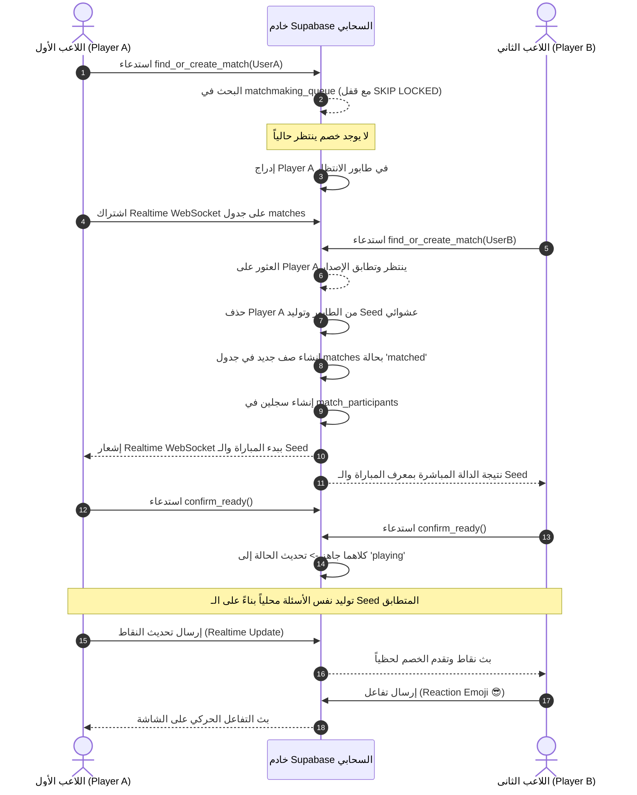

# دليل المعمارية والمميزات الشامل (Architecture & Features Deep-Dive)
> **مشروع لعبة: «معركة أحفاد الصحابة»**  
> وثيقة تقنية تفصيلية توضح كافة الشاشات، آليات اللعب، البنية التحتية، ومنطق التحديات الأونلاين والبوت الذكي.

---

## 1. فهرس الشاشات والمميزات الأساسية (Screens & Features)

### 1. شاشة البداية والتحميل (Splash Screen - `splash_screen.dart`)
* **الوظيفة**: تهيئة الموارد السريعة، التأكد من حالة تسجيل الدخول للمستخدم عبر `AuthService`، وتشغيل رسوم متحركة دائرية وهوية اللعبة.
* **المنطق البرمجي**: فحص وجود جلسة Supabase نشطة والانتقال التلقائي إلى `HomeScreen`، أو إلى `OnboardingScreen` في أول تشغيل.

### 2. شاشة البداية والتعريف (Onboarding Screen - `onboarding_screen.dart`)
* **الوظيفة**: تعريف اللاعب بأقسام اللعبة (القرآن، الحديث، السيرة، الفقه، الإمبراطورية، التحديات).
* **إدارة البيانات**: حفظ متغير `is_first_time` في `SharedPreferences` لمنع تكرار العرض.

### 3. الشاشة الرئيسية (Home Screen - `home_screen.dart`)
* **الوظيفة**: مركز القيادة الرئيسي للعبة؛ تحتوي على:
  * ملخص رصيد النقاط والنجوم ومستوى اللاعب.
  * زر بدء المسابقة الفردية (مستويات متدرجة).
  * زر "إمبراطورية المعرفة" (بناء المدن والحضارة الإسلامية).
  * زر "التحدي المباشر" (أونلاين ولعب محلي).
  * وصول سريع للوحة الصدارة (Leaderboard)، الإعدادات، وأقوال وحكم السلف اليومية.

### 4. شاشات المسابقة الفردية (Quiz & Levels)
* **`categories_screen.dart`**: اختيار القسم المعرفي (القرآن الكريم، الحديث الشريف، الفقه، السيرة النبوية، التاريخ، العقيدة).
* **`levels_screen.dart`**: عرض المستويات المتدرجة (مفتوح / مقفل) مع عدد النجوم المحققة (من 1 إلى 3 نجوم) بناءً على نسبة الإجابة الصحيحة (الحد الأدنى لفتح المستوى التالي هو 50%).
* **`quiz_screen.dart`**: شاشة التحدي الفردي التفاعلية:
  * مؤقت زمني متحرك (20 ثانية قابلة للتخصيص).
  * خيارات تفاعلية بنظام الملاحظات البصرية والصوتية الفورية (أخضر للإجابة الصحيحة، أحمر للخاطئة مع كشف الإجابة الصحيحة).
  * تأثيرات بصرية احتفالية عند الإجابة المتتالية (Streak Bonus).
* **`result_screen.dart`**: شاشة النتيجة النهائية؛ تعرض النتيجة التفصيلية، النجوم المكتسبة، مكافأة الوقت السريع، وخيار مشاركة النتيجة بصورة أنيقة عبر منصات التواصل (`ShareService`).

### 5. شاشة إمبراطورية المعرفة (Creative Empire - `creative_empire_screen.dart`)
* **فكرة الميزة**: دمج ميكانيكا ألعاب البناء والاستراتيجية (City Building) مع التعلم الإسلامي.
* **الآلية**: كل نقطة أو نجمة يكسبها اللاعب في الاختبارات تمكنه من تشييد معالم إسلامية تاريخية (المسجد الجامع، بيت الحكمة، أسوار المدينة، دار الضيافة، مزارع النخيل)، وترقية مستوى الحضارة من "قرية ناشئة" إلى "إمبراطورية ذهبية".

### 6. شاشة لوحة الصدارة العالمية (Global Ranking - `global_ranking_screen.dart`)
* **الوظيفة**: عرض ترتيب أفضل 50 لاعباً على مستوى العالم في الوقت الفعلي مع نقاطهم ورتبهم وصورهم الرمزية (Avatars) مستخرجة مباشرة من جدول `public.leaderboard` في Supabase.

---

## 2. التشريح التقني لنظام التحديات عبر الإنترنت (Online Multiplayer Architecture)

تعتمد ميزة اللعب الجماعي على نموذج هجين بين **منطق الخادم الذري (Server-Side Atomic Functions)** و **بروتوكول البث اللحظي (Supabase Realtime WebSockets)**.



### هل هذه الميزة خالية من الأخطاء والعيوب المنطقية؟ (Forensic Audit)

| جانب المراجعة | الحالة الهندسية | كيفية معالجة المشاكل المحتملة |
| :--- | :---: | :--- |
| **التعارض التنافسي (Race Condition)** | 🟢 معالج ومحصن | استدعاء الدالة السحابية يطبق قفل صفوف Postgres الذري `FOR UPDATE SKIP LOCKED`؛ مما يمنع نهائياً اقتران لاعبين مع نفس الخصم في نفس الجزء من الثانية. |
| **تطابق الأسئلة بين اللاعبين** | 🟢 متطابق 100% | يتم تبادل رقم `seed` موحد يتم توليده في الخادم؛ وتستخدمه خوارزمية `Random(seed)` في كلا الهاتفين لفرز واختيار نفس الأسئلة ونفس ترتيب الخيارات بالضبط. |
| **اللاعبون الشبح (Ghost Players)** | 🟢 محمي بفحص نبضات القلب | طابور الانتظار يتحقق من شرط `updated_at > NOW() - INTERVAL '30 seconds'`؛ أي لاعب يفقد الاتصال أو يغلق التطبيق يُستبعد تلقائياً بعد 30 ثانية. |
| **انقطاع اتصال أحد اللاعبين أثناء الجولة** | 🟢 لا يوقف المباراة | تم تصميم واجهة `OnlineGameScreen` لتعمل بشكل منفصل؛ إذا توقف الخصم عن إرسال التحديثات، يستمر اللاعب في إنهاء أسئلته ويتم تسجيل نتيجته في الخادم دون تجميد الشاشة. |

---

## 3. التشريح العميق للروبوت / الذكاء الاصطناعي (Bot Analysis)

### هل الروبوت فعلاً ذكاء اصطناعي (Generative AI / LLM)؟
**الحقيقة الهندسية الصريحة**: **لا، ليس نموذج لغوي (LLM) ولا شبكة عصبية تدريبية (Neural Network)**، بل هو **محاكي سلوكي احتمالي متطور (Heuristic Behavioral Simulator)**.

### كيف يعمل الروبوت برمجياً داخل الكود؟ (`online_game_screen.dart`):

1. **محاكاة وقت القراءة البشري (Dynamic Reading Delay)**:
   * لا يجيب الروبوت في نفس اللحظة حتى لا يشعر المستخدم بأنه آلة ميكانيكية، بل يحسب طول نص السؤال:
     ```dart
     final readingTime = currentQ.questionText.length * 40; // 40 ملي ثانية لكل حرف عربي
     ```
   * يضيف إليها وقتاً عشوائياً للتفكير البشري بين ثانية ونصف إلى أربع ثوان ونصف:
     ```dart
     final thinkingTime = 1500 + _rnd.nextInt(3000) + readingTime;
     ```
   * يضع سقفاً أقصى للتفكير لا يتجاوز 12 ثانية (ضمن مهلة الـ 15 ثانية).

2. **التوزيع الإحصائي للإجابات الصحيحة (Statistical Accuracy)**:
   * تم ضبط نسبة ذكاء البوت برمجياً على **`85%`** إجابات صحيحة:
     ```dart
     final isCorrect = _rnd.nextDouble() < 0.85;
     ```
   * هذا المعدل يجعله منافساً قوياً وممتعاً دون أن يكون مستحيلاً أو غبياً.

3. **حساب نقاط السرعة والمكافأة**:
   * يحصل البوت على 10 نقاط للإجابة الصحيحة + مكافأة سرعة (من 2 إلى 5 نقاط) بحسب المدة التي استغرقها في التفكير المحاكى.

4. **المشاعر والتفاعلات التلقائية (Emotional Feedback)**:
   * بنسبة 20%، يرسل البوت تفاعلات إيموجي (Reactions) إلى شاشة اللاعب بعد الإجابة (`😎` إذا كانت إجابته صحيحة، أو `😡` إذا أخطأ) بعد تأخير بشري مدته 500ms لإضفاء روح المنافسة الحقيقية.

### لماذا يعتبر هذا النموذج الهندسي أفضل بكثير من استدعاء LLM حقيقي داخل اللعبة؟
1. **السرعة والانعدام التام للتأخير (Zero Latency)**: يعمل محلياً داخل معالج الهاتف فوراً دون انتظار خوادم خارجية.
2. **عدم وجود تكاليف مالية (Zero API Costs)**: تشغيل الذكاء الاصطناعي السحابي لكل جولة أسئلة سيكلف مئات الدولارات شهرياً.
3. **الالتزام الصارم بالوقت**: يلتزم بمهلة الـ 15 ثانية بدقة متناهية عكس استجابات نماذج الذكاء الاصطناعي التوليدية التي قد تتأخر بحسب ضغط السيرفر.

