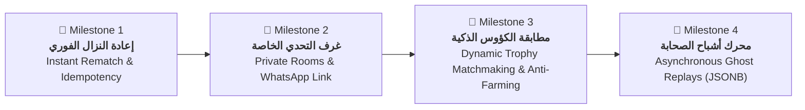
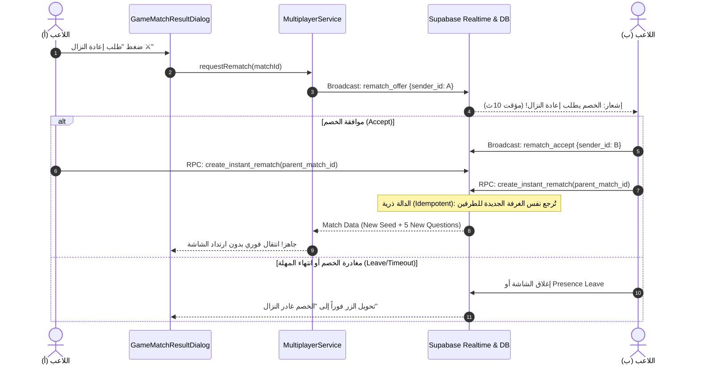
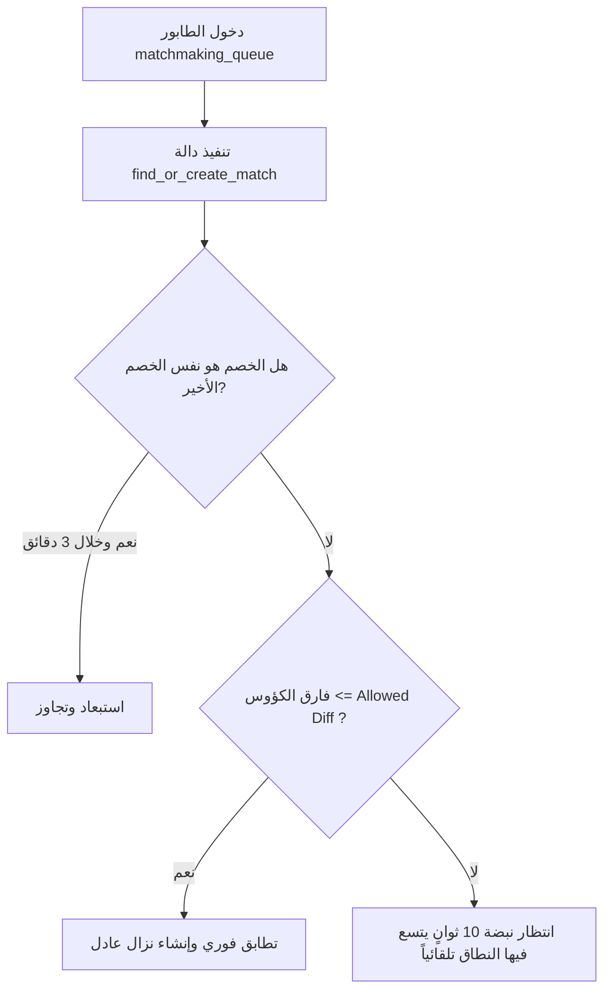

# 🏛️ الخطة الهندسية الشاملة لمنظومة التحديات الجماعية والمبارزات الملكية (Master Plan)
> **المشروع:** «معركة أحفاد الصحابة: مسابقات»  
> **الإصدار الأساسي المعتمد:** `1.0.10+11` ➔ **الإصدارات المستهدفة:** `1.0.11+12` وحتى `1.1.0+15`  
> **الحالة:** وثيقة معمارية ملزمة ومعتمدة (Active Architectural Specification)  
> **المرجعية:** دستور التنفيذ الهندسي الصارم (`AGENTS.md`) وهوية التطبيق الملكية الأندلسية (`AppTheme`)

---

## 🛡️ ميثاق الجودة الصارمة: القواعد الذهبية الـ 12 الملزمة (Zero-Tolerance Engineering Manifesto)
> **تنبيه ملزم لأي مهندس أو نموذج ذكاء اصطناعي يعمل على هذا المشروع:**  
> يُمنع منعاً باتاً كسر أو تجاوز القواعد الـ 12 التالية أثناء برمجة أي ميزة في هذه المنظومة:

### 🔹 المجموعة الأولى: سلامة الكود والأداء (Core Implementation)
1. **ممنوع منعاً باتاً الكود الوهمي أو الصوري (No Stubs / No Fake Wiring):**  
   يُحظر تماماً تعريف دوال فارغة أو مؤقتات واشتراكات شكلية (`Timer?`, `StreamSubscription?`) دون ربطها بمنطق تشغيلي حقيقي كامل، ويُمنع وضع تعليقات مثل `// TODO: implement later`.
2. **ممنوع الكود المبتور أو المختصر (Zero Incomplete Code):**  
   أي كود يُضاف يجب أن يكون كامل المعالجة بنسبة 100%، متضمناً معالجة الأخطاء (`try/catch`)، تنظيف الذاكرة (`dispose()`)، والتعامل مع جميع الحالات الشاذة (`Edge Cases`).
3. **أعلى معايير الكفاءة ومعدل 60 إطاراً (High Performance & 60 FPS):**  
   يُمنع أي منطق ثقيل يحجب الـ UI Thread أو يسبب ارتعاشاً (Jank). استدعاءات الشبكة غير حاجزة (Non-blocking)، واستعلامات SQL محسنة بفهارس لتنفذ في أقل من **50ms**.
4. **مناعة تامة ضد الانهيار (Crash Immunity & Non-Blocking Fallbacks):**  
   أي انقطاع في الشبكة أو عطل في الخادم يجب ألا يُسقط التطبيق أو يجمده إطلاقاً؛ بل ينتقل فوراً (0ms) للبديل المحلي السليم مع إشعار المستخدم بلباقة.
5. **قدسية تقدم ونقاط اللاعبين (Zero Data Loss Guarantee):**  
   الكؤوس، نقاط الخبرة، العملات، والمراحل لا يجوز أن تُفقد أو تتأخر مزامنتها تحت أي ظرف، وتُحدث سحابياً ومحلياً بالتزامن.
6. **التحديث الإلزامي الموحد لرقم الإصدار وسجل المشروع:**  
   مع كل ريليز، يجب تحديث رقم الإصدار بالتزامن في المواضع الأربعة (`pubspec.yaml`, `build.gradle.kts`, `app_constants.dart`, `splash_screen.dart`) وتوثيق التغييرات فوراً في `PROJECT_STATUS.md`.

### 🔹 المجموعة الثانية: قواعد الإنتاج والأمان ومناعة الذاكرة (Production Safety & Security)
7. **حماية دورة الحياة والذاكرة (Mounted & Memory Leak Guard):**  
   فحص إلزامي دائم: `if (!mounted) return;` قبل أي تعديل على الواجهة بعد أي استدعاء شبكي (`await`)، مع إلغاء صريح لجميع قنوات البث والمؤقتات في `dispose()`.
8. **حماية الشاشات وتكبير الخط (Zero-Overflow & Text Scaler Guard):**  
   منع تفيض البكسل (`RenderFlex overflow`)؛ حماية العناصر الحساسة كأكواد الغرف وشارات الكؤوس بـ `FittedBox` أو تقييد معامل تكبير الخط (`TextScaler.linear(1.0)`).
9. **مكافحة الغش وأمان قاعدة البيانات (Anti-Cheat & RLS Shield):**  
   منع أي تعديل مباشر للجداول الحساسة من العميل؛ جميع عمليات حسم الفائز والكؤوس تتم حصراً بدوال `SECURITY DEFINER RPC` تتحقق من `auth.uid() = p_user_id`.
10. **عزل المؤثرات الصوتية والاهتزاز (Decoupled Audio & Haptics):**  
    تشغيل كافة الأصوات والاهتزازات باستدعاءات غير حاجزة معزولة (`unawaited` مع `try/catch` صامت) لضمان عدم توقف مسار اللعب إذا تعثر ملف صوتي.
11. **مهلة التسامح عند تذبذب الشبكة (Network Flapping Grace Period):**  
    منح مهلة ذكية (5 إلى 7 ثوانٍ) لإعادة الاتصال التلقائي عند تبديل الشبكة (Wi-Fi إلى 4G) قبل إعلان مغادرة الخصم رسمياً.
12. **الحماية ضد التراجع البرمجي (Zero-Regression Test Suite):**  
    استمرار نجاح كافة اختبارات المشروع الـ 31 كاملة بنسبة 100%، وإضافة اختبارات وحدة جديدة مخصصة لكل معلم جديد قبل تسليمه.

---

## 📑 فهرس المعالم الكبرى (Milestones Roadmap)



---

## 1. الفلسفة المعمارية والالتزام بالدستور الهندسي (Core Principles)

1. **الالتزام الصارم بقواعد الدستور (`AGENTS.md`):**
   * **القاعدة 1 (منع الكود الصوري):** كل مؤقت أو قناة أو استدعاء شبكي يكتب بمنطق تشغيلي حقيقي وإلغاء صريح في `dispose()`.
   * **القاعدة 2 (التحقق السحابي الحي):** لا يُعتمد أي ملف `.sql` إلا بعد تطبيقه واختباره فعلياً على قاعدة بيانات Supabase.
   * **القاعدة 3 (حفظ تقدم ونقاط اللاعبين):** الكؤوس ونقاط الخبرة والعملات تُحدث سحابياً ومحلياً بالتزامن مع منع أي فقدان للبيانات.
   * **القاعدة 4 (عزل الأزرار عن تجميد الشبكة):** أزرار الإلغاء والعودة تعمل بـ Non-blocking unawaited calls بانتقال لحظي (0ms).
   * **القاعدة 5 (توحيد رقم الإصدار في 4 مواضع):** التحديث المتزامن عند كل ريليز في `pubspec.yaml`, `build.gradle.kts`, `app_constants.dart`, `splash_screen.dart`.
   * **القاعدة 6 (سلامة النصوص والخطوط):** الحفاظ على بادينج خط Cairo (`vertical: 8` للأزرار المحصورة الارتفاع) ومنع تداخل الشارات.
   * **القاعدة 7 (تحديث سجل المشروع):** التوثيق الفوري في `PROJECT_STATUS.md`.

2. **الهوية البصرية الأندلسية الملكية (`Royal Andalusian Design System`):**
   * التدرج الليلي الداكن الفاخر (`AppTheme.primaryDark`: `#0F172A` / `#1E293B`).
   * اللمسات الذهبية الملكية المتوهجة (`AppTheme.accentColor`: `#F59E0B` / `#D97706`).
   * إطارات الدروع والزخارف الإسلامية المنسجمة مع روح معارك أحفاد الصحابة.

---

## 🚩 المعلم الأول (Milestone 1): نظام إعادة النزال الفوري (Instant Rematch System)
> **الهدف:** تمكين الخصمين من استئناف النزال فوراً من نافذة النتيجة دون العودة للشاشة الرئيسية، مع منع الغرف المزدوجة وسقف الـ 3 مباريات.



### 📋 حزمة مهام المعلم الأول (Tasks Breakdown):
* [ ] **المهمة 1.1 (قاعدة البيانات - SQL Migration):**
  * إنشاء دالة `create_instant_rematch(p_parent_match_id UUID, p_user_id UUID)` في Supabase.
  * تطبيق قيد الفردية `UNIQUE` أو فحص وجود غرفة مشتقة من `parent_match_id` لمنع الـ Race Condition.
  * فحص عدد المواجهات المتتالية: إذا كانت $\ge 3$، تصبح المباراة ودية (`is_friendly = TRUE`) بدون تأثير على الكؤوس لمنع التلاعب (Win-Trading).
* [ ] **المهمة 1.2 (منطق العميل - `MultiplayerService`):**
  * إضافة دالة `listenToRematchEvents(String matchId, ...)` للاستماع إلى `rematch_offer`, `rematch_accept`, و `presence_leave`.
  * إضافة دالة `sendRematchOffer()` و `acceptRematch()`.
* [ ] **المهمة 1.3 (واجهة المستخدم - `GameMatchResultDialog`):**
  * إضافة الزر الملكي الذهبي `طلب إعادة النزال ⚔️`.
  * إضافة شريط التقدم الزمني النابض (10 ثوانٍ) واستشعار مغادرة الخصم فوراً.
  * الانتقال السلس للمباراة الجديدة دون أي وميض أو ارتداد للشاشة الرئيسية.

---

## 🚩 المعلم الثاني (Milestone 2): غرف التحدي الخاصة وتحدي الأصدقاء (Private Rooms & WhatsApp Invite)
> **الهدف:** إتاحة إنشاء غرف مغلقة برمز سداسي (PIN Code) ورابط دعوة لواتساب لدخول الأصدقاء المباشر.

```
┌────────────────────────────────────────────────────────┐
│                   ⚔️ غرفة التحدي الخاص                  │
├────────────────────────────────────────────────────────┤
│                                                        │
│                    كود الغرفة الذهبي                    │
│                 ┌─────────────────────┐                │
│                 │     8 4 2 - 1 9 0   │  [نسخ 📋]      │
│                 └─────────────────────┘                │
│                                                        │
│              [ 📲 مشاركة الرابط عبر واتساب ]           │
│                                                        │
│       بطاقة الداعي (المضيف)          بطاقة الصديق (الضيف)     │
│       ┌───────────────────┐         ┌───────────────────┐     │
│       │    [ صورتك 👤 ]    │         │   [ إطار نابض ⏳ ] │     │
│       │   محمد (الداعي)   │   VS    │  بانتظار الصديق.. │     │
│       │   👑 جاهز للقتال  │         │   أدخل الكود      │     │
│       └───────────────────┘         └───────────────────┘     │
│                                                        │
│             ⏳ مهلة بقاء الغرفة: 03:00 دقائق           │
│                   [ ❌ إلغاء الغرفة ]                   │
└────────────────────────────────────────────────────────┘
```

### 📋 حزمة مهام المعلم الثاني (Tasks Breakdown):
* [ ] **المهمة 2.1 (قاعدة البيانات - SQL Migration):**
  * إضافة عمود `room_code VARCHAR(6)` وحقل `is_private BOOLEAN DEFAULT FALSE` لجدول `matches`.
  * دالة `create_private_room(p_host_id UUID)` لتوليد رمز فريد من 6 خانات مع مؤقت انتهاء صلاحية 3 دقائق.
  * دالة `join_private_room(p_room_code VARCHAR, p_guest_id UUID)` للتحقق من وجود الغرفة وشغور مقعد الضيف.
* [ ] **المهمة 2.2 (شاشات واجهة المستخدم UI):**
  * إنشاء شاشة `PrivateRoomHubScreen` تحتوي على تبويبين: (إنشاء غرفة / الانضمام برمز).
  * حقل إدخال الرمز الملكي المكون من 6 مربعات أنيقة مع تركيز تلقائي.
  * شاشة `PrivateRoomLobbyScreen` (ردهة الانتظار) مع مؤثرات النبض واستشعار دخول الضيف فوراً.
* [ ] **المهمة 2.3 (الربط اللحظي ومشاركة واتساب):**
  * زر مشاركة يفتح واتساب مع رسالة جذابة تحوي كود الغرفة ورابط الانضمام.
  * مؤقت أمان لإلغاء الغرفة تلقائياً عند انقضاء 3 دقائق دون انضمام.

---

## 🚩 المعلم الثالث (Milestone 3): المطابقة الذكية بالكؤوس وحماية النزاهة (Dynamic Trophy Matchmaking & Anti-Farming)
> **الهدف:** مطابقة عادلة مبنية على الكؤوس مع توسع رياضي ذاتي داخل الـ SQL، ومنع تكرار نفس الخصم عشوائياً.

$$\text{Allowed Diff} = 100 + (\text{EXTRACT(EPOCH FROM (NOW() - created\_at))} \times 25)$$



### 📋 حزمة مهام المعلم الثالث (Tasks Breakdown):
* [ ] **المهمة 3.1 (تعديل جدول الطابور):**
  * إضافة عمود `trophies INTEGER` لجدول `matchmaking_queue` ليعكس كؤوس اللاعب وقت البحث.
* [ ] **المهمة 3.2 (تحديث دالة `find_or_create_match` السحابية):**
  * تطبيق معادلة التوسع الذاتي في الـ SQL لحساب الفارق المسموح دون أي استدعاءات إضافية من الهاتف (Zero Extra Requests).
  * دعم معامل `p_last_opponent_id` لتفادي مطابقة نفس الخصم مرتين متتاليتين في الطابور العام.
* [ ] **المهمة 3.3 (التدقيق والأداء الحي):**
  * تشغيل فحص الأداء `EXPLAIN ANALYZE` على استعلام المطابقة لضمان سرعة استجابة أقل من 50ms.

---

## 🚩 المعلم الرابع (Milestone 4): محرك أشباح الصحابة للاعبين الحقيقيين (Ghost Replay Engine)
> **الهدف:** تسجيل جولات اللاعبين البشر بصيغة `JSONB` خفيفة وتشغيلها عند انعدام المتصلين في ساعات الفجر لتجربة واقعية 100% مع احتساب كامل للكؤوس والنقاط.

```json
{
  "ghost_meta": {
    "user_name": "أبو عبيدة البطل",
    "avatar_index": 4,
    "trophies": 1420
  },
  "timeline": [
    {"q_idx": 0, "delay_ms": 2350, "is_correct": true},
    {"q_idx": 1, "delay_ms": 4820, "is_correct": true},
    {"q_idx": 2, "delay_ms": 3100, "is_correct": false},
    {"q_idx": 3, "delay_ms": 1950, "is_correct": true},
    {"q_idx": 4, "delay_ms": 5200, "is_correct": true}
  ]
}
```

### 📋 حزمة مهام المعلم الرابع (Tasks Breakdown):
* [ ] **المهمة 4.1 (تخزين بيانات الجولات - Ghost Recorder):**
  * إضافة عمود `ghost_log JSONB` داخل سجلات المباريات المكتملة في جدول `matches`.
  * تسجيل توقيتات إجابات كل لاعب بشري حقيقي بالمللي ثانية في نهاية كل مباراة.
* [ ] **المهمة 4.2 (مشغل الأشباح - Ghost Playback Service):**
  * بناء `GhostPlaybackService` في تطبيق Flutter ليحل محل البوت التقليدي.
  * قراءة الـ Timeline وتطبيق التأخيرات البشرية الواقعية (الانتروبيا البشرية والتفكير المتقطع).
* [ ] **المهمة 4.3 (مكافآت النزال العادل):**
  * منح اللاعب الفائز ضد الشبح كامل الكؤوس والعملات ونقاط الخبرة، مع حماية سقف يومي (15 جولة أشباح يومياً) لمنع التضخم.

---

## 🔒 مصفوفة التحقق والاختبار الإلزامية قبل تسليم أي معلم

| المعيار | أداة الفحص | النتيجة المطلوبة |
| :--- | :--- | :--- |
| **سلامة الكود** | `flutter analyze` | `0 errors, 0 warnings` |
| **اختبارات الوحدة** | `flutter test` | نجاح جميع الاختبارات (100% Passing) |
| **تطبيق السيرفر** | استعلام حي على Supabase | `SELECT pg_get_functiondef(...)` والتأكد من عدم وجود أخطاء |
| **أمان البيانات** | فحص حسابات ومزامنة النقاط | صفر فقدان لأي نقطة أو كأس |
| **توحيد الإصدار** | مطابقة 4 ملفات | تطابق كامل لأرقام الإصدار والبناء |
| **التوثيق** | `PROJECT_STATUS.md` | تحديث السجل بجدول التغييرات قبل الإعلان |

