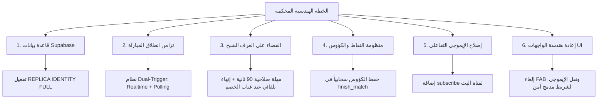
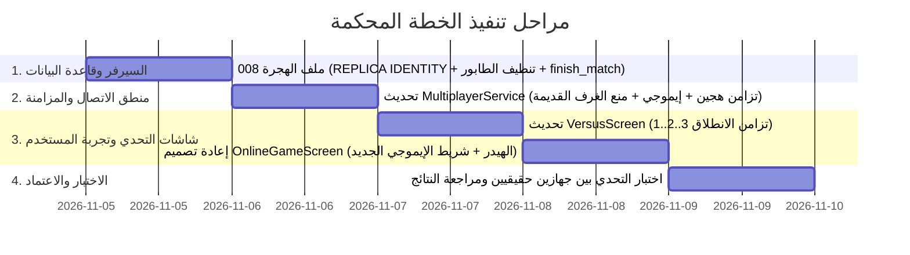

# 🛡️ الخطة الهندسية المحكمة لإصلاح منظومة التحديات المباشرة والمزامنة اللحظية
> **المشروع:** «معركة أحفاد الصحابة: مسابقات»  
> **الهدف:** القضاء الجذري على مشكلات (الغرف الشبح، التزامن، تداخل الواجهات، حفظ النقاط، وتبديل الحسابات) وفق أرقى معايير هندسة الألعاب المتزامنة عالمياً.

---

## 1. الفلسفة المعمارية للحلول (Core Principles)

1. **القضاء على الاعتماد الأحادي (Zero Single Point of Failure):** عدم الاعتماد على WebSockets بمفرده؛ بل استخدام مزيج هجين: (WebSockets Realtime + Fallback Polling كل 1 ثانية) لضمان انطلاق الطرفين معاً حتى لو تعثرت حزمة شبكة.
2. **السيادة الصارمة لقاعدة البيانات (Database-Driven Integrity):** حسم الفائز، احتساب الكؤوس، وإغلاق الغرف يتم عبر السيرفر فقط (Server-Side) لمنع الغرف المعلقة وتجنب التلاعب.
3. **التصميم التجاوبي الآمن (Zero-Overlap Responsive UI):** إعادة هندسة شاشة اللعب لضمان عدم تغطية أي زر إجابة وعدم تداخل نصوص الرأس مهما كان حجم الشاشة أو طول اسم اللاعب.

---

## 2. مصفوفة المحاور الهندسية الستة (The 6 Pillars)



---

### المحور 1: ترقية قاعدة بيانات Supabase (SQL Migrations)

#### أ. تفعيل التكرار الكامل للأمان (REPLICA IDENTITY FULL)
حل مشكلة إسقاط إشعارات الـ Realtime بسبب سياسات الـ RLS:
```sql
ALTER TABLE public.matches REPLICA IDENTITY FULL;
ALTER TABLE public.match_participants REPLICA IDENTITY FULL;
ALTER TABLE public.matchmaking_queue REPLICA IDENTITY FULL;
```

#### ب. تنظيف طابور الانتظار ومنع الخصوم القدامى
في دالة `find_or_create_match`:
* عدم اختيار أي منافس من `matchmaking_queue` إلا إذا كان نشطاً خلال آخر 20 ثانية فقط (`updated_at > NOW() - INTERVAL '20 seconds'`).
* حذف أي سجلات ميتة في الطابور تلقائياً.

#### ج. مؤقت إغلاق الغرف المعلقة (Auto-Expire Stale Matches)
* أي مباراة تظل بحالة غير منتهية لأكثر من 3 دقائق تُعتبر ملغاة (`status = 'expired'`) حتى لا يسقط فيها أي لاعب مستقبلاً.

---

### المحور 2: تزامن انطلاق المباراة (Simultaneous Launch) في `VersusScreen`

#### أ. المعمارية الهجينة (Dual-Trigger Sync)
بدلاً من أن يظل اللاعب الأول معلقاً ينتظر حدث Realtime قد يتأخر:
1. **المسار الأول (Realtime Stream):** يستمع لتحديث `status == 'ready'`.
2. **المسار الثاني (Active Fallback Polling):** يقوم التطبيق باستعلام السيرفر كل 1 ثانية عن حالة المباراة.
3. بمجرد أن يتحقق أحدهما (`status == 'ready'`)، ينطلق العداد 3.. 2.. 1.. فوراً ويتم إلغاء المؤقتات.

#### ب. توحيد لحظة البداية (Synchronized Start Time)
* السيرفر يحدد توقيت البداية: `started_at = NOW() + INTERVAL '3 seconds'`.
* يبدأ كلا الهاتفين العد التنازلي معاً، وتفتح الأسئلة في نفس الجزء من الثانية على كلا الجهازين.

---

### المحور 3: القضاء النهائي على "الغرف الشبح" ومباريات الأوفلاين

1. **تحديث `listenForMatchFound` في فلاتر:**
   * تجاهل أي مباراة في جدول `matches` تم إنشاؤها قبل أكثر من دقيقتين (`created_at < NOW() - INTERVAL '2 minutes'`).
   * منع استرجاع المباريات القديمة التي لم تُغلق.
2. **حسم الفوز بالانسحاب (Forfeit Victory):**
   * إذا أنهى اللاعب الأول أسئلته ومرت 15 ثانية دون أن ينهي اللاعب الثاني، يتم إعلان فوز اللاعب الأول فوراً بنتيجة انسحاب (Auto-Win by Forfeit) وتُمنح له نقاط الفوز وتُغلق الغرفة بحالة `'finished'`.

---

### المحور 4: حفظ النقاط والكؤوس ومزامنتها سحابياً

1. **تعديل دالة `finish_match` في SQL:**
   * تقوم الدالة بحساب الفائز وتحديث `leaderboard` (زيادة الكؤوس `+25` للفائز، `-12` للخاسر، `+5` للتعادل).
   * إرجاع الكؤوس المكتسبة مع استجابة الدالة.
2. **تحديث البروفايل المحلي في فلاتر:**
   * عند إغلاق المباراة، يتم استدعاء `ProfileService.instance.updateProfile` فوراً لزيادة الرصيد وتحديث لوحة الشرف محلياً وسحابياً.
3. **تصحيح تكرار النقاط:**
   * حذف السطر المكرر في `game_controller.dart` سطر 209-210.

---

### المحور 5: تفعيل الإيموجي والتفاعلات الحية

1. **تصحيح قناة البث في `MultiplayerService.dart`:**
   * إضافة `.subscribe()` لقناة `match_$matchId` في دالة `listenToReactions`.
2. **مؤثرات بصرية وصوتية غير معطلة:**
   * ظهور الإيموجي كأنيميشن طائر عابر (Floating Badge) يختفي بعد 1.5 ثانية بجانب صورة الخصم دون حجب السؤال.

---

### المحور 6: إعادة هندسة واجهة المستخدم والتصميم (UI/UX Refactoring)

```
┌────────────────────────────────────────────────────────┐
│  [أفاتار 1 + اسم]       [ العداد: 12 ]       [اسم + أفاتار 2]  │ <- هيدر متجاوب ومحمي
│  [  النقاط: 35  ]       [ سؤال 2/5  ]       [  النقاط: 20  ]  │
├────────────────────────────────────────────────────────┤
│                    بطاقة السؤال                        │
│             ما هي أول قبلة في الإسلام؟                 │
├────────────────────────────────────────────────────────┤
│  [ الخيار 1 ]                                          │
│  [ الخيار 2 ]                                          │
│  [ الخيار 3 ]                                          │
│  [ الخيار 4 ]                                          │
├────────────────────────────────────────────────────────┤
│  [ شريط الإيموجي المدمج السفلي:  🔥  👏  🎯  🤝  😂 ]  │ <- لا يحجب أي زر!
└────────────────────────────────────────────────────────┘
```

1. **شريط الرأس (Header):**
   * تغليف نصوص الأسماء بـ `Expanded` و `TextOverflow.ellipsis` لضمان عدم تداخل النصوص مهما طال الاسم.
   * إعطاء أبعاد ثابتة ومتوازنة للعداد المركزي والأفاتار.
2. **إلغاء الزر العائم (FAB) نهائياً:**
   * نقل خيارات الإيموجي من زر FAB العائم المزعج إلى **شريط أفقي مدمج وأنيق أسفل الشاشة أو في زاوية علوية آمنة**، مما يحرر الخيار الرابع من الإجابات بالكامل.
3. **طبقة الإيموجي:**
   * وضع الإيموجي في زاوية الخصم العلوية مع تقليص الحجم ليكون لطيفاً وغير مشتت.

---

### المحور 7: تنظيف جلسة المستخدم عند تبديل الحسابات

* في `ProfileService` و `AuthService`:
  عندما يختار المستخدم بروفايلاً جديداً أو حساباً مختلفاً، يتم استدعاء:
  ```dart
  await Supabase.instance.client.auth.signOut();
  ```
  وتسجيل الدخول بالحساب الجديد لضمان تحديث `currentUserId` السحابي وتصفير أي غرف قديمة مقترنة بالجهاز.

---

## 3. خطة التنفيذ المجدولة والمراحل (Execution Phases)



