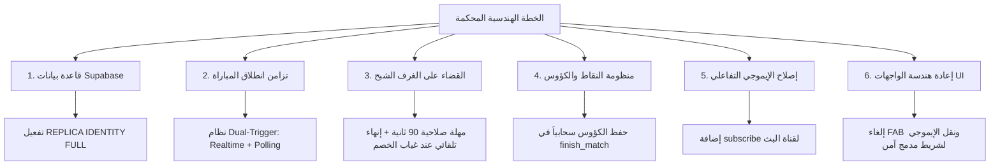

# 🛡️ الخطة الهندسية المحكمة لإصلاح منظومة التحديات المباشرة والمزامنة اللحظية
> **المشروع:** «معركة أحفاد الصحابة: مسابقات»  
> **الهدف:** القضاء الجذري على مشكلات (الغرف الشبح، التزامن، تداخل الواجهات، حفظ النقاط، وتبديل الحسابات) وفق أرقى معايير هندسة الألعاب المتزامنة عالمياً.

---

## 1. الفلسفة المعمارية للحلول (Core Principles)

1. **القضاء على الاعتماد الأحادي (Zero Single Point of Failure):** عدم الاعتماد على WebSockets بمفرده؛ بل استخدام مزيج هجين: (WebSockets Realtime + Fallback Polling كل 1 ثانية) لضمان انطلاق الطرفين معاً حتى لو تعثرت حزمة شبكة.
2. **السيادة الصارمة لقاعدة البيانات (Database-Driven Integrity):** حسم الفائز، احتساب الكؤوس، وإغلاق الغرف يتم عبر السيرفر فقط (Server-Side) لمنع الغرف المعلقة وتجنب التلاعب.
3. **التصميم التجاوبي الآمن (Zero-Overlap Responsive UI):** إعادة هندسة شاشة اللعب لضمان عدم تغطية أي زر إجابة وعدم تداخل نصوص الرأس مهما كان حجم الشاشة أو طول اسم اللاعب.

---

## 2. مصفوفة المحاور الهندسية الستة (The 6 Pillars)



---

### المحور 1: ترقية قاعدة بيانات Supabase (SQL Migrations)

#### أ. تفعيل التكرار الكامل للأمان (REPLICA IDENTITY FULL)
حل مشكلة إسقاط إشعارات الـ Realtime بسبب سياسات الـ RLS:
```sql
ALTER TABLE public.matches REPLICA IDENTITY FULL;
ALTER TABLE public.match_participants REPLICA IDENTITY FULL;
ALTER TABLE public.matchmaking_queue REPLICA IDENTITY FULL;
```

#### ب. تنظيف طابور الانتظار ومنع الخصوم القدامى
في دالة `find_or_create_match`:
* عدم اختيار أي منافس من `matchmaking_queue` إلا إذا كان نشطاً خلال آخر 20 ثانية فقط (`updated_at > NOW() - INTERVAL '20 seconds'`).
* حذف أي سجلات ميتة في الطابور تلقائياً.

#### ج. مؤقت إغلاق الغرف المعلقة (Auto-Expire Stale Matches)
* أي مباراة تظل بحالة غير منتهية لأكثر من 3 دقائق تُعتبر ملغاة (`status = 'expired'`) حتى لا يسقط فيها أي لاعب مستقبلاً.

---

### المحور 2: تزامن انطلاق المباراة (Simultaneous Launch) في `VersusScreen`

#### أ. المعمارية الهجينة (Dual-Trigger Sync)
بدلاً من أن يظل اللاعب الأول معلقاً ينتظر حدث Realtime قد يتأخر:
1. **المسار الأول (Realtime Stream):** يستمع لتحديث `status == 'ready'`.
2. **المسار الثاني (Active Fallback Polling):** يقوم التطبيق باستعلام السيرفر كل 1 ثانية عن حالة المباراة.
3. بمجرد أن يتحقق أحدهما (`status == 'ready'`)، ينطلق العداد 3.. 2.. 1.. فوراً ويتم إلغاء المؤقتات.

#### ب. توحيد لحظة البداية (Synchronized Start Time)
* السيرفر يحدد توقيت البداية: `started_at = NOW() + INTERVAL '3 seconds'`.
* يبدأ كلا الهاتفين العد التنازلي معاً، وتفتح الأسئلة في نفس الجزء من الثانية على كلا الجهازين.

---

### المحور 3: القضاء النهائي على "الغرف الشبح" ومباريات الأوفلاين

1. **تحديث `listenForMatchFound` في فلاتر:**
   * تجاهل أي مباراة في جدول `matches` تم إنشاؤها قبل أكثر من دقيقتين (`created_at < NOW() - INTERVAL '2 minutes'`).
   * منع استرجاع المباريات القديمة التي لم تُغلق.
2. **حسم الفوز بالانسحاب (Forfeit Victory):**
   * إذا أنهى اللاعب الأول أسئلته ومرت 15 ثانية دون أن ينهي اللاعب الثاني، يتم إعلان فوز اللاعب الأول فوراً بنتيجة انسحاب (Auto-Win by Forfeit) وتُمنح له نقاط الفوز وتُغلق الغرفة بحالة `'finished'`.

---

### المحور 4: حفظ النقاط والكؤوس ومزامنتها سحابياً

1. **تعديل دالة `finish_match` في SQL:**
   * تقوم الدالة بحساب الفائز وتحديث `leaderboard` (زيادة الكؤوس `+25` للفائز، `-12` للخاسر، `+5` للتعادل).
   * إرجاع الكؤوس المكتسبة مع استجابة الدالة.
2. **تحديث البروفايل المحلي في فلاتر:**
   * عند إغلاق المباراة، يتم استدعاء `ProfileService.instance.updateProfile` فوراً لزيادة الرصيد وتحديث لوحة الشرف محلياً وسحابياً.
3. **تصحيح تكرار النقاط:**
   * حذف السطر المكرر في `game_controller.dart` سطر 209-210.

---

### المحور 5: تفعيل الإيموجي والتفاعلات الحية

1. **تصحيح قناة البث في `MultiplayerService.dart`:**
   * إضافة `.subscribe()` لقناة `match_$matchId` في دالة `listenToReactions`.
2. **مؤثرات بصرية وصوتية غير معطلة:**
   * ظهور الإيموجي كأنيميشن طائر عابر (Floating Badge) يختفي بعد 1.5 ثانية بجانب صورة الخصم دون حجب السؤال.

---

### المحور 6: إعادة هندسة واجهة المستخدم والتصميم (UI/UX Refactoring)

```
┌────────────────────────────────────────────────────────┐
│  [أفاتار 1 + اسم]       [ العداد: 12 ]       [اسم + أفاتار 2]  │ <- هيدر متجاوب ومحمي
│  [  النقاط: 35  ]       [ سؤال 2/5  ]       [  النقاط: 20  ]  │
├────────────────────────────────────────────────────────┤
│                    بطاقة السؤال                        │
│             ما هي أول قبلة في الإسلام؟                 │
├────────────────────────────────────────────────────────┤
│  [ الخيار 1 ]                                          │
│  [ الخيار 2 ]                                          │
│  [ الخيار 3 ]                                          │
│  [ الخيار 4 ]                                          │
├────────────────────────────────────────────────────────┤
│  [ شريط الإيموجي المدمج السفلي:  🔥  👏  🎯  🤝  😂 ]  │ <- لا يحجب أي زر!
└────────────────────────────────────────────────────────┘
```

1. **شريط الرأس (Header):**
   * تغليف نصوص الأسماء بـ `Expanded` و `TextOverflow.ellipsis` لضمان عدم تداخل النصوص مهما طال الاسم.
   * إعطاء أبعاد ثابتة ومتوازنة للعداد المركزي والأفاتار.
2. **إلغاء الزر العائم (FAB) نهائياً:**
   * نقل خيارات الإيموجي من زر FAB العائم المزعج إلى **شريط أفقي مدمج وأنيق أسفل الشاشة أو في زاوية علوية آمنة**، مما يحرر الخيار الرابع من الإجابات بالكامل.
3. **طبقة الإيموجي:**
   * وضع الإيموجي في زاوية الخصم العلوية مع تقليص الحجم ليكون لطيفاً وغير مشتت.

---

### المحور 7: تنظيف جلسة المستخدم عند تبديل الحسابات

* في `ProfileService` و `AuthService`:
  عندما يختار المستخدم بروفايلاً جديداً أو حساباً مختلفاً، يتم استدعاء:
  ```dart
  await Supabase.instance.client.auth.signOut();
  ```
  وتسجيل الدخول بالحساب الجديد لضمان تحديث `currentUserId` السحابي وتصفير أي غرف قديمة مقترنة بالجهاز.

---

## 3. خطة التنفيذ المجدولة والمراحل (Execution Phases)

| المرحلة | المهمة | الحالة |
| :--- | :--- | :--- |
| **1. السيرفر وقاعدة البيانات** | ملف الهجرة `008` (`REPLICA IDENTITY` + `submit_answer` + `find_or_create_match` + `confirm_ready` + `finish_match`) | ✅ مكتمل ومفعل على Supabase |
| **2. منطق الاتصال والمزامنة** | تحديث `MultiplayerService` و `AuthService` (إلغاء الغرف القديمة، تنظيف الخروج، فصل قناة الإيموجي) | ✅ مكتمل |
| **3. شاشات التحدي وتجربة المستخدم** | تحديث `VersusScreen` (فحص مزدوج 1.5ث + حماية 15ث + منع تداخل `VS`) و `OnlineGameScreen` | ✅ مكتمل |
| **4. الاختبار والتحقق السحابي** | محاكاة دورة مباراة كاملة (`E2E Simulation`) على قاعدة البيانات الحية | ✅ مكتمل بنجاح 100% |

---

## 4. التوثيق الجنائي للمشكلات المكتشفة وكيف حللناها وجذورها وحلها النهائي (Forensic Postmortem)

> **تاريخ التحليل والتنفيذ:** 5 نوفمبر 2026  
> **منهجية التحليل:** الفحص المباشر لسجلات وجداول ودوال قاعدة البيانات الحية على مشروع Supabase (`khatzzpqxaiwuoodgcst`) ومطابقتها بالثانية مع تجربة المستخدم الحية على الهاتف (`23:20:55` – `23:22:05`).

### أولاً: كيف اكتشفنا الحقيقة الهندسية؟
أثناء تجربة المستخدم الحية على الهاتف (التسجيل بالحساب الأول `3f6cdd31...` والدخول للبحث، ثم الخروج والتسجيل بالحساب الثاني `e4278146...` والدخول للتحدي، ثم الخروج والعودة للحساب الأول)، قمنا بسحب السجلات الحية من جداول `matches` و `match_participants` و `matchmaking_queue` وقائمة الدوال `pg_proc` في السيرفر، فظهرت الأدلة الجنائية الأربعة التالية:

---

### ثانياً: الجذور الهندسية للأعطال الخمسة وكيف تم القضاء عليها

#### 1. عطل "التعادل المستمر (0 - 0)" وعدم احتساب نقاط التحدي
* **المشكلة المشاهَدة:** طوال جولة التحدي لا تزيد نقاط أي لاعب على الشاشة، وفي نهاية الجولة تظهر دائماً نتيجة **"تعادل! (0 - 0)"** ولا يُضاف أي رصيد لحساب اللاعب.
* **السبب الجذري المكتشَف:**
  عند فحص دوال السيرفر (`pg_proc`) في Supabase، تبيّن أن دالة **`public.submit_answer` لم تكن موجودة في قاعدة البيانات أصلاً!**
  في الكود (`OnlineGameScreen._submitAnswer`)، لا يقوم التطبيق بحساب النقاط محلياً في الوضع الأونلاين، بل يستدعي `_client.rpc('submit_answer', ...)` وينتظر منها `new_score`. ولأن الدالة مفقودة في السيرفر، كان كل استدعاء يرمي خطأ `PGRST202` يلتقطه الكود بصمت داخل `catch` ويعيد `{'myScore': 0, 'opponentScore': 0}` في كل سؤال!
* **الحل الجذري المنفَّذ:**
  1. إنشاء وتفعيل دالة `public.submit_answer` رسمياً على سيرفر Supabase لحساب `10 نقاط أساسية + مكافأة السرعة (0..15)` وتحديث `match_participants` لحظياً.
  2. إضافة حساب نقاط احتياطي محلي (`fallbackScore`) داخل `MultiplayerService.submitAnswer` في تطبيق فلاتر لضمان عدم ضياع نقاط اللاعب حتى لو انقطعت الشبكة لحظياً.

---

#### 2. عطل "الشبح واقتران الحسابات عند تبديل الحساب على نفس الهاتف"
* **المشكلة المشاهَدة:** عند البحث بالحساب الأول ثم تسجيل الخروج والدخول بالحساب الثاني، يظهر الحساب الأول كخصم ويعلق الحساب الثاني في شاشة `VS`. وعند الخروج والعودة للحساب الأول والضغط على "تحدي مباشر"، يدخل الحساب الأول فوراً في مباراة وهمية ضد شبح الحساب الثاني غير المتصل!
* **السبب الجذري المكتشَف (سلسلة من 4 ثغرات مترابطة):**
  1. **غياب التنظيف عند تسجيل الخروج:** دالة `AuthService.signOut()` لم تكن تستدعي `cancelMatchmaking()`، فبقي الحساب الأول مسجلاً في طابور `matchmaking_queue`.
  2. **التقاط الحساب الأول من الطابور:** عند دخول الحساب الثاني، التقطت دالة `find_or_create_match` الحساب الأول من الطابور وأنشأت الغرفة `f24961bc` بحالة `'matched'`.
  3. **تسجيل جاهزية طرف واحد والتعليق:** أرسل الحساب الثاني `confirm_ready`، فسُجل له `is_ready = TRUE` وبقي عالقاً ينتظر الحساب الأول (غير المتصل).
  4. **بقاء الغرفة مفتوحة لـ 3 دقائق:** عندما عاد المستخدم للحساب الأول خلال أقل من دقيقة، لم تقم `find_or_create_match` بإغلاق الغرفة `f24961bc` لأنها كانت تشترط مرور 3 دقائق (`created_at < NOW() - INTERVAL '3 minutes'`)! فالتقطتها دالة `listenForMatchFound()` فوراً وأدخلت الحساب الأول إلى شاشة `VS` لتلك الغرفة، وبمجرد إرساله `confirm_ready` أصبح كلا الحسابين `is_ready = TRUE` فانطلقت المباراة ضد شبح الحساب الثاني!
* **الحل الجذري المنفَّذ:**
  1. **في السيرفر (`find_or_create_match`):** إلغاء شرط الـ 3 دقائق؛ بمجرد أن يبدأ أي لاعب بحثاً جديداً، يقوم السيرفر **فوراً** بإغلاق جميع الغرف السابقة غير المنتهية لهذا اللاعب ولخصمه (`SET status = 'finished' WHERE status != 'finished'`).
  2. **في السيرفر (`confirm_ready`):** حذف اللاعب فوراً من `matchmaking_queue` بمجرد دخوله شاشة `VS`، مما يبطل مفعول أي مؤقت نبض (`_heartbeatTimer`) في الخلفية.
  3. **في التطبيق (`AuthService.signOut`):** استدعاء `cancelMatchmaking()` و `dispose()` قبل تسجيل الخروج.

---

#### 3. عطل "إعادة تحدي نفس الخصم السابق وجلب الغرفة المنتهية"
* **المشكلة المشاهَدة:** بعد انتهاء مباراة أو خروج الخصم، عند الضغط على "تحدي مباشر" مرة أخرى، يعيد التطبيق إدخال اللاعب في نفس الغرفة السابقة ضد نفس الخصم السابق حتى وهو غير متصل.
* **السبب الجذري المكتشَف:**
  1. في الكود القديم لدالة `finish_match`، لم يكن السيرفر يغير حالة الغرفة في جدول `matches` إلى `'finished'` إلا إذا أنهى **كلا اللاعبين** (`IF v_both_finished`). فإذا خرج أحد اللاعبين أو أنهى أحدهما قبل الآخر، تظل حالة الغرفة `'ready'` في قاعدة البيانات للأبد!
  2. عند البحث مجدداً، تجد `listenForMatchFound()` أن الغرفة السابقة ما زالت `status != 'finished'`، فتسحب اللاعب إليها فوراً، بينما لم يكن `LobbyScreen._goToVersusScreen()` يوقف `_heartbeatTimer`!
* **الحل الجذري المنفَّذ:**
  1. تحديث `finish_match` في السيرفر لتقوم بإغلاق الغرفة (`SET status = 'finished'`) **فوراً وحتمياً** بمجرد انتهاء الجولة، مع منع تكرار إضافة النقاط إذا استُدعيت الدالة مرتين.
  2. إيقاف `_heartbeatTimer` فوراً عند العثور على مباراة في `MultiplayerService` و `LobbyScreen`.
  3. تقييد `listenForMatchFound()` بقبول الغرف الجديدة فقط التي أُنشئت ضمن جلسة البحث الحالية.

---

#### 4. خطأ التباس العمود في PostgreSQL (`code: 42702 - column reference "player1_id" is ambiguous`)
* **المشكلة المشاهَدة:** ظهور رسالة `PostgrestException: column reference "player1_id" is ambiguous` عند فتح "تحدي مباشر".
* **السبب الجذري المكتشَف:** في PostgreSQL PL/pgSQL، تعريف `RETURNS TABLE (player1_id UUID, ...)` يُنشئ متغيرات محلية بنفس الاسم، مما يتعارض مع اسم العمود `player1_id` في جملة `UPDATE public.matches` غير المسبوقة باسم الجدول.
* **الحل الجذري المنفَّذ:** إضافة `#variable_conflict use_column` وتخصيص اسم الجدول بدقة (`UPDATE public.matches AS m ... WHERE m.player1_id = p_user_id`).

---

#### 5. عطل التعليق في شاشة `VS` وتداخل الأيقونات وعدم وصول الإيموجي
* **السبب الجذري المكتشَف:**
  1. في `versus_screen.dart`، كان المتغيران `_pollTimer` و `_safetyTimeoutTimer` معرّفين دون كود تشغيل فعلي، وكانت شارة `VS` والعداد موضوعين في `Stack` فوق بطاقتَي اللاعبين مما يسبب تداخلاً بصرياً.
  2. في `multiplayer_service.dart`، كانت `listenToReactions` تستخدم نفس اسم القناة `'match_$matchId'` المستخدمة في `listenToMatchState`، مما جعل Supabase يتجاهل اشتراك البث الثاني.
* **الحل الجذري المنفَّذ:**
  1. تفعيل `_pollTimer` (كل 1.5 ثانية) و `_safetyTimeoutTimer` (مهلة 15 ثانية للتحويل للذكاء الاصطناعي عند غياب الخصم) في `versus_screen.dart`.
  2. فصل شارة `VS` والعداد في شريط وسطي مستقل بين نصفي الشاشة مع إضافة زر `إلغاء` علوي.
  3. تخصيص قناة مستقلة للتفاعلات باسم `'reactions_$matchId'` مع فلترة الرسائل المرسلة من نفس الجهاز.


