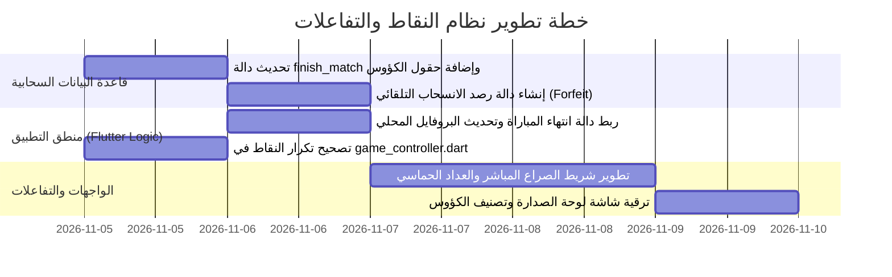

# 🏆 الميثاق الهندسي لنظام النقاط، الرتب، والتفاعلات التنافسية
> **مشروع:** «معركة أحفاد الصحابة: مسابقات»  
> **وثيقة التصميم المعماري:** إدارة النقاط في الواجهة (Frontend)، المنظومة السحابية (Backend)، والتفاعلات مع منصة Supabase.

---

## 1. الفلسفة المعمارية: نظام النقاط الثنائي (Dual-Currency Standard)

اتباعاً لأفضل الممارسات العالمية في كبرى التطبيقات التنافسية والتعليمية (مثل: Duolingo, Trivia Crack, Clash Royale)، تم فصل منظومة النقاط إلى مسارين منفصلين تماماً لمنع التضخم وضمان عدالة المنافسة:

```
                               ┌────────────────────────────────┐
                               │   منظومة نقاط أحفاد الصحابة   │
                               └────────────────────────────────┘
                                                │
                 ┌──────────────────────────────┴──────────────────────────────┐
                 ▼                                                             ▼
    ┌──────────────────────────────┐                             ┌──────────────────────────────┐
    │  1. نقاط المعرفة والخبرة     │                             │  2. كؤوس المعارك المباشرة    │
    │         (Knowledge XP)       │                             │        (Battle Trophies)     │
    ├──────────────────────────────┤                             ├──────────────────────────────┤
    │ • مصدرها: المراحل والأقسام الـ 6 │                             │ • مصدرها: التحديات الحية فقط │
    │ • تراكمية تزيد ولا تنقص أبداً │                             │ • تصنيف تنافسي (تزيد وتنقص)  │
    │ • تقيس مستوى الحصيلة العلمية │                             │ • تقيس المهارة وسرعة البديهة │
    │ • تفتح المستويات والألقاب    │                             │ • تحدد الدوريات وقوائم الشرف │
    └──────────────────────────────┘                             └──────────────────────────────┘
```

---

## 2. تفاصيل نظام كؤوس المعارك المباشرة (Battle Trophies & ELO Rating)

### أ. الرصيد والتدرج الحسابي
* يبدأ كل لاعب مسجل برصيد افتتاحي قدره **1000 كأس**.
* **معادلة الفوز والخسارة:**
  * **الفوز (Victory):** يمنح اللاعب الفائز `+25` إلى `+35` كأساً (تتأثر بفارق النقاط وسرعة الإجابة).
  * **الخسارة (Defeat):** تخصم `-12` إلى `-18` كأساً (الخصم دائماً أقل من الفوز لتشجيع الاستمرار).
  * **التعادل (Draw):** يمنح كلا الطرفين `+5` كؤوس تكريماً لجهدهما.

### ب. رتب ودوريات أحفاد الصحابة (Competitive Leagues)

| الرتبة والدوري | نطاق الكؤوس (Trophies) | الشارة البصرية والمكافأة |
| :--- | :---: | :--- |
| **دوري المرابطين (Murabitoon)** | 0 – 799 | شارة برونزية إسلامية |
| **دوري الفاتحين (Fatihoon)** | 800 – 1499 | شارة فضية مع سيفين متقاطعين |
| **دوري الفرسان (Fursan)** | 1500 – 2499 | شارة ذهبية متوهجة |
| **دوري القادة (Qiyadah)** | 2500 – 3999 | شارة ياقوتية ملكية |
| **صفوة أحفاد الصحابة (Legends)** | 4000+ | تاج أسطوري متوهج وإطار ذهبي مضيء للبروفايل |

---

## 3. هندسة الواجهة والتجربة البصرية (Frontend UI/UX)

```
┌────────────────────────────────────────────────────────┐
│ [أنت: 35] ▓▓▓▓▓▓▓▓▓▓▓▓░░░░░░░░░░░░ [الخصم: 20]        │ <- شريط الصراع المباشر (Tug of War)
│                   الوقت المتبقي: 08 ثوانٍ              │
└────────────────────────────────────────────────────────┘
```

### أ. أثناء المعركة (`online_game_screen.dart`):
1. **شريط الصراع الحي (Dynamic Tug-of-War Bar):**
   * شريط علوي ملون يتحرك ديناميكياً جهة المتقدم؛ يمنح شعوراً بالحماسة اللحظية دون تشتيت الانتباه عن قراءة السؤال.
2. **عداد مكافأة السرعة (Speed Bonus Meter):**
   * الإجابة خلال أول 5 ثوانٍ تمنح علامة "سرعة خارقة" (+15 نقطة بدلاً من 10) مع وميض ذهبي خفيف.
3. **شريط الإيموجي والتفاعلات الطائرة (Floating Reaction Stream):**
   * أزرار إيموجي سريعة أسفل الشاشة (🔥, 👏, 🎯, 🤝) ترسل نبضات لحظية عبر Supabase Broadcast لتظهر وتطفو على شاشة الخصم بنعومة.

### ب. شاشة نهاية المباراة والنتائج:
1. **أنيميشن عداد الكؤوس (Trophy Count-up Animation):**
   * عرض العداد وهو يرتفع (`+28 🏆`) مع مؤثر صوتي احتفالي وتدرج في شريط تقدم الرتبة الحالية.
2. **سجل المواجهة (Match Summary):**
   * مقارنة سريعة لعدد الإجابات الصحيحة ومتوسط سرعة الإجابة بين الطرفين.
3. **أزرار الإجراءات السريعة:**
   * زر بارز "طلب جولة إعادة (Rematch)"، وزر "مباراة جديدة"، وزر ذهبي عريض "العودة للرئيسية".

### ج. شاشة لوحة الصدارة (`LeaderboardScreen`):
* إضافة تبويبين علويين متناسقين:
  1. **🏆 أبطال التحديات المباشرة:** تصنيف يعتمد على الكؤوس وعدد الانتصارات ونسبة الفوز (Win Rate).
  2. **📜 كبار أهل المعرفة:** تصنيف يعتمد على مجموع نقاط المستويات والأسئلة المنجزة (Knowledge XP).

---

## 4. هندسة الباك إند وقاعدة البيانات (Backend & Supabase RPCs)

### أ. معالجة الثغرة الحالية وحفظ النقاط التلقائي
في النظام الحالي، كانت نقاط التحدي الأونلاين لا تُحفظ للمتسابقين. الحل المعتمد في الخطة هو جعل قاعدة البيانات نفسها هي المسؤولة عن تحديث النقاط وحساب الكؤوس بمجرد استدعاء دالة `finish_match`:

```sql
-- ترقية دالة finish_match لتحديث الكؤوس والبروفايل تلقائياً في خادم Supabase
CREATE OR REPLACE FUNCTION finish_match(p_match_id uuid, p_user_id uuid)
RETURNS TABLE (winner_user_id uuid, my_final_score int, opponent_final_score int, trophies_delta int)
LANGUAGE plpgsql
SECURITY DEFINER
AS $$
DECLARE
  v_my_score int;
  v_opp_id uuid;
  v_opp_score int;
  v_the_winner uuid;
  v_trophies int := 0;
BEGIN
  -- 1. تسجيل إنهاء اللاعب
  UPDATE match_participants
  SET finished_at = NOW()
  WHERE match_id = p_match_id AND user_id = p_user_id
  RETURNING current_score INTO v_my_score;

  -- 2. جلب معلومات الخصم
  SELECT user_id, current_score INTO v_opp_id, v_opp_score
  FROM match_participants
  WHERE match_id = p_match_id AND user_id != p_user_id;

  -- 3. إذا انتهى الطرفان، يتم حسم النتيجة وتوزيع الكؤوس
  IF (SELECT COUNT(*) FROM match_participants WHERE match_id = p_match_id AND finished_at IS NOT NULL) >= 2 THEN
    IF v_my_score > COALESCE(v_opp_score, 0) THEN
      v_the_winner := p_user_id;
      v_trophies := 25; -- مكافأة الفوز
    ELSIF COALESCE(v_opp_score, 0) > v_my_score THEN
      v_the_winner := v_opp_id;
      v_trophies := -12; -- خصم الخسارة
    ELSE
      v_the_winner := NULL; -- تعادل
      v_trophies := 5;
    END IF;

    -- تحديث حالة المباراة
    UPDATE matches
    SET status = 'finished', winner_id = v_the_winner
    WHERE id = p_match_id;

    -- تحديث جدول المتصدرين للطرفين بأمان (Server-side)
    UPDATE leaderboard
    SET 
      score = score + v_my_score,
      trophies = GREATEST(0, COALESCE(trophies, 1000) + v_trophies),
      wins_count = wins_count + CASE WHEN v_the_winner = p_user_id THEN 1 ELSE 0 END,
      matches_count = matches_count + 1,
      updated_at = NOW()
    WHERE user_id = p_user_id;

  END IF;

  RETURN QUERY SELECT v_the_winner, v_my_score, COALESCE(v_opp_score, 0), v_trophies;
END;
$$;
```

### ب. الأمان ومكافحة التلاعب (Anti-Cheat & Validation)
1. **الحساب السحابي فقط:** لا يستطيع تطبيق الهاتف إرسال كؤوس أو رتب مباشرة، بل يرسل فقط إجابته والوقت المتبقي لكل سؤال، والخادم هو الذي يحسب النتيجة ويعدل الكؤوس.
2. **مؤقت الانقطاع والانسحاب (Forfeit Detection):**
   * إذا توقف أحد اللاعبين عن إرسال النبضات لأكثر من 20 ثانية أثناء المباراة، يُعتبر منسحباً ويُسجل الفوز للطرف الآخر تلقائياً مع منحه كامل الكؤوس.

---

## 5. خطة التنفيذ الميدانية المجدولة



