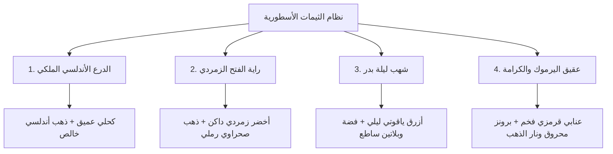

# 🎨 الخطة الهندسية والمعمارية لتطوير الثيمات الأسطورية
> **مشروع:** «معركة أحفاد الصحابة: مسابقات»  
> **الهدف:** الانتقال من الثيم الثابت إلى نظام هويات بصرية ملحمية متعددة (Multi-Theme Islamic Design System)

---

## 1. الفلسفة البصرية والمعايير الهندسية (Design Tokens & Philosophy)

1. **الوقار والأصالة التاريخية:** تعكس ألوان كل ثيم حقبة أو معركة أو طابعاً إسلامياً عريقاً.
2. **التباين الفائق وسهولة القراءة (Accessibility & High Contrast):**
   * ضمان تحقيق معيار WCAG AAA للتباين بين النصوص والخلفيات بنسبة لا تقل عن $12:1$.
   * إلغاء أي احتمالية لاختفاء الأزرار أو بهتان النصوص تحت أي إضاءة.
3. **تأثيرات الجيل الجديد (Modern Gaming Aesthetics):**
   * استخدام زجاج مصقول (Glassmorphism) بدرجات شفافية دقيقة.
   * حدود مضيئة رقيقة (1.5px Neon / Metallic Glow) للأزرار والبطاقات التفاعلية.

---

## 2. مصفوفة الثيمات الأسطورية الأربعة



### 🏛️ 1. ثيم «الدرع الأندلسي الملكي» (Andalusian Royal Gold) — *الثيم الافتراضي*
* **الطابع:** هيبة قصر الحمراء وقرطبة.
* **الخلفية العميقة:** `#0D061A` $\rightarrow$ `#1A0F2E` (تدرج ليلي ملكي يعزل المحتوى).
* **البطاقات والأسطح:** `#24143D` (زجاجي داكن مع شفافية 85%).
* **اللون السيادي والتفاعلي:** `#F3C644` (ذهب أندلسي فاقع للدرجات والأزرار الرئيسية).
* **إشعاع الحواف:** `#D4AF37` بنسبة شفافية 30%.
* **نصوص العناوين:** `#FFFFFF` و `#FDE88E`.

### 🌴 2. ثيم «راية الفتح الزمردي» (Emerald Conquest)
* **الطابع:** روحانية الفتوحات والواحات النبوية ورايات النصر.
* **الخلفية العميقة:** `#051811` $\rightarrow$ `#0A2B1E` (أخضر غاباتي عميق جداً).
* **البطاقات والأسطح:** `#0F3D2B` مع حواف خضراء متلألئة.
* **اللون السيادي والتفاعلي:** `#10B981` (زمردي مشع) مع تطعيم بالذهب الرملي `#E5C07B`.
* **نصوص العناوين:** ناصعة البياض `#F0FDF4`.

### 🌌 3. ثيم «شهب ليلة بدر» (Badr Night Sapphire)
* **الطابع:** سكينة الليالي المباركة ووقار السيوف الفضية في سماء صافية.
* **الخلفية العميقة:** `#070F26` $\rightarrow$ `#0C1A3D` (أزرق ياقوتي ليلي ملكي).
* **البطاقات والأسطح:** `#142552` مع تأثير بلوري قطبي.
* **اللون السيادي والتفاعلي:** `#38BDF8` (سماوي بلاتيني متوهج) مدمج مع الفضة `#E2E8F0`.
* **نصوص العناوين:** `#FFFFFF` و `#BAE6FD`.

### ⚔️ 4. ثيم «عقيق اليرموك والكرامة» (Yarmouk Crimson Agate)
* **الطابع:** شجاعة الفرسان، حماسة التحديات المباشرة، وهيبة المعارك الفاصلة.
* **الخلفية العميقة:** `#18080C` $\rightarrow$ `#2E0F17` (عنابي قرمزي داكن وفخم).
* **البطاقات والأسطح:** `#421520` مع حواف برونزية دافئة.
* **اللون السيادي والتفاعلي:** `#FB7185` (عقيقي متوهج) مع برونز مائل للذهب `#F59E0B`.
* **نصوص العناوين:** `#FFFFFF` و `#FFE4E6`.

---

## 3. المعمارية البرمجية في فلاتر (Code Architecture)

```
lib/core/theme/
├── app_theme.dart                 # الحاوية الرئيسية ومولد ThemeData
├── theme_enums.dart               # مصفوفة أسماء ومعرفات الثيمات (AppThemeId)
├── theme_colors.dart              # كلاس تجريدي يعرف الـ Palette لكل ثيم
├── theme_provider.dart            # مزود الحالة التفاعلي (ChangeNotifier / Riverpod)
└── palettes/
    ├── andalusian_gold_palette.dart
    ├── emerald_conquest_palette.dart
    ├── badr_sapphire_palette.dart
    └── yarmouk_crimson_palette.dart
```

### آلية العمل البرمجية:
1. **النمط التجريدي (Palette Interface):**
   كل ثيم يرث من كلاس `BaseThemePalette` ويحدد بدقة:
   * `scaffoldBackground`, `cardBackground`, `accentColor`, `primaryColor`
   * `surfaceGlow`, `textColorPrimary`, `textColorSecondary`
2. **الحفظ والمزامنة الفورية:**
   * عند تبديل الثيم من شاشة الإعدادات، يتم حفظ المفتاح فوراً في `SharedPreferences` بالرمز `selected_theme_key`.
   * يتم استدعاء `notifyListeners()` ليتحول كامل التطبيق بسلاسة (Animated Theme Transition) في جزء من الثانية دون الحاجة لإعادة تشغيل التطبيق.

---

## 4. تجربة المستخدم في شاشة الإعدادات (UI Component)

* إضافة قسم **«المظهر والهوية البصرية»** في شاشة الإعدادات.
* عرض **بطاقات أفقية تفاعلية (Carousel or Grid)** لكل ثيم:
  * معاينة دائرية لألوان الثيم الرئيسية (الخلفية، الكرت، اللون الذهبي/المشع).
  * شارة (Badge) مضيئة: "مفعّل حالياً".
  * نقرة واحدة لتطبيق وتجربة الثيم في الحال.

---

## 5. مراحل التنفيذ والاختبار (Implementation Roadmap)

| المرحلة | الأهداف والمهام | المدة المقدرة |
| :--- | :--- | :---: |
| **المرحلة 1: بناء الأساس الهيكلي** | إنشاء هيكل مجلد `lib/core/theme/` وتعريف الـ 4 Palettes والـ `ThemeController` | ساعتان |
| **المرحلة 2: ربط التطبيق الرئيسي** | تعديل `MaterialApp` في `main.dart` ليستمع لـ `ThemeController` وتفعيل الحفظ المحلي | ساعة |
| **المرحلة 3: تعميم الثيم على الشاشات** | استبدال الألوان الثابتة في الشاشات الرئيسية والتحديات بحقول `Theme.of(context)` | 3 ساعات |
| **المرحلة 4: شاشة الاختيار والاختبار** | تصميم بطاقات اختيار الثيم في الإعدادات واختبار سلاسة التبديل والتباين الفائق | ساعتان |
