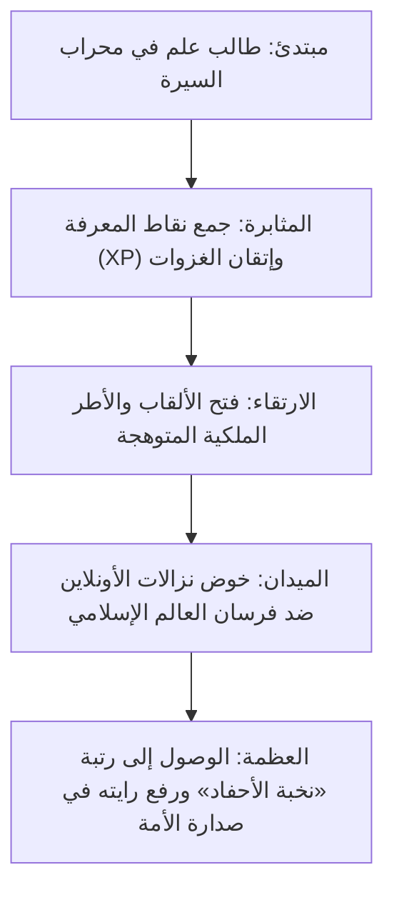
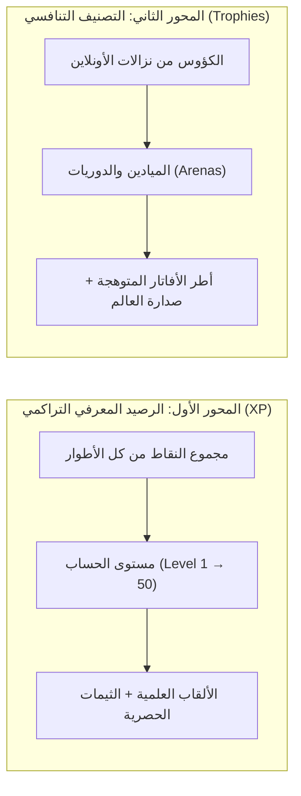
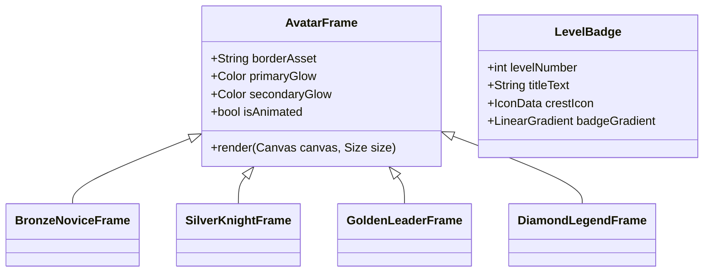

# 👑 الوثيقة المعمارية الشاملة: نظام المستويات والميادين التنافسية (من الألف إلى الياء)
## «معركة أحفاد الصحابة — منصة التنافس المعرفي التاريخي الأعظم»

> **الوثيقة الرسمية:** `docs/development_plans/08_MASTER_LEVELS_AND_GLORY_SYSTEM.md`  
> **كبير المهندسين ومصمم الأنظمة:** م. محمد لطف & فريق الذكاء الاصطناعي  
> **تاريخ التوثيق:** نوفمبر 2026  
> **الهدف الاستراتيجي:** بناء نظام مستويات ورتب أسطوري يمزج بين **الفخر التاريخي الإسلامي**، و**أعلى معايير الإدمان الإيجابي وتصميم الألعاب العالمية (World-Class Game Economics & Behavioral Gamification)**، ليمنح اللاعب شعوراً مطلقاً بالعظمة والانغماس.

---

## 🏛️ الفهرس العام للوثيقة المعمارية

1. **الرؤية والأساس النفسي (Behavioral Psychology & The Hero's Journey)**
2. **الهندسة الحسابية المزدوجة (Dual-Axis Mathematical Architecture)**
3. **سُلّم المستويات المعرفية (50 Level Knowledge Mastery Ladder)**
4. **سُلّم الميادين والدوريات التنافسية (Historic Glory Arenas & Leagues)**
5. **نظام الهوية البصرية والأطر الملكية (Royal Andalusian Visual System)**
6. **التجربة الحسية الفائقة: المؤثرات الصوتية البشرية والنبض اللمسي (SFX & Haptics)**
7. **بنية قواعد بيانات Supabase والدوال الذرية (PostgreSQL & Live RPCs)**
8. **الهندسة البرمجية في Flutter (State Management, Shaders & Widgets)**
9. **حلقات الإدمان الإيجابي والانتشار (Daily Chests, Viral Cards & Streaks)**
10. **خارطة طريق التنفيذ البرمجي (Step-by-Step Implementation Roadmap)**

---

## 1️⃣ الرؤية والأساس النفسي (The Hero's Journey)

في معظم التطبيقات التقليدية، يشعر المستخدم بأنه مجرد "مُجيب على أسئلة".  
أما في **«معركة أحفاد الصحابة»**، يتحول اللاعب إلى **«فارس معرفي يخوض فتوحات العقل والشرف»**.



### المبادئ النفسية الثلاثة الحاكمة للنظام:
1. **الارتقاء الدائم (Permanent Pride):** نقاط المعرفة ومستوى الحساب لا ينقصان أبداً؛ الجهد التاريخي محفوظ مدى الحياة.
2. **التنافس المثير الشريف (High-Stakes Thrill):** الكؤوس هي ساحة النزال المباشر، ترتفع بالانتصارات وتنخفض بالهزائم، مع وجود أمان تدريجي (+25 / -12).
3. **تأثير الاقتراب من الهدف (Goal-Gradient Effect):** إشعار اللاعب دائماً بأنه قريب جداً من اللقب القادم (مثلاً: *"بقي لك 120 نقطة لتنال لقب فارس الميدان"*).

---

## 2️⃣ الهندسة الحسابية المزدوجة (Dual-Axis Mathematical Architecture)

يفصل النظام بذكاء تام بين **المخزون المعرفي التراكمي** و**التصنيف التنافسي اللحظي**:



### معادلة شريط الخبرة والانتقال بين المستويات (Quadratic Scaling Formula):
لكي يكون الانتقال في المستويات الأولى سهلاً ومحفزاً (Dopamine Quick Wins)، ثم يصبح تدريجياً أصعب وأكثر هيبة ووقاراً:

$$\text{XP Required for Level } L = 100 \times L^{1.6} + 150 \times L$$

* **المستوى 2:** يحتاج 250 نقطة (جولتان فقط).
* **المستوى 5:** يحتاج 1,500 نقطة.
* **المستوى 10:** يحتاج 4,800 نقطة.
* **المستوى 25:** يحتاج 24,000 نقطة.
* **المستوى 50:** يحتاج 75,000 نقطة (قمة النخبة).

---

## 3️⃣ سُلّم المستويات المعرفية (The 50-Level Mastery Ladder)

يُقسم سلم الـ 50 مستوى إلى **6 فئات مجد تاريخية**؛ كل فئة تمنح اللاعب لقباً فريداً، شارة هندسية مستوحاة من العمارة الإسلامية، وإشعاراً صوتياً مهيباً:

| الفئة والمستويات | اللقب المكتسب | النقاط المطلوبة | الهوية البصرية والمكافأة |
| :--- | :--- | :---: | :--- |
| **المستويات 1 - 4** | **طالب علم** | `0 - 1,499` | شارة برونزية أندلسية بسيطة + إطار خشبي عتيق. |
| **المستويات 5 - 9** | **راوي الأثر** | `1,500 - 4,799` | شارة نحاسية منقوشة + خلفية مخطوطة بردي للملف. |
| **المستويات 10 - 19** | **فارس الميدان** | `4,800 - 14,999` | شارة فضية بسيفين متقاطعين + إطار فضي مع نسر إسلامي. |
| **المستويات 20 - 29** | **قائد الكتيبة** | `15,000 - 34,999` | شارة ذهبية متوهجة + راية الفتوحات ترفرف في بروفايله. |
| **المستويات 30 - 44** | **حكيم السيرة** | `35,000 - 64,999` | شارة زمردية ملكية مع هالة نورانية + ثيم قصر الحمراء. |
| **المستويات 45 - 50** | **نخبة الأحفاد 👑** | `65,000+` | شارة أسطورية ماسية مشعة + تاج الصحابة الذهبي + إعلان عام في التطبيق عند وصوله! |

---

## 4️⃣ سُلّم الميادين والدوريات التنافسية (Historic Glory Arenas)

الكؤوس تحدد **الميدان التاريخي** الذي يقاتل فيه اللاعب في نزالات الأونلاين (Matchmaking Arenas).  
كل ميدان يملك **خلفية بصرية خاصة، موسيقى أندلسية بالصوت البشري فقط، ومؤثرات دخول مميزة**:

```
⚔️ [الميدان 5] ميدان الفتوحات العظمى (1600+ كأس)
   └── خلفية قصر الحمراء والرايات الخضراء والذهبية، تنافس نخبة العالم
   ▲
⚔️ [الميدان 4] ميدان القادسية (1400 - 1599 كأس)
   └── صحراء نجد المشرفة مع شمس الضحى، نزال الفرسان الكبار
   ▲
⚔️ [الميدان 3] ميدان اليرموك (1200 - 1399 كأس)
   └── هضاب الشام الخضراء وأصوات تكبير عند بدء الجولة
   ▲
⚔️ [الميدان 2] ميدان بدر الكبرى (1000 - 1199 كأس)
   └── نقطة انطلاق التنافس الأساسية (أرض العريش)
   ▲
⚔️ [الميدان 1] ميدان يثرب (أقل من 1000 كأس)
   └── روضة المدينة، ميدان التدريب والتأهيل
```

### قواعد الكؤوس الصارمة:
* **الفوز:** `+25` كأساً ثابتة.
* **الخسارة:** `-12` كأساً (تمنع الإحباط وتعطي نمواً إيجابياً).
* **التعادل:** `+5` كؤوس للطرفين تقديراً للمنافسة القوية.
* **أمان الهبوط (Floor Protection):** لا يمكن للاعب أن يهبط عن 800 كأس مطلقاً لحماية المبتدئين.

---

## 5️⃣ نظام الهوية البصرية والأطر الملكية (Royal Andalusian Visual System)

التصميم يعتمد على **الفخامة الإسلامية الملكية (Royal Islamic Majesty)** بعيداً عن أسلوب الألعاب الكرتونية الرخيصة:



### لوحة الألوان السيادية:
* **الأخضر الزمردي الخلدوني:** `#0D5C3A` (رمز العزة والفتح).
* **الذهب الأندلسي الإمبراطوري:** `#D4AF37` مع لمعان شيدر `#FFDF73`.
* **الأزرق الليلي الملوكي:** `#071526` و `#0F243A` (عمق السماء والسكينة).
* **ورق البردي التاريخي:** `#F7F2E7` مع خطوط قاهرية وأميرية مطعمة بنقوش المشربية.

---

## 6️⃣ التجربة الحسية الفائقة: المؤثرات الصوتية البشرية والنبض اللمسي (SFX & Haptics)

هنا يكمن التفوق العالمي: **تطبيق إسلامي 100% خالٍ من المعازف والموسيقى تماماً، ومع ذلك يمتلك أعمق تجربة صوتية وحسية على الهواتف الذكية**:

### 1. الهندسة الصوتية البشرية الخالصة (Acoustic & Human Harmonies):
* **صوت الارتقاء بالمستوى (Level Up Fanfare):** همهمات بشرية مهيبة بصوت جهوري (Vocal Harmony Bass) يتبعه صليل غمد سيف دمشقي خفيف وتكبير موقر يملأ النفس فخراً.
* **صوت انتصار الأونلاين (Online Victory):** وقع حوافر خيل مسرعة يتلوها هتاف نصر جماعي بدون معازف.
* **صوت الإجابة الصحيحة المتتالية (Combo Streak):** نقرة سبحة كهرمانية نقية مع تصاعد نغمي بشري هادئ.
* **صوت آخر 3 ثوانٍ من السؤال:** صوت أنفاس وتركيز خافت يشعل الحماس دون توتر سلبي.

### 2. النبض اللمسي التفاعلي (Dynamic Flutter Haptic Feedback):
* **عند الإجابة الصحيحة:** نبضة خفيفة ناعمة `HapticFeedback.lightImpact()`.
* **عند تحقيق الفوز أو ترقية الرتبة:** اهتزاز ثلاثي فخم متتالي (Double Heavy Pulse) يشعر به اللاعب في راحة يده.
* **في آخر ثانيتين من الوقت:** نبضات متزامنة مع نبض القلب (Heartbeat Haptics) تجعل الهاتف ينبض حياً.

---

## 7️⃣ بنية قواعد بيانات Supabase والدوال الذرية (PostgreSQL Schema)

لضمان الدقة المطلقة ومنع التلاعب، تتم جميع حسابات المستويات والألقاب والكؤوس داخل **معاملات ذرية (Atomic Transactions)** على خادم Supabase:

```sql
-- 1. إضافة أعمدة المستويات والألقاب لجدول التقدم والمتصدرين
ALTER TABLE public.user_progress
ADD COLUMN IF NOT EXISTS player_level INT DEFAULT 1,
ADD COLUMN IF NOT EXISTS player_title TEXT DEFAULT 'طالب علم',
ADD COLUMN IF NOT EXISTS current_level_xp INT DEFAULT 0,
ADD COLUMN IF NOT EXISTS next_level_xp INT DEFAULT 250;

ALTER TABLE public.leaderboard
ADD COLUMN IF NOT EXISTS player_level INT DEFAULT 1,
ADD COLUMN IF NOT EXISTS player_title TEXT DEFAULT 'طالب علم',
ADD COLUMN IF NOT EXISTS arena_name TEXT DEFAULT 'ميدان بدر الكبرى';

-- 2. دالة حساب المستوى واللقب الذرية (Pure Server-Side Calculation)
CREATE OR REPLACE FUNCTION public.calculate_level_and_title(p_total_score INT)
RETURNS TABLE (
  out_level INT,
  out_title TEXT,
  out_cur_xp INT,
  out_next_xp INT,
  out_progress_percent FLOAT
) 
LANGUAGE plpgsql
IMMUTABLE
AS $$
DECLARE
  v_lvl INT := 1;
  v_prev_xp INT := 0;
  v_target_xp INT := 250;
  v_title TEXT := 'طالب علم';
BEGIN
  -- حلقة حساب المستوى الرياضي
  WHILE p_total_score >= v_target_xp AND v_lvl < 50 LOOP
    v_lvl := v_lvl + 1;
    v_prev_xp := v_target_xp;
    v_target_xp := FLOOR(100 * POWER(v_lvl, 1.6) + 150 * v_lvl);
  END LOOP;

  -- تحديد اللقب
  IF v_lvl >= 45 THEN v_title := 'نخبة الأحفاد 👑';
  ELSIF v_lvl >= 30 THEN v_title := 'حكيم السيرة';
  ELSIF v_lvl >= 20 THEN v_title := 'قائد الكتيبة';
  ELSIF v_lvl >= 10 THEN v_title := 'فارس الميدان';
  ELSIF v_lvl >= 5 THEN v_title := 'راوي الأثر';
  ELSE v_title := 'طالب علم';
  END IF;

  RETURN QUERY SELECT 
    v_lvl,
    v_title,
    GREATEST(0, p_total_score - v_prev_xp),
    GREATEST(1, v_target_xp - v_prev_xp),
    LEAST(1.0, GREATEST(0.0, (p_total_score - v_prev_xp)::FLOAT / GREATEST(1, v_target_xp - v_prev_xp)::FLOAT));
END;
$$;
```

---

## 8️⃣ الهندسة البرمجية في Flutter (Frontend Architecture)

يتم تنظيم الكود البرمجي وفق مبدأ **Clean Architecture** داخل بنية المشروع الحالية:

```
lib/
├── data/
│   ├── models/
│   │   ├── player_level_model.dart          # نموذج المستوى وشريط التقدم
│   │   └── arena_model.dart                 # نموذج الميدان والكؤوس
│   └── services/
│       └── progression_service.dart         # مزود الحالة وحساب الترقية اللحظي
└── ui/
    ├── screens/
    │   ├── profile/
    │   │   └── glory_road_screen.dart       # شاشة "طريق المجد" (مسار المكافآت والمستويات)
    │   └── dialogs/
    │       ├── level_up_celebration_dialog.dart # الاحتفالية الملحمية عند الترقية
    │       └── arena_promotion_dialog.dart  # احتفالية الصعود إلى ميدان جديد
    └── widgets/
        ├── animated_avatar_frame.dart       # إطار الأفاتار الملكي المتوهج
        ├── level_badge_widget.dart          # شارة المستوى التفاعلية
        └── glory_progress_bar.dart          # شريط الخبرة الزجاجي الأندلسي
```

---

## 9️⃣ حلقات الإدمان الإيجابي والانتشار الفيروسي (Viral Loops & Retention)

1. **صندوق الفاتحين اليومي (Daily Conquest Chest):**
   * الفوز في 3 نزالات يومياً يفتح الصندوق ويمنح مضاعف خبرة.
2. **بطاقات الفخر المصورة الذكية (Dynamic Shareable Cards):**
   * توليد شهادة مجد مصورة بدقة عالية للمشاركة في حالات الواتساب وتيليجرام مع كود QR.
3. **سلسلة المثابرة اليومية (Daily Devotion Streak):**
   * مضاعف خبرة تراكمي للمحافظة على اللعب اليومي.

---

## 🔟 خارطة طريق التنفيذ البرمجي خطوة بخطوة (Roadmap & Milestones)

| المرحلة | المهام المحددة | المخرجات البرمجية |
| :---: | :--- | :--- |
| **M1** | **تأسيس النماذج والمعادلات الحسابية** | إنشاء `player_level_model.dart` و `arena_model.dart`. |
| **M2** | **تطبيق دوال Supabase السحابية** | تطبيق دوال الـ SQL لحساب المستويات والميادين. |
| **M3** | **تصميم وبناء أودجات الواجهة الملكية** | بناء الأطر المتوهجة وشارات المستويات. |
| **M4** | **بناء شاشة "طريق المجد" والاحتفاليات** | إنشاء `GloryRoadScreen` و `LevelUpCelebrationDialog`. |
| **M5** | **تحديث الشاشة الرئيسية وقوائم الصدارة** | إبراز المستوى والميدان في كل أرجاء التطبيق. |

