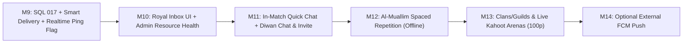

# 🏛️ الخطة الهندسية 10: صندوق البريد الملكي، إدارة موارد Supabase، ومنظومة الدردشة والتحديات المتقدمة

> **المسار:** `docs/development_plans/10_ROYAL_INBOX_RESOURCES_AND_SOCIAL_ECOSYSTEM.md`  
> **تاريخ الاعتماد:** 17 نوفمبر 2026  
> **الإصدار الأساسي المكتمل قبله:** `1.0.19+20` (الترحيلات الحية `001` ← `016`)  
> **الإصدار المستهدف القادم:** `1.1.0+21` وما يليه (المراحل **9 ← 14**)  
> **كبير المهندسين والمسؤول:** م. محمد لطف  
> **المعيار الهندسي الملزم:** الالتزام الحرفي بـ [`AGENTS.md`](../../AGENTS.md) — `0ms Local-First SWR` — حماية باقة Supabase المجانية (`500 MB DB`, `5 GB Egress`, `200 Concurrent Connections`, `2M Messages/mo`) — توافق `Android 15/16 Edge-to-Edge` وشاشات `360x800dp`.

---

## 🎯 1. الرؤية الاستراتيجية ونطاق الخطة

تجمع هذه الخطة كل ما تم إقراره وتطويره في الرؤية الحديثة للتطبيق بعد إتمام بوابة `016` والنسخة `1.0.19+20`، مع تقسيم واضح بين:
1. **المكونات ذات الأولوية الفورية والعالية** (صندوق البريد الملكي 📬 + التسليم الذكي/الفوري + شاشة إدارة ومراقبة الموارد 🎛️).
2. **التطوير التفاعلي والاجتماعي الآمن** (ديوان الأحفاد الآمن + عبارات النزال السريعة + زر التحدي من الدردشة + غرف البطولات والكتائب).
3. **التنقيح التربوي والانتقائي** (اعتماد «المعلم الحكيم» للتكرار المتباعد محلياً، و**تأجيل البوتات التكتيكية الثلاثة** لأن «أشباح الصحابة» الحالية أكثر واقعية ومنافسة).

---

## 🛡️ 2. دستور الكفاءة والشفافية وحماية الباقة المجانية

### أ) قواعد حماية حدود Supabase Free Plan
| المورد في Supabase Free Plan | الحد الشهري/اللحظي | السياسة الهندسية الإلزامية في هذه الخطة |
| :--- | :---: | :--- |
| **الاتصالات اللحظية المتزامنة (`Realtime Peak`)** | `200` اتصال في نفس الثانية | 1. **عبارات النزال السريعة (`QuickPhrasesBar`)** تستخدم قناة المباراة المفتوحة مسبقاً (`0` اتصالات إضافية). 2. **قناة «ديوان الأحفاد»** لا تُفتح إلا عند دخول شاشة الدردشة وتُغلق فوراً في `dispose()`. 3. **قناة النبضة الحية للرسائل (`live_announcement_ping`)** تُغلق فور الانتقال للخلفية ويمكن إيقافها لحظياً بـ `FeatureFlag`. |
| **رسائل `Realtime`** | `2,000,000` رسالة / شهر | الرقم `200` في الخطة هو عدد **المتصلين في نفس الثانية** وليس عدد الرسائل؛ فوجود `50` متصلاً يتبادلون `200` رسالة يستهلك `10,000` رسالة فقط (`0.5%` من الحد الشهري). |
| **حجم قاعدة البيانات (`Database Size`)** | `500 MB` | تطبيق سياسات تنظيف `TTL` (حذف رسائل الشات الأقدم من 24 ساعة، وتوفير أزرار تنظيف للمباريات المنتهية القديمة والإيصالات المنتهية عبر شاشة إدارة الموارد). |
| **نقل البيانات (`Egress`)** | `5 GB` / شهر | صندوق البريد يعتمد كاش محلياً ولا يجلب السجل (`get_player_inbox`) إلا عند ضغط اللاعب لفتح الصندوق (**On-Demand**)، مع بقاء فحص الخلفية عند `128` بايت (`changed: false`). |

### ب) مبدأ الشفافية الهندسية (الفرق بين مؤشرات Postgres ومؤشرات بوابة Supabase)
* **ما يُقرأ بدقة برمجياً من PostgreSQL:** حجم القاعدة الفعلي (`pg_database_size`) بالميجابايت، حجم وعدد صفوف كل جدول (`pg_total_relation_size`)، عدد التحديات المفتوحة حالياً، اللاعبون النشطون خلال آخر `5m / 60m / 24h`، وإجمالي الحسابات.
* **ما يظل حكراً على لوحة Supabase Studio:** العداد الدقيق لـ `Realtime Concurrent Connections` و`Network Egress GB`؛ ولذا **يُمنع وضع أي Management API Token داخل التطبيق**، ويُكتفى بزر رابط مباشر يفتح صفحة `Usage` في Supabase Studio من شاشة الإدارة عند الرغبة.

### ج) معايير الجودة الإلزامية (`AGENTS.md`)
1. منع أي متغيرات أو مؤقتات أو اشتراكات صورية (`No Stubs`)، وإلغاء جميع `Timer` و`RealtimeChannel` صراحةً في `dispose()`.
2. تزويد جميع دوال SQL بـ `#variable_conflict use_column` و`SET search_path = public, auth` مع اختبار حي بـ `BEGIN ... ROLLBACK`.
3. الحفاظ التام على `360x800dp` دون أي `RenderFlex overflow` وبحشوات `SafeArea` متوافقة مع `Edge-to-Edge`.

---

## 🧱 3. التفصيل المعماري للركائز الجديدة

### 📬 الركيزة الأولى: «صندوق البريد الملكي» ونظام التسليم الفوري الذكي
#### 1) نقطة الدخول المزدوجة الخالية من الازدحام (`360dp Safe`)
* **بدون زحام في شريط `HomeScreen.AppBar`:** يحافظ الشريط العلوي في [`home_screen.dart`](../../lib/ui/screens/home_screen.dart) على أزراره الحالية، ويُضاف على أيقونة/إطار صورة اللاعب (`AnimatedAvatarFrame`) **شارة عدد الرسائل غير المقروءة (`unreadCountBadge`)**.
* **عند النقر على صورة اللاعب أو اسمه:** تُفتح قائمة/بطاقة ملف اللاعب الأنيقة (أو داخل [`profile_selector_screen.dart`](../../lib/ui/screens/profile_selector_screen.dart)) وتضم خيارَين واضحَين:
  1. **📬 صندوق البريد الملكي** (يعرض عداد غير المقروء ويدخل لـ `RoyalInboxScreen` على المسار `/inbox`).
  2. **👤 ملفاتي وهويتي (`SAH-XXXX`)** (إدارة وتبديل الملفات الشخصية).
* **اختصار ثانوي:** زر اختياري داخل [`HomeSpeedDial`](../../lib/ui/screens/home/widgets/home_speed_dial.dart) + دعم التوجيه إليه عبر `ctaRoute: '/inbox'`.

#### 2) محتوى الصندوق وتبويباته
* **الرسائل والإعلانات الإدارية (`admin_announcements`):** تعرض آخر `25–30` رسالة تخص اللاعب (العامة `all` والموجهة `single_user` عبر `auth.uid()` أو `SAH-XXXX`) بجميع الأنواع الأربعة (`normal`, `mandatory`, `admin`, `motivational`)، مع بقاء زر الإجراء (`ctaLabel` + `ctaRoute`) قابلاً للضغط في أي وقت دون ضياع بعد الإغلاق.
* **سجل الهدايا والتعويضات (`admin_grant_player_compensation`):** عند منح أي تعويض للاعب من لوحة الإدارة، تولّد الدالة تلقائياً رسالة إدارية في صندوق اللاعب توضح المبلغ المضاف والسبب ورسالة شكر رسمية، مع وسم خاص في تبويب «الهدايا والتعويضات».
* **تصرف الذكاء البصري:**
  * `mandatory` (إلزامي ⚠️): يظهر تلقائياً كنافذة حوار إجبارية لا تُغلق إلا بالموافقة، ثم يُحفظ أرشيفه في الصندوق.
  * `normal` / `admin` / `motivational`: تضيء شارة الصندوق ✉️ (مع إمكانية خيار انبثاق أول مرة أو هدوء داخل الصندوق)، وتتحول لـ «مقروء» فور الاطلاع وتُسجل في `user_announcement_receipts` (`uid:` + `code:`).

#### 3) تسريع وصول الرسائل (`Smart Delivery Modes`)
1. **المستوى الأساسي الموفّر (تحديث دائم بكلفة ~0):**
   * تقليص فترة التبريد (`appControlSyncCooldownMinutes`) من `15` دقيقة إلى **`2` أو `3` دقائق** فقط.
   * استدعاء `syncControlState()` المحكوم بهذا التبريد أيضاً داخل `didChangeAppLifecycleState(AppLifecycleState.resumed)` حتى لا يضطر اللاعب لإغلاق التطبيق كلياً لرؤية الجديد.
2. **المستوى اللحظي (`< 1 ثانية`) — نمط «النبضة الفارغة الآمنة (`Realtime Sync Ping`)»:**
   * محكوم بعلم الميزة `feature_flags.live_announcement_ping` (مفعّل/معطّل من لوحة الإدارة بضغطة واحدة!).
   * قناة Broadcast واحدة باسم `app_control_live` لا يُكتب فيها نص أي رسالة خاصة؛ فقط تبث نبضة صامتة مثل `{ "event": "control_ping", "target_code": "SAH-XXXX" | "all", "ts": ... }` عند النشر أو تغيير وضع الصيانة.
   * التطبيق المفتوح في الواجهة يلتقط النبضة خلال `< 1` ثانية ويستدعي `syncControlState(force: true)` الآمنة؛ فيسحب الرسالة الحقيقية **المعنيّ فقط** دون أي تسريب للبيانات، وتُفصل القناة تلقائياً عند خروج التطبيق للخلفية (`AppLifecycleState.paused`).
3. **ملاحظة الفصل التقني (خارج التطبيق):** النبضة والصندوق يعملان داخل التطبيق؛ أما الإشعار والهاتف مغلق والتطبيق مقفل تماماً فيبقى اختيارياً في المرحلة 14 عبر `FCM Push`.

---

### 🎛️ الركيزة الثانية: شاشة «إدارة ومراقبة موارد Supabase 🎛️» (في الهاتف + الويب)
#### 1) المؤشرات المعروضة عبر `admin_get_resource_health()`
* **شريط سعة قاعدة البيانات:** `الحجم الحالي MB / 500 MB` + نسبة مئوية + مؤشر حالة (`أخضر <60%` / `برتقالي 60–80%` / `أحمر >80%`).
* **تفكيك أكبر الجداول (الحجم + عدد الصفوف):** `matches`, `match_participants`, `ghost_recordings`, `admin_audit_logs`, `player_directory`, `user_announcement_receipts`, `user_progress`, `leaderboard`.
* **عداد النشاط الحي والتنبيهات:**
  * المباريات النشطة لحظياً الآن (`status IN ('waiting', 'playing')`).
  * اللاعبون النشطون خلال آخر `5` دقائق، `60` دقيقة، و`24` ساعة (من `player_directory.last_seen_at`).
  * تنبيه واضح عند الاقتراب من السقوف الحرجة + زر فتح لوحة `Supabase Usage` مباشرة في المتصفح للاطلاع على عداد WebSockets (`x/200`) و`Egress`.

#### 2) أدوات التحكم والتنظيف الفوري (`admin_cleanup_stale_resources`)
* **تنظيف المباريات المنتهية القديمة:** حذف `matches` و`match_participants` المنتهية الأقدم من `30` (أو `60`) يوماً مع حماية الترتيب والإحصاءات التراكمية المحفوظة أصلاً في `user_progress` و`leaderboard`.
* **تنظيف الإيصالات والإعلانات المنتهية:** حذف `user_announcement_receipts` المرتبطة بإعلانات منتهية الصلاحية وقديمة.
* **أزرار الطوارئ:** تعطيل فوري لأعلام الميزات الثقيلة (`live_announcement_ping`, `diwan_chat`, `online_multiplayer`) إذا ظهر ضغط مفاجئ، مع توثيق كل إجراء في `admin_audit_logs`.

---

### 💬 الركيزة الثالثة: الدردشة الجماعية («ديوان الأحفاد») وعبارات النزال وزر التحدي المباشر
*(تطوير مدمج للخطة [`03_LIVE_CHAT_AND_MESSAGING_SYSTEM.md`](./03_LIVE_CHAT_AND_MESSAGING_SYSTEM.md) مع التحديات الخاصة)*
1. **عبارات التشجيع السريعة داخل المواجهة (`QuickPhrasesBar`):** تمر عبر `Broadcast` على نفس قناة المباراة المفتوحة في `VersusScreen` و`OnlineGameScreen` (`0` اتصالات إضافية، `0` صفوف في القاعدة).
2. **ديوان الأحفاد المنبثق (`GlobalChatBottomSheet`):**
   * تُفتح القناة اللحظية لـ `chat_messages` **فقط أثناء بقاء نافذة الشات مفتوحة** وتُغلق فور إغلاقها.
   * القراءة للمستخدمين والكتابة محصورة للحسابات الموثقة بـ `Google` (`auth.uid() IS NOT NULL`)؛ لمنع السبام والحسابات الوهمية، مع فلتر كلمات محظورة محلي وسحابي، وحد رسالة كل `3` ثوانٍ (`<= 250` حرفاً)، وزر إبلاغ/حظر للمشرفين.
   * **حفظ الصغر:** حذف تلقائي للرسائل الأقدم من `24` ساعة (`TTL`).
3. **بطاقة «تحدّاني الآن ⚔️» داخل الدردشة:** زر ينشئ غرفة خاصة (`create_private_room`) ويرسل رابط انضمام تفاعلياً في الشات لينضم أي متصل للمواجهة بلمسة واحدة.

---

### 🛡️ الركيزة الرابعة: الكتائب والرايات وغرف البطولات الجماعية الحية (`Plan 07`)
*(تفعيل منظومة [`07_LIVE_TOURNAMENTS_AND_CLANS.md`](./07_LIVE_TOURNAMENTS_AND_CLANS.md))*
* **الكتائب (`guilds` & `guild_members`):** رايات من `5` إلى `30` عضواً وتنافس أسبوعي في «معركة الجمعة الكبرى».
* **غرف البطولات الحية (`live_quiz_sessions`):** غرف جماعية حتى `100` مشارك عبر `PIN`/`QR` يتحكم فيها المشرف بطرح الأسئلة تزامنياً وعرض المتصدرين بعد كل سؤال، مع إغلاق القنوات فور انتهاء البطولة وتنظيف الجلسات المنتهية من شاشة الموارد.

---

### 🧠 الركيزة الخامسة: الانتقاء التربوي الذكي (`المعلم الحكيم`) واستبعاد البوتات التكتيكية الثلاثة
* **قرار هندسي صريح:** تأجيل/استبعاد الشخصيات الثلاث للبوت التكتيكي في [`01_AI_ADAPTIVE_MASTERY_AND_BOTS.md`](./01_AI_ADAPTIVE_MASTERY_AND_BOTS.md) لأن **«أشباح الصحابة»** الحالية تقدم منافسة بشرية حقيقية وواقعية أعلى دون شخصيات آلية مكررة.
* **ما نأخذه من الخطة `01`:** ميزة **«المعلم الحكيم» (`Spaced Repetition`)** + بطاقة **«الإضاءة التاريخية»** عند الخطأ في اللعب الفردي، حيث تحفظ محلياً الأسئلة التي أخطأ فيها اللاعب وتعيد جدولتها بعد `24 ساعة ← 3 أيام ← أسبوع` بدون أي حمل على Supabase.

---

## 🗺️ 4. خارطة المعالم التنفيذية المتسلسلة (Milestones: M9 ← M14)

### 🔵 المرحلة 9 (`M9`): البنية السحابية (`017`) وتسريع الوصول والنبضة الآمنة
* **المهمة `M9.1` — ملف الترحيل `supabase/migrations/017_inbox_and_resource_health.sql` (وتطبيقه حياً مع `BEGIN ... ROLLBACK`):**
  1. دالة `get_player_inbox(p_player_code TEXT DEFAULT NULL, p_limit INTEGER DEFAULT 25)` تُعيد آخر رسائل اللاعب (مقروءة + غير مقروءة) بحالة `is_read` وتطابق `auth.uid()` أو `SAH-XXXX`.
  2. دالة `mark_all_inbox_read(p_player_code TEXT DEFAULT NULL)` لتصفير الشارة بضغطة واحدة.
  3. ترقية `admin_grant_player_compensation` لإدراج إشعار تعويض تلقائي في `admin_announcements` (`target_scope = 'single_user'`, `message_type = 'admin'`).
  4. دالة `admin_get_resource_health()` (محمية بـ `check_is_admin()`) ترجع حجم القاعدة من `500 MB` وأحجام الجداول والصفوف والمباريات المفتوحة والنشاط الحي (`5m / 60m / 24h`).
  5. دالة `admin_cleanup_stale_resources(p_action TEXT, p_older_than_days INTEGER DEFAULT 30)` مع تسجيل إلزامي في `admin_audit_logs`.
* **المهمة `M9.2` — تسريع التسليم في `AppControlService` و`main.dart`:**
  1. ضبط التبريد الافتراضي إلى `2` أو `3` دقائق وربط `didChangeAppLifecycleState(resumed)` بمزامنة خفيفة (`syncControlState()`).
  2. إضافة علم الميزة `live_announcement_ping` وقناة «النبضة الفارغة» (`app_control_live`) في التطبيق وفي لوحتَي الإدارة (الهاتف والويب) عند النشر، مع فصلها في `paused`/`dispose`.

### 🟣 المرحلة 10 (`M10`): واجهة «صندوق البريد الملكي 📬» و«مراقبة الموارد 🎛️» + بناء `1.1.0+21`
* **المهمة `M10.1` — صندوق البريد الملكي في Flutter:**
  1. إضافة شارة غير المقروء على صورة اللاعب في [`home_screen.dart`](../../lib/ui/screens/home_screen.dart)، وفتح بطاقة/خيارات الملف الشخصي للوصول إلى **«📬 صندوق البريد الملكي»** أو **«👤 تبديل/إدارة الملف»**، مع اختصار في [`home_speed_dial.dart`](../../lib/ui/screens/home/widgets/home_speed_dial.dart) ومسار `/inbox` في [`app_routes.dart`](../../lib/core/app_routes.dart).
  2. بناء `RoyalInboxService` + `RoyalInboxScreen` (تبويب «الإعلانات والرسائل»، تبويب «الهدايا والتعويضات»، أزرار `ctaRoute`، زر «تحديد الكل كمقروء»، وكاش محلي أوفلاين).
* **المهمة `M10.2` — شاشة مراقبة وإدارة الموارد:**
  1. بناء `AdminResourcesScreen` داخل [`admin_dashboard_screen.dart`](../../lib/ui/screens/admin_dashboard_screen.dart) + تبويب «الموارد والصحة» في `admin_web/` بعرض بصري لسعة القاعدة من `500 MB` وأكبر الجداول وأزرار التنظيف الفوري ورابط Supabase Studio.
* **المهمة `M10.3` — بوابة التحقق الشاملة (`M9 + M10`):**
  * اختبار SQL الحي + `flutter analyze --no-fatal-infos lib test` + اختبارات ودجات `360dp` + `Edge CDP` + تحديث رقم الإصدار في المواضع الأربعة (`1.1.0+21`) + بناء `AAB/APK` وتحديث [`PROJECT_STATUS.md`](../../PROJECT_STATUS.md).

### 🟠 المرحلة 11 (`M11`): التفاعل الحي داخل النزالات و«ديوان الأحفاد» الآمن
* **المهمة `M11.1` — عبارات التحية والتشجيع داخل النزال (`QuickPhrasesBar`):** فقاعات سريعة محترمة فوق قناة المباراة الحالية في `VersusScreen` و`OnlineGameScreen` (`0` اتصالات جديدة).
* **المهمة `M11.2` — ديوان الأحفاد (`018_diwan_live_chat.sql` + `GlobalChatBottomSheet`):**
  * جدول `chat_messages`، RLS للمسجلين (`auth.uid()` للكتابة)، فلتر الكلمات المحظورة، `Rate Limit` كل `3` ثوانٍ، التنظيف التلقائي لأكثر من `24` ساعة، زر **«تحدّي داخل الدردشة ⚔️»** عبر الغرف الخاصة، وأدوات كتم/حذف للمشرف.
* **المهمة `M11.3` — اختبار التسريب وإغلاق القناة:** التأكد أن إغلاق نافذة الدردشة يُنهي اشتراك WebSocket فوراً، والتحقق من كلفة الرسائل والحدود.

### 🟢 المرحلة 12 (`M12`): «المعلم الحكيم» للتكرار المتباعد وبطاقة الإضاءة التاريخية (`Offline`)
* **المهمة `M12.1`:** إنشاء `SpacedRepetitionService` لتسجيل أخطاء اللاعب محلياً وجدولتها في التحدي الفردي (`24h`, `3d`, `7d`).
* **المهمة `M12.2`:** بناء نافذة/بطاقة «إضاءة تاريخية» عند الخطأ في [`quiz_screen.dart`](../../lib/ui/screens/quiz_screen.dart) دون زيادة حجم التطبيق بأكثر من `150 KB` وبلا أي طلبات سحابية إضافية.

### 🟡 المرحلة 13 (`M13`): نظام الكتائب والرايات وغرف البطولات الجماعية الحية (`Plan 07`)
* **المهمة `M13.1` — الترحيل `019_guilds_and_live_arenas.sql`:** إنشاء `guilds`, `guild_members`, و`live_quiz_sessions` بـ RLS محكمة ودوال ذرية.
* **المهمة `M13.2`:** واجهة تأسيس وإدارة الكتائب (5–30 عضواً) + لوحة ترتيب «معركة الجمعة الكبرى».
* **المهمة `M13.3`:** غرفة البطولة الحية للمشرف والمعلم (كود `PIN/QR` + بث الأسئلة حتى `100` مشارك عبر `Realtime Broadcast` + لوحة المتصدرين الحية) + ربط تنظيف الجلسات المنتهية بشاشة الموارد.

### ⚪ المرحلة 14 (`M14` — توسّع اختياري عند الحاجة): الإشعارات الخارجية (`FCM Push Notifications`)
* إضافة ربط خارجي اختياري بـ `Firebase Cloud Messaging` فقط عند الرغبة في وصول التنبيهات إلى شريط إشعارات أندرويد والهاتف مقفل والتطبيق مغلق تماماً، مع ضبط التوجيه عند النقر إلى `/inbox` مباشرةً.

---

## 📋 5. ملخص الجاهزية والبدء

* **الحالة الحالية لهذا المخطط:** 📝 **خطة استراتيجية متكاملة معتمدة وجاهزة للتنفيذ المتسلسل بعد إتمام التجربة الميدانية لنسخة `1.0.19+20`.**
* **ترتيب البدء الموصى به:** البدء فوراً بـ **المعالم `M9` + `M10`** (صندوق البريد الملكي + التسليم السريع والنبضة الآمنة + شاشة إدارة ومراقبة موارد Supabase) لأنها تخدم إدارة التطبيق واللاعبين يومياً وبكلفة سحابية شبه صفرية.
