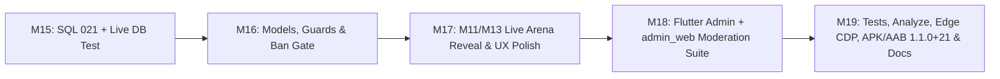

# 🛡️ الخطة الهندسية 11: منظومة الصلاحيات الديناميكية، الحظر والإشراف الكامل، وإغلاق فجوات المزايا (`1.1.0+21`)

> **المسار:** `docs/development_plans/11_ADMIN_MODERATION_PERMISSIONS_AND_POLISH.md`  
> **تاريخ الاعتماد:** 19 نوفمبر 2026  
> **الإصدار المستهدف:** **`1.1.0` (`versionCode: 21`) — يُمنع منعاً باتاً رفع رقم الإصدار أو رقم البناء** (تبقى المواضع الأربعة ثابتة على `1.1.0+21` بطلب المسؤول).  
> **حالة النشر على Google Play:** **موقوف (ليس وقت النشر الآن)**.  
> **حالة الإنجاز والتنفيذ:** **✅ مكتملة ومطبقة حياً ومختبرة 100% (155/155 اختباراً) ومبنية للإنتاج محلياً على الإصدار `1.1.0+21`** (بانتظام وبأعلى معايير `AGENTS.md`).  
> **كبير المهندسين والمسؤول:** م. محمد لطف  
> **الدستور الهندسي الملزم:** الالتزام الحرفي بـ [`AGENTS.md`](../../AGENTS.md) — `No Stubs / No Fake Wiring` — `#variable_conflict use_column` + `SET search_path = public, auth` — `Live Supabase Verification (BEGIN ... ROLLBACK)` — حماية باقة Supabase المجانية (`500 MB DB`, `5 GB Egress`, `200 Realtime`) — `360x800dp` صفر `Overflow` مع `SafeArea` و`Edge-to-Edge` — **صفر حزم خارجية جديدة في `pubspec.yaml`**.

---

## 🎯 1. الهدف الاستراتيجي ونطاق الخطة (إغلاق 100% من مكتشفات التدقيق الجنائي)

أُنشئت هذه الخطة بناءً على التدقيق الجنائي الدقيق بعد إتمام الخطة العاشرة (`M9`–`M14`)، وتهدف إلى تحويل لوحتَي الإدارة (**التطبيق `Flutter`** + **لوحة الويب `admin_web/`**) و**قاعدة البيانات (`Supabase`)** إلى منظومة قيادة وسيطرة متكاملة لا ثغرة فيها ولا ميزة خارج رقابة المدير:

1. **التحكم الديناميكي الكامل بصلاحية إنشاء البطولات الحية (`100` مشارك) وبكافة المزايا:**
   * سياسة عامة ديناميكية (`live_arena_host_restricted`) + تفويض/منع ثلاثي الحالات لكل لاعب (`NULL` = يتبع السياسة العامة | `TRUE` = تفويض معلم/منظّم مسموح دائماً | `FALSE` = منع فردي صريح حتى في الوضع المفتوح).
2. **منظومة الحظر والكتم والصلاحيات الفردية لكل لاعب (`player_permissions`):**
   * حظر عام (مؤقت `24h / 7d / 30d` أو دائم) مع بوابة حظر فورية في التطبيق + سحب/منح فردي لصلاحيات: الأونلاين، ديوان الأحفاد، الكتائب، واستضافة البطولات الحية — **مع وصول التعديل للاعب المعنيّ وحده خلال `< 1` ثانية دون رفع `config_version` العام لكل المستخدمين**.
3. **لوحة الإشراف الاجتماعي الكاملة (تطبيق + ويب):**
   * استعراض بلاغات الديوان (`diwan_reports`) مع نص الرسالة والمرسل والمبلِّغين + حذف الرسالة / كتم المستخدم / تجاهل البلاغ.
   * قائمة المكتومين (`diwan_moderation`) والمحظورين مع زر **فك الكتم / فك الحظر الفوري**.
   * استعراض الكتائب (`guilds`) مع حذف كتيبة مخالفة أو تصفير نقاطها، واستعراض البطولات الحية الجارية (`live_quiz_sessions`) مع زر **إنهاء طارئ فوري**.
4. **إغلاق جميع ثغرات فرض `Feature Flags` بين السيرفر والعميل:**
   * إضافة علم `quick_phrases` لعبارات النزال السريعة، وفرض `guilds_arenas` و`royal_inbox` في الخادم (`SQL`) وفي شاشات `HostControlScreen` و`StudentParticipantScreen` و`HomeSpeedDial`، وتوحيد القيمة الافتراضية لـ `guilds_arenas` (`true`)، وتحديث رقائق المسارات السريعة (`/inbox`, `/diwan`, `/guilds`, `/live-arena`) وعداد الأعلام (`13` علماً).
5. **إكمال نواقص تجربة البطولة الحية (`M13`) والديوان (`M11`):**
   * تفعيل عرض **الترتيب المرحلي (`reveal`)** في `StudentParticipantScreen`.
   * دعم الأقسام السحابية (CMS) واختيار المستوى (`1..totalLevels` أو مختلط) وعدد الأسئلة (`5 / 8 / 10`) ومشاركة PIN الفورية عبر `SharePlus.instance` وحارس الخروج `PopScope` (لإنهاء الجلسة بـ `'finished'` وعدم تركها عالقة 6 ساعات) في `HostControlScreen`.
   * حوار اختيار سبب البلاغ في الديوان ولافتة توضح حالة الكتم أو المنع مع وقت الانتهاء.

> **ملاحظة نطاق `M14` (`FCM Push`):** يظل تفعيل `firebase_messaging` ونشر `push-dispatch` خارج نطاق هذه الخطة ما لم يزوّد المسؤول المشروع بملف `google-services.json` ومفتاح `FCM_SERVICE_ACCOUNT_JSON`.

---

## 🧭 2. جدول الحقيقة الهندسي للصلاحيات والأعلام (Single Source of Truth)

### أ) أعلام الميزات العامة في `app_release_config.feature_flags` (`13` علماً)

| # | المفتاح في JSONB | الافتراضي الموحّد | الموضع المُلزَم بفرضه (السيرفر + العميل) |
| :-: | :--- | :---: | :--- |
| 1–6 | `online_multiplayer`, `ghost_matches`, `private_rooms`, `knights_store`, `show_event_banner`, `daily_challenges` | `true` | مفروضة مسبقاً + يُضاف معها فحص `can_use_online` و`is_banned` |
| 7 | `royal_inbox` | `true` | **SQL `get_player_inbox`** + `RoyalInboxScreen` + `HomeSpeedDial` + `HomeScreen` |
| 8 | `live_announcement_ping` | `true` | `AppControlService` (`app_control_live`) + `AdminService.broadcastControlPing` |
| 9 | `wise_teacher_mode` | `true` | `SpacedRepetitionService` + `SettingsScreen` + `QuizScreen` |
| 10 | `diwan_chat` | `true` | **SQL `send_diwan_message`** + `GlobalChatBottomSheet` + `ChatService` + `ChallengeMenuScreen` + `HomeSpeedDial` + `HomeScreen` |
| 11 | `guilds_arenas` | **`true`** *(توحيد!)* | **SQL `create_guild`, `join_guild`, `create_live_quiz_session`, `join_live_quiz_session`** + `GuildDashboardScreen` + `GuildService` + **`HostControlScreen`** + **`StudentParticipantScreen`** + `LiveTournamentService` + `ChallengeMenuScreen` + `AppControlVisuals` |
| 12 | **`quick_phrases`** *(جديد)* | `true` | `VersusScreen` + `OnlineGameScreen` (إخفاء الشريط وزر التبديل تماماً عند `false`) |
| 13 | **`live_arena_host_restricted`** *(جديد)* | **`true`** *(حماية افتراضية لسقف `200` اتصال!)* | **SQL `create_live_quiz_session`** + `_get_effective_player_permissions` + `AppControlService.canHostLiveArena()` + `GuildDashboardScreen` + `HostControlScreen` |

> **لماذا `live_arena_host_restricted = true` افتراضياً؟**  
> حمايةً لسقف الباقة المجانية (`200` اتصال Realtime متزامن)، يبدأ النظام محصوراً بالمشرفين (`app_admins`) والمعلمين المفوّضين (`can_host_live_arenas = TRUE`)؛ وبضغطة زر واحدة من لوحة الإدارة (الهاتف أو الويب) يستطيع المدير فتحه لجميع اللاعبين (`false`) مع بقاء حق المنع الفردي (`FALSE`).

### ب) جدول الحقيقة الديناميكي لصلاحية استضافة البطولات الحية (`100` مشارك)

| دور المستخدم | `guilds_arenas` | `is_banned` | `live_arena_host_restricted` | `player_permissions.can_host_live_arenas` | النتيجة الفعلية (`effective_can_host_live_arenas`) |
| :--- | :---: | :---: | :---: | :---: | :--- |
| أي لاعب | `false` | أي | أي | أي | ❌ **مغلق** (النظام متوقف مؤقتاً للصيانة) |
| لاعب غير مشرف | `true` | `true` | أي | أي | ❌ **محظور** (حساب محظور) |
| مشرف (`app_admins`) | `true` | `false` | أي (`true` أو `false`) | أي | ✅ **مسموح دائماً** |
| لاعب عادي | `true` | `false` | `false` *(وضع مفتوح)* | `NULL` *(يتبع السياسة)* | ✅ **مسموح** |
| لاعب مسيء | `true` | `false` | `false` *(وضع مفتوح)* | **`FALSE`** *(منع فردي)* | ❌ **ممنوع فردياً من الإدارة** |
| لاعب عادي | `true` | `false` | `true` *(وضع المعلمين فقط)* | `NULL` *(يتبع السياسة)* | ❌ **محصور بالمعلمين والمشرفين المعتمدين** |
| معلم مفوّض | `true` | `false` | `true` *(وضع المعلمين فقط)* | **`TRUE`** *(تفويض فردي)* | ✅ **مسموح بتفويض معلم 🎓** |
| معلم سُحب تفويضه | `true` | `false` | `true` *(وضع المعلمين فقط)* | `FALSE` | ❌ **ممنوع فردياً** |

### ج) تصميم الأداء وحماية باقة Supabase المجانية (`Zero Global Churn`)
* عند تعديل صلاحيات أو حظر **لاعب واحد** عبر `admin_upsert_player_permissions`:
  1. **لا نرفع `app_release_config.config_version` العام** (حتى لا يُجبر آلاف اللاعبين الأبرياء على إعادة سحب الإعدادات!).
  2. نُرسل نبضة موجهة (`broadcastControlPing(targetPlayerCode, targetUserId)`) عبر REST `httpSend` فيستيقظ **ذلك اللاعب وحده** خلال `< 1` ثانية.
  3. في `get_app_control_state`، يُضاف الحقل الخفيف `'player_permissions'` في **كلٍّ من المسار السريع (`changed: false`) والمسار الكامل (`changed: true`)** — وعندما يكون اللاعب بلا قيود خاصة يكون الحجم شبه معدوم (`~110` بايت فقط أو `NULL` قبل التوسيع)، مع بقاء فحص الخلفية أقل من `250` بايت!

---

## 🗺️ 3. خارطة المراحل التنفيذية المتسلسلة (`M15` ← `M19`)



---

### 🔵 المرحلة 1 (`M15`): قاعدة البيانات السحابية — الترحيل `supabase/migrations/021_admin_moderation_permissions_and_guards.sql`

> **شرط إلزامي (`AGENTS.md` قاعدة 2):** كل دالة PL/pgSQL تبدأ بـ `#variable_conflict use_column` و`SET search_path = public, auth` وأسماء جداول مستعارة صريحة، وتُطبَّق حياً على مشروع `khatzzpqxaiwuoodgcst` وتُختبر بمعاملة `BEGIN ... ROLLBACK` قبل الانتقال لـ `M16`.

#### `M15.1` — جدول الصلاحيات الفردية `public.player_permissions`
* الأعمدة:
  * `user_id UUID PRIMARY KEY REFERENCES auth.users(id) ON DELETE CASCADE`
  * `player_code TEXT`
  * `is_banned BOOLEAN NOT NULL DEFAULT FALSE`
  * `banned_until TIMESTAMPTZ` *(عند `NULL` مع `is_banned = TRUE` يكون الحظر دائماً؛ وعند تاريخ ماضٍ يسقط الحظر تلقائياً)*
  * `ban_reason TEXT NOT NULL DEFAULT ''`
  * `can_use_online BOOLEAN NOT NULL DEFAULT TRUE`
  * `can_use_diwan BOOLEAN NOT NULL DEFAULT TRUE`
  * `can_use_guilds BOOLEAN NOT NULL DEFAULT TRUE`
  * `can_host_live_arenas BOOLEAN DEFAULT NULL` *(ثلاثي الحالات: `NULL` / `TRUE` / `FALSE`)*
  * `notes TEXT NOT NULL DEFAULT ''`
  * `updated_by UUID`
  * `updated_at TIMESTAMPTZ NOT NULL DEFAULT NOW()`
* الفهارس وRLS:
  * فهرس جزئي `idx_player_permissions_banned ON public.player_permissions (is_banned) WHERE is_banned = TRUE`.
  * تفعيل RLS: المستخدم يقرأ صفه فقط (`auth.uid() = user_id`)؛ المشرف يدير كل الصفوف (`public.check_is_admin()`).

#### `M15.2` — دوال المساعدة المركزية للصلاحيات والحماية
1. **`public._get_effective_player_permissions(p_uid UUID)`:**
   * **حماية إلزامية للضيوف (`p_uid IS NULL`):** عند استدعائها للاعب ضيف (`auth.uid() IS NULL`) يجب ألا ترمي أي خطأ أو `NULL` مكسور؛ بل تُعيد فوراً JSONB آمناً:
     `{"is_banned": false, "banned_until": null, "ban_reason": "", "is_diwan_muted": false, "diwan_muted_until": null, "can_use_online": true, "can_use_diwan": false, "can_use_guilds": false, "can_host_live_arenas": null, "effective_can_host_live_arenas": false, "notes": ""}`.
   * للمسجلين (`p_uid IS NOT NULL`): تجمع في استعلام واحد `player_permissions` + `diwan_moderation` + أعلام `live_arena_host_restricted` (الافتراضي `TRUE` إن غاب) و`guilds_arenas` (الافتراضي `TRUE`) + فحص الإشراف عبر الربط الصحيح `auth.users(id) ↔ public.app_admins(email)` (تنبيه: جدول `app_admins` مفتاحه الأساسي `email` وليس فيه عمود `user_id`!).
   * تحسب تلقائياً:
     * `is_banned`: `TRUE` فقط إذا `pp.is_banned = TRUE AND (pp.banned_until IS NULL OR pp.banned_until > NOW())` والمستخدم ليس مشرفاً.
     * `is_diwan_muted`: `dm.muted_until IS NOT NULL AND dm.muted_until > NOW()`.
     * `effective_can_host_live_arenas`: وفق **جدول الحقيقة** في القسم `2.ب`.
2. **`public._assert_player_allowed(p_uid UUID, p_scope TEXT)`:**
   * دالة تحقق موحّدة تُستدعى في بداية كل RPC تفاعلي لمنع تكرار الكود وتضارب المنطق؛ تفحص `is_banned` دائماً، وتفحص قيود النطاق (`'online'`, `'private_room'`, `'ghost_match'`, `'diwan'`, `'guilds'`, `'live_arena_join'`, `'host_live_arena'`) مع رسائل خطأ عربية صريحة.

#### `M15.3` — ترقية الدوال القائمة بفرض صارم على السيرفر (مع الحفاظ الحرفي على تواقيعها الحالية منعاً لـ `PGRST203`)
1. **`get_app_control_state(...)`:** الحفاظ التام على جميع الحقول المرجعة سابقاً في `016`، وإضافة الحقل `'player_permissions': public._get_effective_player_permissions(v_uid)` في **كلٍّ من حالة `changed: FALSE` وحالة `changed: TRUE`**.
2. **`admin_get_player_detail(p_user_id, p_player_code)`:** الحفاظ التام على الحقول السابقة، وإضافة `'permissions'` (صف `player_permissions` أو الافتراضي) و`'diwan_moderation'` (حالة الكتم الحالية `muted_until`, `reason`).
3. **`get_player_inbox(p_player_code, p_limit)`:** فحص `feature_flags->>'royal_inbox'` — إن كان `FALSE` والمستخدم ليس مشرفاً يُعيد `'[]'::jsonb`.
4. **دوال الأونلاين والغرف الخاصة وإعادة النزال والأشباح (فرض `is_banned` + `can_use_online` + الأعلام العامة):**
   * `find_or_create_match(p_user_id UUID, p_app_version TEXT DEFAULT '1.0.13', p_trophies INT DEFAULT 1000, p_last_opponent_id UUID DEFAULT NULL)` *(المرجع الأحدث: `014` س78)* ← إضافة `PERFORM public._assert_player_allowed(p_user_id, 'online');` مع `SET search_path = public, auth`.
   * `find_or_create_ghost_match(p_user_id UUID, p_trophies INT DEFAULT 1000)` *(المرجع الأحدث: `014` س572 — مع الحفاظ التام على عمود `is_human_match BOOLEAN` المرجَع!)* ← إضافة `PERFORM public._assert_player_allowed(p_user_id, 'ghost_match');` مع `SET search_path = public, auth`.
   * `create_private_room(p_host_id UUID)` *(المرجع الأحدث: `014` س206)* ← إضافة `PERFORM public._assert_player_allowed(p_host_id, 'private_room');` مع `SET search_path = public, auth`.
   * `join_private_room(p_room_code VARCHAR(6), p_guest_id UUID)` *(المرجع الأحدث: `011` س107)* ← إضافة حارس الهوية `IF auth.uid() IS NOT NULL AND auth.uid() IS DISTINCT FROM p_guest_id THEN RAISE EXCEPTION 'Unauthorized'; END IF;` + `PERFORM public._assert_player_allowed(p_guest_id, 'private_room');` مع `SET search_path = public, auth`.
   * `create_instant_rematch(p_parent_match_id UUID, p_user_id UUID)` *(المرجع الأحدث: `014` س275)* ← إضافة `PERFORM public._assert_player_allowed(p_user_id, 'online');` مع `SET search_path = public, auth`.
5. **`send_diwan_message(...)`:** إضافة فحص `is_banned` و`can_use_diwan = FALSE` إلى جانب فحص `diwan_chat` و`diwan_moderation.muted_until` الموجودين مسبقاً.
6. **`create_guild(...)` و`join_guild(...)`:** إضافة فحص `feature_flags->>'guilds_arenas'` (ما لم يكن مشرفاً) + فحص `is_banned` + فحص `can_use_guilds = FALSE`.
7. **`create_live_quiz_session(...)`:** إضافة فحص `feature_flags->>'guilds_arenas'` + `is_banned` + فحص السياسة الديناميكية `effective_can_host_live_arenas` مع رسالة خطأ عربية دقيقة توضح السبب (صيانة / محظور / محصور بالمعلمين المعتمدين / ممنوع فردياً).
8. **`join_live_quiz_session(...)`:** إضافة فحص `feature_flags->>'guilds_arenas'` + `is_banned`.

#### `M15.4` — دوال الإدارة والرقابة الجديدة (كلها محمية بـ `check_is_admin()` وموثّقة في `admin_audit_logs`)
1. **`admin_upsert_player_permissions(...)`:**
   * المعاملات: `p_user_id UUID`, `p_is_banned BOOLEAN DEFAULT FALSE`, `p_ban_hours INTEGER DEFAULT NULL`, `p_ban_reason TEXT DEFAULT ''`, `p_can_use_online BOOLEAN DEFAULT TRUE`, `p_can_use_diwan BOOLEAN DEFAULT TRUE`, `p_can_use_guilds BOOLEAN DEFAULT TRUE`, `p_can_host_live_arenas BOOLEAN DEFAULT NULL`, `p_notes TEXT DEFAULT ''`.
   * **حارس أمان حاسم (بالبريد الإلكتروني الصحيح):** يُمنع حظر حساب مشرف عبر الفحص:
     `EXISTS (SELECT 1 FROM auth.users au JOIN public.app_admins aa ON LOWER(aa.email) = LOWER(BTRIM(au.email)) WHERE au.id = p_user_id)` *(يُمنع كتابة `aa.user_id` لأن جدول `app_admins` مفتاحه `email` فقط!)*.
   * يحسب `banned_until = CASE WHEN NOT p_is_banned THEN NULL WHEN p_ban_hours IS NULL OR p_ban_hours <= 0 THEN NULL ELSE NOW() + make_interval(hours => LEAST(p_ban_hours, 8760)) END`.
   * يُعيد `{ ok: TRUE, user_id, player_code, permissions }`.
2. **`admin_list_diwan_moderation_queue(p_limit INTEGER DEFAULT 50)`:**
   * تُعيد JSONB يحتوي ثلاث مصفوفات منظّمة:
     * `reports`: رسائل مُبلّغ عنها مجمّعة بـ `message_id` مع نص الرسالة `content`، صاحب الرسالة (`sender_id`, `sender_name`, `sender_code`)، عدد البلاغات `reports_count`، أحدث سبب `latest_reason`، وأحدث تاريخ `latest_reported_at`.
     * `muted_users`: المكتومون حالياً في `diwan_moderation` (`muted_until > NOW()`) مع الاسم والكود من `player_directory` والسبب وتاريخ الانتهاء.
     * `recent_messages`: آخر `25` رسالة نشطة في الديوان ليتمكن المدير من حذف/كتم أي رسالة مباشرة حتى قبل وصول بلاغ.
3. **ترقية `admin_moderate_diwan(...)`:**
   * الإبقاء على `delete_message`, `mute_user`, `unmute_user`, `cleanup_24h` + إضافة الفعل **`dismiss_reports`** (حذف صفوف `diwan_reports` المرتبطة بـ `p_message_id` دون حذف الرسالة).
   * عند `mute_user` / `unmute_user` يُعاد `player_code` الخاص بالمستخدم المستهدف لكي ترسل لوحة الإدارة نبضة فورية له!
4. **`admin_list_guilds_and_arenas(p_limit INTEGER DEFAULT 50)`:**
   * تُعيد `{ guilds: [...], live_sessions: [...] }`:
     * `guilds`: `id`, `name`, `description`, `banner_icon`, `weekly_score`, `total_score`, `members_count`, `max_members`, `leader_id`, `leader_name`, `created_at`.
     * `live_sessions`: `id`, `pin_code`, `title`, `category_id`, `host_id`, `host_name`, `status`, `current_question_index`, `participants_count`, `expires_at`, `created_at` (مرتّبة بالأحدث والنشطة أولاً).
5. **`admin_moderate_guild_or_arena(p_action TEXT, p_target_id UUID, p_reason TEXT DEFAULT '')`:**
   * الأفعال المدعومة:
     * `'delete_guild'`: حذف الكتيبة المخالفة (ويُحذف أعضاؤها تلقائياً بـ `ON DELETE CASCADE`).
     * `'reset_single_guild_score'`: تصفير `weekly_score` لكتيبة واحدة ومساهمات أعضائها.
     * `'force_finish_session'`: تغيير `live_quiz_sessions.status = 'finished'` فوراً وإرجاع `'leaderboard'` المجمّع من `live_quiz_participants` ليُستخدم مباشرةً في بث حدث الإنهاء عبر `httpSend` على قناة `live_arena_<sessionId>` في التطبيق ولوحة الويب فيخرج المضيف وجميع المشاركين فوراً!
     * `'delete_session'`: حذف الجلسة بالكامل.
   * توثيق كل إجراء في `admin_audit_logs`.

#### `M15.5` — تحديث أعلام `app_release_config` ورفع `config_version`
* دمج الأعلام الجديدة (`quick_phrases: true`, **`live_arena_host_restricted: true`**, وتأكيد `guilds_arenas: true`) داخل `app_release_config.feature_flags` لمنصة `android` **مع زيادة `config_version = config_version + 1`** حتى تصل للأجهزة المخزّنة فوراً.
* تطبيق `021` حياً عبر Supabase Management API + التحقق باستعلام `pg_proc` (والتأكد من عدم وجود Overloads مكررة `PGRST203`) + معاملة اختبارية `BEGIN ... ROLLBACK` لجميع الدوال، واختبار `_get_effective_player_permissions(NULL)` للضيوف، وجميع السيناريوهات الأربعة للبطولة الحية وحظر الأونلاين/الغرف الخاصة.

---

### 🟣 المرحلة 2 (`M16`): نماذج العميل، بوابة الحظر، وإغلاق ثغرات فرض الأعلام

1. **[`lib/data/models/app_control_models.dart`](../../lib/data/models/app_control_models.dart):**
   * إضافة `quickPhrases = true` و**`liveArenaHostRestricted = true`** (افتراضياً لحماية حد الـ `200` اتصال!) إلى `AppFeatureFlags` (مع `fromJson`, `toJson`, `rawFlags`).
   * إنشاء نموذج `PlayerPermissions` (`isBanned`, `bannedUntil`, `banReason`, `isDiwanMuted`, `diwanMutedUntil`, `canUseOnline`, `canUseDiwan`, `canUseGuilds`, `canHostLiveArenas` (`bool?`), `effectiveCanHostLiveArenas`, `notes` + `fromJson`/`toJson` + `isEffectivelyBannedAt(DateTime nowUtc)` + `isEffectivelyDiwanMutedAt(DateTime nowUtc)`).
   * توسيع `AppControlSnapshot` بحقل `playerPermissions` وتوسيع `AdminPlayerDetail` بحقلَي `permissions` و`diwanMutedUntil`/`diwanMuteReason`.
   * إضافة النماذج المهيكلة للرقابة: `AdminDiwanReport`, `AdminMutedUser`, `AdminDiwanMessagePreview`, `AdminDiwanModerationQueue`, `AdminGuildSummary`, `AdminLiveSessionSummary`, `AdminGuildsAndArenasSnapshot`.
2. **[`lib/data/services/app_control_service.dart`](../../lib/data/services/app_control_service.dart):**
   * إضافة `final ValueNotifier<PlayerPermissions> playerPermissionsNotifier = ValueNotifier(const PlayerPermissions());`.
   * تحديث `playerPermissionsNotifier` وحفظه في الكاش المحلي عند استلام `player_permissions` في **كلٍّ من `changed: false` و`changed: true`**.
   * تخفيض `effectiveCooldownMs` إلى `15` ثانية أيضاً عند `playerPermissions.isEffectivelyBannedAt(nowUtc)` (مثل وضع الصيانة تماماً) لسرعة فك الحظر الفوري عند الضغط على «إعادة التحقق».
   * إضافة دالة `bool canHostLiveArena()` التي تطبق **جدول الحقيقة** الموحّد لحظياً (`!flags.guildsArenas => false`, `isAdmin => true`, `perms.isEffectivelyBannedNow => false`, ثم `perms.canHostLiveArenas ?? !flags.liveArenaHostRestricted`).
3. **[`lib/data/services/admin_service.dart`](../../lib/data/services/admin_service.dart):**
   * إضافة الدوال الفعلية (مع `@visibleForTesting` overrides لاختبارات الوحدات):
     * `upsertPlayerPermissions(...)` + استدعاء `broadcastControlPing(targetCode: playerCode ?? 'SINGLE', targetUserId: userId)`.
     * `getDiwanModerationQueue({int limit = 50})`.
     * `moderateDiwan({required String action, String? messageId, String? targetUserId, int muteHours = 24, String reason = ''})` + إرسال نبضة مستهدفة عند `mute_user` / `unmute_user`.
     * `listGuildsAndArenas({int limit = 50})`.
     * `moderateGuildOrArena({required String action, required String targetId, String reason = ''})`: **عند `action == 'force_finish_session'` يجب بث حدث الإنهاء فوراً عبر REST `ch.httpSend(event: 'arena_event', payload: {'type': 'finish', 'question_index': 999, 'leaderboard': leaderboard})` على قناة `'live_arena_$targetId'` ليخرج المضيف وجميع المشاركين فوراً من الجلسة في `< 100ms`!** *(ونفس البث الفوري عبر REST يُنفَّذ من `admin_web/cms_suite.js` عبر دالة مستقلة `broadcastLiveArenaFinish` غير مقيّدة بزر `#flag-live-ping`!)*
4. **بوابة الحظر العام في [`lib/ui/dialogs/app_control_dialogs.dart`](../../lib/ui/dialogs/app_control_dialogs.dart) و[`lib/ui/screens/home_screen.dart`](../../lib/ui/screens/home_screen.dart):**
   * إضافة `AppControlDialogs.showAccountBannedDialog(...)` (نافذة غير قابلة للإغلاق بـ `PopScope(canPop: false)` تعرض سبب الحظر وتاريخ انتهائه أو «حظر دائم» وزر «إعادة التحقق» الذي ينادي `syncControlState(force: true)` ويُغلق تلقائياً فور فك الحظر).
   * دمجها في **`AppControlCoordinator.checkAndPresent(...)`** *(الاسم الفعلي للصنف في `app_control_dialogs.dart` س16)* مباشرة بعد فحص وضع الصيانة (لغير المشرفين).
   * **حاسم جداً في [`lib/ui/screens/home_screen.dart`](../../lib/ui/screens/home_screen.dart) (`initState`, `dispose`, `_onControlStateChanged`):** إضافة مستمع وإلغاؤه على **`AppControlService.instance.playerPermissionsNotifier`** وتضمين `service.playerPermissionsNotifier.value.isEffectivelyBannedNow` في `hasPendingGate` — حتى تنبثق بوابة الحظر لحظياً لو حُظر اللاعب أثناء وجوده على الشاشة الرئيسية!
5. **إصلاح ابتلاع رسائل الحظر في [`lib/core/network_error_formatter.dart`](../../lib/core/network_error_formatter.dart) و[`lib/data/services/multiplayer_service.dart`](../../lib/data/services/multiplayer_service.dart):**
   * في `NetworkErrorFormatter.format()` (قبل سطر 28 الذي يبتلع كل `PostgrestException` برسالة مطابقة عامة): فحص `rawError is PostgrestException` أو استخراج رسالة PostgreSQL العربية الصريحة عند احتوائها على (`حظر`, `منع`, `كتم`, `متوقف`, `محصور`, `غير مصرح`) وإرجاعها نظيفةً للمستخدم بدل طمسها!
   * وفي `MultiplayerService` (`findOrCreateMatch`, `createPrivateRoom`, `joinPrivateRoom`, `createInstantRematch`, `findOrCreateGhostMatch`): استخراج `e is PostgrestException ? e.message : e.toString()` حتى لا تظهر نصوص تقنية خام للمستخدم.
6. **إغلاق جميع ثغرات فرض الأعلام والصلاحيات في الواجهات والخدمات:**
   * [`lib/ui/screens/home/widgets/home_speed_dial.dart`](../../lib/ui/screens/home/widgets/home_speed_dial.dart): قفل زر البريد الملكي (`flags.royalInbox`) وزر الديوان (`flags.diwanChat && perms.canUseDiwan`) بأيقونة قفل + رسالة تنبيه بنفس أسلوب زر الأونلاين تماماً.
   * [`lib/ui/screens/multiplayer/challenge_menu_screen.dart`](../../lib/ui/screens/multiplayer/challenge_menu_screen.dart): ربط بطاقات الأونلاين والديوان والكتائب أيضاً بـ `playerPermissionsNotifier` (`canUseOnline`, `canUseDiwan`, `canUseGuilds`).
   * [`lib/ui/screens/multiplayer/versus_screen.dart`](../../lib/ui/screens/multiplayer/versus_screen.dart) و[`lib/ui/screens/multiplayer/online_game_screen.dart`](../../lib/ui/screens/multiplayer/online_game_screen.dart): إخفاء `QuickPhrasesBar` وزر تبديله عند `!AppControlService.instance.featureFlagsNotifier.value.quickPhrases`.
   * [`lib/ui/screens/guilds/guild_dashboard_screen.dart`](../../lib/ui/screens/guilds/guild_dashboard_screen.dart) و[`lib/data/services/guild_service.dart`](../../lib/data/services/guild_service.dart): فحص `flags.guildsArenas` و`perms.canUseGuilds`، وضبط زر `إنشاء بطولة (معلم)` (`Key('arena_host_entry_btn')`) بناءً على `AppControlService.instance.canHostLiveArena()` (يُظهر شارة قفل ورسالة واضحة عند التقييد).
   * [`lib/ui/screens/live_arena/host_control_screen.dart`](../../lib/ui/screens/live_arena/host_control_screen.dart) و[`lib/ui/screens/live_arena/student_participant_screen.dart`](../../lib/ui/screens/live_arena/student_participant_screen.dart) و[`lib/data/services/live_tournament_service.dart`](../../lib/data/services/live_tournament_service.dart): إضافة حارس فحص مباشر داخل الشاشتين والخدمة (`guildsArenas`, `isBanned`, و`canHostLiveArena` للمضيف) لمنع أي تجاوز عبر المسار المباشر `/live-arena`.

---

### 🟠 المرحلة 3 (`M17`): استكمال وتنقيح البطولة الحية (`M13`) وتجربة الديوان (`M11`)

1. **[`lib/ui/screens/live_arena/student_participant_screen.dart`](../../lib/ui/screens/live_arena/student_participant_screen.dart):**
   * إضافة حالة `_showMidRoundReveal = false` و`_revealBoard`: عند وصول حدث Broadcast `event.type == 'reveal'` يتحول عرض الطالب إلى **بطاقة «الترتيب المرحلي المباشر 🏆»** (تُبرز ترتيب المتصدرين ومرتبة الطالب الحالية) حتى يبث المعلم السؤال التالي (`event.type == 'question'`) فيعود تلقائياً لشاشة السؤال الجديد!
   * حماية فهرس السؤال من `RangeError` عند فراغ `_questions` أو تخطي الطول.
2. **[`lib/ui/screens/live_arena/host_control_screen.dart`](../../lib/ui/screens/live_arena/host_control_screen.dart) و[`lib/data/services/question_service.dart`](../../lib/data/services/question_service.dart):**
   * **دعم أسئلة السحابة (`CMS`) في [`QuestionService.loadQuestionsBySpecs`](../../lib/data/services/question_service.dart):** لأن `loadQuestionBySpec` تقرأ من `_baseAssetCache` فقط (المستويات 1–10 المحلية)، يجب توسيع `loadQuestionsBySpecs` لدعم صيغة `'cms:<questionId>'` بجانب `'category:level:index'` (بالقراءة الحتمية من `CmsCacheService.instance.snapshot.quizQuestions[id]` مع خلط خيارات حتمي بنفس البذرة `seed`، ودون المساس بـ `loadQuestionBySpec` لئلا تتأثر مباريات `1v1` أو الأشباح!).
   * جلب الأقسام ديناميكياً في `HostControlScreen` من `QuestionService` / `CmsCacheService` (تشمل الأقسام السحابية الجديدة وليس الـ 6 الثابتة فقط).
   * إضافة اختيار **المستوى** (`1..totalLevels` أو «مختلط من عدة مستويات») و**عدد الأسئلة** (`5` / `8` / `10`).
   * إضافة زر **مشاركة رمز البطولة** بجانب النسخ باستخدام `SharePlus.instance.share(...)` (صفر حزم جديدة!).
   * تغليف الشاشة بـ `PopScope`: عند محاولة المضيف الرجوع وجلسته لا تزال `waiting` أو `active`، يظهر حوار تأكيد واضح يتيح **«إنهاء البطولة للجميع والخروج»** (يستدعي `hostPushState(status: 'finished', ...)` قبل `leaveSession()` حتى لا تبقى الجلسة عالقة 6 ساعات!).
3. **[`lib/ui/screens/chat/global_chat_bottom_sheet.dart`](../../lib/ui/screens/chat/global_chat_bottom_sheet.dart):**
   * عند ضغط «إبلاغ عن مخالفة»: فتح حوار سريع من 3 أسباب واضحة («ألفاظ غير لائقة»، «رابط أو إعلان مخالف»، «إزعاج وتكرار/سبام») وتمرير السبب المختار إلى `reportMessage(msg.id, reason: ...)`.
   * عرض شريط حالة واضح بدل خانة الكتابة عندما يكون اللاعب مكتوماً (`isEffectivelyDiwanMutedNow`) أو ممنوعاً من الديوان (`!canUseDiwan`) يوضح السبب وموعد انتهاء الكتم.

---

### 🟢 المرحلة 4 (`M18`): لوحة الإشراف والصلاحيات الكاملة (التطبيق `Flutter` + لوحة الويب `admin_web/`)

#### أ) تحديثات لوحة الإدارة داخل التطبيق (`Flutter`)
1. **[`lib/ui/screens/admin_dashboard_screen.dart`](../../lib/ui/screens/admin_dashboard_screen.dart):**
   * تصحيح وصف بطاقة الإصدارات والمزايا من `'و6 أعلام ميزات'` إلى `'و13 علم ميزة وتحكم ديناميكي'`.
   * إضافة بطاقة جديدة (`Key('admin_nav_social_moderation')`): **«إشراف الديوان والكتائب والبطولات 🛡️»** تفتح `AdminSocialModerationScreen`.
2. **[`lib/ui/screens/admin/admin_release_control_screen.dart`](../../lib/ui/screens/admin/admin_release_control_screen.dart):**
   * توحيد `_guildsArenas = true` و**`_liveArenaHostRestricted = true`** افتراضياً.
   * إضافة مفتاحين جديدين مع حفظهما في `upsertReleaseConfig`:
     * `Key('flag_quick_phrases')`: **«عبارات الفرسان السريعة في النزالات 💬»**
     * `Key('flag_live_arena_host_restricted')`: **«حصر إنشاء البطولات الحية بالمعلمين والمشرفين 🎓»** (الافتراضي `true` حمايةً لسقف `200` اتصال، مع شرح واضح للوضع المقيد مقابل المفتوح).
3. **[`lib/ui/screens/admin/admin_players_support_screen.dart`](../../lib/ui/screens/admin/admin_players_support_screen.dart):**
   * إضافة قسم **«الصلاحيات والحظر الفردي 🛡️»** (`Key('player_permissions_card')`) داخل `_buildDossierSection` (للحسابات المسجلة بـ `userId`):
     * مفتاح «حظر اللاعب من التطبيق» + اختيار المدة (`24 ساعة` / `7 أيام` / `30 يوماً` / `دائم`) + حقل سبب الحظر.
     * مفاتيح المنع الفردي: `السماح بالأونلاين`، `السماح بالديوان`، `السماح بالكتائب`.
     * **قائمة ثلاثية الحالات** لصلاحية البطولات الحية (`Key('player_perm_host_arena_dropdown')`):
       * `inherit` (`NULL`): «حسب السياسة العامة (افتراضي)»
       * `allow` (`TRUE`): «تفويض معلم — مسموح دائماً 🎓»
       * `deny` (`FALSE`): «ممنوع فردياً 🚫»
     * عرض شارة واضحة إن كان اللاعب مكتوماً حالياً في الديوان مع زر سريع «فك كتم الديوان».
     * زر حفظ (`Key('btn_save_player_permissions')`) يوثق الإجراء ويرسل نبضة فورية للاعب.
4. **شاشة جديدة [`lib/ui/screens/admin/admin_social_moderation_screen.dart`](../../lib/ui/screens/admin/admin_social_moderation_screen.dart):**
   * مصممة بـ `AdminScaffoldShell` و`DefaultTabController(length: 3)` متوافقة تماماً مع `360x800dp` و`SafeArea`:
     * **تبويب 1 — البلاغات (`diwan_reports`) + آخر الرسائل:** بطاقة لكل بلاغ مع نص الرسالة والمرسل وعدد البلاغات، وأزرار (`حذف الرسالة` / `كتم 24س` / `كتم 7 أيام` / `تجاهل البلاغ`).
     * **تبويب 2 — المكتومون (`diwan_moderation`):** قائمة المكتومين حالياً مع السبب ووقت الانتهاء وزر **`فك الكتم الآن`** (`Key('unmute_user_btn_...')`).
     * **تبويب 3 — الكتائب والبطولات الحية:** قائمة الكتائب (`حذف كتيبة مخالفة` / `تصفير أسبوعها`) وقائمة البطولات الحية الجارية (`إنهاء فوري للجلسة` / `حذف الجلسة`) مع حوار تأكيد لكل عملية حذف أو إنهاء.
5. **[`lib/ui/screens/admin/admin_announcements_screen.dart`](../../lib/ui/screens/admin/admin_announcements_screen.dart):**
   * إضافة رقائق المسارات السريعة: `البريد (/inbox)`، `الديوان (/diwan)`، `الكتائب (/guilds)`، `البطولة الحية (/live-arena)`.

#### ب) تحديثات لوحة الويب المستقلة (`admin_web/`) — تطابق 1:1 مع التطبيق
1. **[`admin_web/index.html`](../../admin_web/index.html) & [`admin_web/app.js`](../../admin_web/app.js):**
   * في التبويب الأول (**`#tab-release`** — `data-tab="release"`): إضافة `#flag-quick-phrases` (`checked`) و`#flag-live-arena-host-restricted` (`checked` — الافتراضي **`true`** في HTML و`flags.live_arena_host_restricted ?? true` في `app.js`) وتوحيد `flags.guilds_arenas ?? true` وتحديث نصوص السقوط الاحتياطية `rc.latest_version_code ?? 21` و`rc.latest_version_name ?? '1.1.0'`.
   * إضافة دالة `broadcastLiveArenaFinish(sessionId, leaderboard)` في `admin_web/app.js` وتصديرها في `window.SahabaAdminBridge` (تستخدم `typeof ch.httpSend === 'function' ? ch.httpSend('arena_event', ...) : ch.send({ type: 'broadcast', ... })` ثم `supabase.removeChannel(ch)` **ودون تقييدها بزر `#flag-live-ping`**!).
   * في تبويب الإعلانات (`#tab-announcements`): إضافة أزرار الرقائق السريعة لـ `/inbox`, `/diwan`, `/guilds`, `/live-arena`.
   * إضافة **التبويب الثامن** في `.tabs-bar` (الذي يدعم `flex-wrap: wrap` جاهزاً في `styles.css` س253): **`<button class="tab-btn" data-tab="moderation" type="button">🛡️ الديوان والكتائب</button>`** مع لوحة `#tab-moderation`.
2. **[`admin_web/cms_suite.js`](../../admin_web/cms_suite.js):**
   * في تبويب اللاعبين (`#tab-players`): إضافة بطاقة **«الصلاحيات والحظر الفردي»** داخل ملف اللاعب المحدّد (`#player-permissions-form`: حظر + مدة + سبب + مفاتيح الأونلاين/الديوان/الكتائب + قائمة ثلاثية الحالات للبطولة الحية + زر فك كتم الديوان + إرسال `broadcastWebControlPing` مستهدف).
   * في تبويب الرقابة (`#tab-moderation`):
     * قسم `#diwan-reports-list` (حذف رسالة / كتم 24س / كتم 7 أيام / تجاهل البلاغ).
     * قسم `#diwan-muted-list` (قائمة المكتومين + زر فك الكتم).
     * قسم `#admin-guilds-list` (حذف كتيبة مخالفة / تصفير أسبوعها) وقسم `#admin-live-arenas-list` (إنهاء فوري **مع بث حدث `finish` عبر `httpSend` على قناة `live_arena_<sessionId>` ليخرج المشاركون فوراً** / حذف الجلسة).
   * تعقيم كامل عبر `esc()` ضد XSS، وتحديث سجل التدقيق `loadAuditLogs()` بعد كل إجراء.

---

### 🟡 المرحلة 5 (`M19`): التصحيحات الختامية، الاختبارات الشاملة، التحقق الحي، بناء الحزم (`1.1.0+21`)، والتوثيق

1. **تصحيح فحص المشرف في [`supabase/functions/push-dispatch/index.ts`](../../supabase/functions/push-dispatch/index.ts) (دون المساس بملفات Firebase):**
   * تصحيح السطور `105–109` التي كانت تستعلم عن جدول غير موجود (`"admin_users"`) وعمود غير موجود (`"user_id"`):
     * استبدال `.from("admin_users").select("user_id").eq("user_id", user.id)` بـ:
       ```ts
       const adminEmail = (user.email ?? "").trim().toLowerCase();
       const { data: adminRow } = adminEmail
         ? await supabase
             .from("app_admins")
             .select("email")
             .eq("email", adminEmail)
             .maybeSingle()
         : { data: null };
       ```
     * وذلك ليطابق المخطط الفعلي لجدول `public.app_admins` (`email TEXT PRIMARY KEY`) في الترحيل `015` دون لمس أو إضافة أي ملفات Firebase (`google-services.json` أو `FCM_SERVICE_ACCOUNT_JSON`).
2. **كتابة ملف الاختبارات الشامل `test/m22_admin_moderation_permissions_and_polish_test.dart`:**
   * اختبارات وحدة لجدول الحقيقة الكامل لـ `canHostLiveArena()` (جميع الحالات الثماني في `2.ب` مع التحقق أن الافتراضي `liveArenaHostRestricted == true`).
   * اختبار `AppControlService` لتحديث `playerPermissionsNotifier` في حالتي `changed: false` و`changed: true`.
   * اختبار ودجات على مقاس حقيقي `360x800dp` (`tester.view.physicalSize = Size(360, 800)` + `48dp` insets، صفر Overflow):
     * `AdminSocialModerationScreen` (التبويبات الثلاثة + حذف بلاغ + فك كتم + إنهاء جلسة مع تحقق استدعاء بث الإنهاء/حذف كتيبة).
     * `AdminPlayersSupportScreen` (بطاقة الصلاحيات والحظر + القائمة ثلاثية الحالات وحفظها).
     * `AppControlDialogs.showAccountBannedDialog` (منع الإغلاق عند الحظر والإغلاق التلقائي بعد فك الحظر).
     * `StudentParticipantScreen` (عرض الترتيب المرحلي عند حدث `'reveal'` + شاشة الإغلاق عند `guildsArenas = false`).
     * `HostControlScreen` (منع الدخول عند `guildsArenas = false` أو `liveArenaHostRestricted = true` دون تفويض، والسماح عند تفويض المعلم `canHostLiveArenas = true`).
     * `HomeSpeedDial` (قفل البريد الملكي والديوان عند تعطيل أعلامهما) + إخفاء `QuickPhrasesBar` عند `quickPhrases = false`.
3. **التحقق من ثبات الإصدار `1.1.0+21` وتنظيف الملفات المؤقتة:**
   * التأكد من عدم تعديل `version` في `pubspec.yaml` و`android/app/build.gradle.kts` و`lib/core/app_constants.dart`.
   * حذف أي ملفات تحقق مؤقتة داخل مجلد المستودع (مثل `sb_query.mjs`, `verify_*.sql`, `edge_cdp_verify.mjs` إن أُنشئت داخل جذر المشروع) قبل الـ `git commit` النهائي والتحقق عبر `git status -s`.
4. **بوابة التحقق الإلزامية (`AGENTS.md`):**
   * `flutter analyze --no-fatal-infos lib test` ← يجب **`ERRORS=0` و`WARNINGS=0`**.
   * `flutter test --timeout 30s` ← يجب **نجاح 100% من جميع الاختبارات** (بما فيها `m22` الجديدة) دون فشل أو تخطي.
   * `node --check admin_web/app.js` و`node --check admin_web/cms_suite.js` + فحص **Edge CDP الحي** لجميع التبويبات الـ **`8/8`** بصفر أخطاء Console/JS.
   * إعادة بناء `flutter build apk --release --target-platform android-arm64` و`flutter build appbundle --release` على نفس الإصدار `1.1.0+21` وتسجيل أحجام البايت الدقيقة.
   * تحديث [`PROJECT_STATUS.md`](../../PROJECT_STATUS.md) بإضافة **البند 28** وأحجام الحزم الجديدة، وحفظ التعديلات في `git commit` نظيف (دون إدراج أي توكن أو ملفات نظام غير تابعة للمهمة، ودون نشر على Google Play).

---

## 📋 4. برومبتا التنفيذ المحكمان (جولتان متتابعتان لضمان الدقة الكاملة)

### 🟢 الجولة الأولى (`M15 + M16`: قاعدة البيانات `021` + المحرك العميلي + بوابة الحظر + فرض الأعلام)

```text
التزم حرفياً بجميع قواعد AGENTS.md في جذر المشروع (d:\newcuzeapp\flutter_application_1) ونفّذ **الجولة الأولى فقط (M15 + M16)** من الخطة:
docs/development_plans/11_ADMIN_MODERATION_PERMISSIONS_AND_POLISH.md

التزامات الجولة الأولى غير القابلة للتجاوز:
1. يُمنع رفع رقم الإصدار (يبقى 1.1.0+21)، ويُمنع إضافة حزم في pubspec.yaml، ويُمنع أي كود صوري (No Stubs).
2. الافتراضي للعلم live_arena_host_restricted يساوي true (محصور بالمشرفين والمفوّضين افتراضياً حمايةً لسقف 200 اتصال).
3. في M15: اكتب supabase/migrations/021_admin_moderation_permissions_and_guards.sql بـ #variable_conflict use_column و SET search_path = public, auth متضمناً:
   - جدول player_permissions + _get_effective_player_permissions(p_uid) تعمل بأمان عند p_uid IS NULL للضيوف + _assert_player_allowed.
   - فرض is_banned و can_use_online داخل find_or_create_match و find_or_create_ghost_match و create_private_room و join_private_room و create_instant_rematch (بنفس التواقيع الحية في 014 و 011 دون أي Overload PGRST203)، وفرض الأعلام والصلاحيات في get_player_inbox و send_diwan_message و create_guild و join_guild و create_live_quiz_session و join_live_quiz_session.
   - فحص عدم حظر مشرف في admin_upsert_player_permissions عبر auth.users ↔ app_admins(email) (جدول app_admins ليس فيه user_id!).
   - دوال الرقابة: admin_upsert_player_permissions, admin_list_diwan_moderation_queue, ترقية admin_moderate_diwan (مع dismiss_reports), admin_list_guilds_and_arenas, admin_moderate_guild_or_arena (حيث force_finish_session يرجع leaderboard).
   - طبّق 021 حياً على Supabase (khatzzpqxaiwuoodgcst) عبر Management API واختبر كل الدوال بـ BEGIN ... ROLLBACK (شاملاً NULL للضيوف وجدول الحقيقة الكامل وحظر الأونلاين) دون حفظ التوكن في أي ملف أو طباعته.
4. في M16: طبّق نماذج PlayerPermissions والرقابة، وتحديث playerPermissionsNotifier في changed: false و changed: true (وتخفيض cooldown إلى 15ث عند الحظر)، وبوابة الحظر في AppControlCoordinator/AppControlDialogs + مستمع playerPermissionsNotifier في HomeScreen، وإصلاح ابتلاع رسائل الحظر في NetworkErrorFormatter و MultiplayerService، وإغلاق جميع ثغرات فرض الأعلام (HomeSpeedDial, ChallengeMenuScreen, VersusScreen, OnlineGameScreen, GuildDashboardScreen, HostControlScreen, StudentParticipantScreen, GuildService, LiveTournamentService)، وبث حدث finish عبر httpSend على قناة live_arena_<sessionId> في AdminService.moderateGuildOrArena('force_finish_session').
5. قبل إنهاء الجولة الأولى، شغّل وأرفق المخرجات الفعلية لكلٍ من:
   - اختبار SQL الحي لـ 021 (pg_proc + BEGIN ... ROLLBACK).
   - flutter analyze --no-fatal-infos lib test (يجب ERRORS=0 و WARNINGS=0).
   - ثم توقّف واعرض تقريراً مختصراً قبل البدء بالجولة الثانية.
```

### 🔵 الجولة الثانية (`M17 + M18 + M19`: تنقيح `M11/M13` + لوحتا الإدارة والويب + الاختبارات + `1.1.0+21`)

```text
استكمل الآن **الجولة الثانية (M17 + M18 + M19)** من الخطة:
docs/development_plans/11_ADMIN_MODERATION_PERMISSIONS_AND_POLISH.md
مع الالتزام الحرفي بـ AGENTS.md وثبات الإصدار على 1.1.0+21 وعدم النشر على Google Play.

التزامات الجولة الثانية:
1. في M17:
   - تفعيل عرض الترتيب المرحلي في StudentParticipantScreen عند وصول حدث 'reveal' وحماية فهرس الأسئلة.
   - توسيع QuestionService.loadQuestionsBySpecs لدعم صيغة 'cms:<questionId>' لأسئلة السحابة بجانب 'category:level:index'، وترقية HostControlScreen لدعم الأقسام السحابية (CMS) واختيار المستوى وعدد الأسئلة ومشاركة PIN عبر SharePlus.instance وحارس الخروج PopScope لإنهاء الجلسة.
   - إضافة حوار اختيار سبب البلاغ وعرض شريط حالة الكتم/المنع في GlobalChatBottomSheet.
2. في M18:
   - التطبيق: تحديث AdminDashboardScreen (و13 علم ميزة + بطاقة إشراف الديوان والكتائب)، AdminReleaseControlScreen (مفتاحا quick_phrases و live_arena_host_restricted=true)، AdminPlayersSupportScreen (بطاقة الصلاحيات والحظر الثلاثية الحالات + زر فك الكتم + نبضة موجهة)، الشاشة الجديدة AdminSocialModerationScreen (3 تبويبات: البلاغات، المكتومون + فك الكتم، الكتائب والبطولات + الإنهاء الفوري ببث httpSend)، وإضافة رقائق /inbox /diwan /guilds /live-arena في AdminAnnouncementsScreen.
   - لوحة الويب admin_web/: تطابق 1:1 (مفاتيح التحكم الجديدة، رقائق المسارات، بطاقة الصلاحيات والحظر الثلاثية الحالات في تبويب اللاعبين، والتبويب الثامن "🛡️ الديوان والكتائب" مع بث finish عبر httpSend عند الإنهاء الفوري، وتعقيم XSS كامل).
3. في M19:
   - تصحيح supabase/functions/push-dispatch/index.ts لاستعلام جدول app_admins بعمود email بدل admin_users/user_id (دون المساس بملفات Firebase).
   - كتابة test/m22_admin_moderation_permissions_and_polish_test.dart وتغطية جدول الحقيقة و360x800dp لجميع الشاشات والبوابات الجديدة.
   - حذف أي ملفات تحقق مؤقتة داخل مجلد المستودع (sb_query.mjs, verify_*.sql, edge_cdp_verify.mjs إن وُجدت) قبل الـ commit.
4. قبل إعلان الإنجاز، شغّل وأرفق المخرجات الفعلية لكلٍ من:
   - flutter analyze --no-fatal-infos lib test (ERRORS=0, WARNINGS=0).
   - flutter test --timeout 30s (نجاح 100% شامل m22).
   - node --check + فحص Edge CDP الحي لجميع تبويبات admin_web/ الـ 8/8 (0 أخطاء Console/JS).
   - إعادة بناء APK (arm64 release) و AAB (release) على نفس الإصدار 1.1.0+21 وتسجيل أحجام البايت الدقيقة.
   - تحديث PROJECT_STATUS.md (البند 28 وأحجام الحزم) وحفظ التعديلات في git commit نظيف دون أي توكن أو ملفات خارج النطاق.
```
