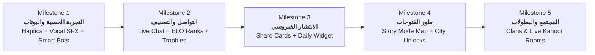

# 🗺️ الدليل الشامل وخرائط الطريق التطويرية — مشروع «معركة أحفاد الصحابة»
> **المسار الأساسي:** `docs/development_plans/`  
> **تاريخ التأسيس:** نوفمبر 2026  
> **كبير المهندسين ومسؤول المعمارية:** م. محمد لطف  
> **معيار الجودة والهندسة:** معايير التطوير العالمية لبيئات الإنتاج (Clean Architecture + Zero-Lag Realtime + RLS Enterprise Security).

---

## 🏛️ الفلسفة الاستراتيجية للمنظومة

تحويل **«معركة أحفاد الصحابة»** من مجرد تطبيق مسابقات تقليدي إلى **منصة ألعاب إسلامية ملحمية حية ومجتمع تنافسي عالمي** يجمع بين:
1. **العمق المعرفي والذكاء التكيفي** (التعلم النشط عبر التكرار المتباعد وتحليل الضعف).
2. **التنافس الجماعي الحي والاتصال المجتمعي** (التشات اللحظي، الكتائب، والبطولات التفاعلية).
3. **الهوية البصرية والحسية الخالصة** (مؤثرات صوتية بشرية وهندسة لمسية تفاعلية).
4. **الاستدامة والانتشار الفيروسي الأخلاقي** (المواسم الشهرية، بطاقات التحدي المصورة، وودجت المخطوطة).

---

## 📑 فهرس خطط التطوير التفصيلية (Master Index)

تم إفراد ملف هندسي مستقل ومفصل لكل ركيزة تقنية، يوضح: المعمارية، جداول قاعدة البيانات، الملفات الجديدة، خطوات التنفيذ، ومعايير القبول (Definition of Done):

| # | اسم الخطة | الملف التوثيقي | الحالة الحالية | الأولوية |
| :-: | :--- | :--- | :-: | :-: |
| **01** | **الذكاء الاصطناعي التكيفي والبوتات التكتيكية** | [`01_AI_ADAPTIVE_MASTERY_AND_BOTS.md`](file:///d:/newcuzeapp/flutter_application_1/docs/development_plans/01_AI_ADAPTIVE_MASTERY_AND_BOTS.md) | مخطط تفصيلي جاهز | 🔴 قصوى (M1) |
| **02** | **الهندسة الصوتية البشرية والنبض اللمسي** | [`02_VOCAL_ACOUSTICS_AND_HAPTICS.md`](file:///d:/newcuzeapp/flutter_application_1/docs/development_plans/02_VOCAL_ACOUSTICS_AND_HAPTICS.md) | مخطط تفصيلي جاهز | 🔴 قصوى (M1) |
| **03** | **شبكة التشات اللحظي للمتصلين (ديوان الأحفاد)** | [`03_LIVE_CHAT_AND_MESSAGING_SYSTEM.md`](file:///d:/newcuzeapp/flutter_application_1/docs/development_plans/03_LIVE_CHAT_AND_MESSAGING_SYSTEM.md) | مخطط تفصيلي جاهز | 🟠 عالية (M2) |
| **04** | **نظام الرتب والتصنيف ELO والمواسم الشهرية** | [`04_ELO_RANKING_AND_SEASONS.md`](file:///d:/newcuzeapp/flutter_application_1/docs/development_plans/04_ELO_RANKING_AND_SEASONS.md) | مخطط تفصيلي جاهز | 🟠 عالية (M2) |
| **05** | **بطاقات المشاركة الفيروسية وودجت اليوم** | [`05_VIRAL_CARDS_AND_WIDGETS.md`](file:///d:/newcuzeapp/flutter_application_1/docs/development_plans/05_VIRAL_CARDS_AND_WIDGETS.md) | مخطط تفصيلي جاهز | 🟡 متوسطة (M3) |
| **06** | **خريطة الفتوحات التفاعلية (طور القصة الملحمي)** | [`06_CONQUEST_MAP_AND_STORY_MODE.md`](file:///d:/newcuzeapp/flutter_application_1/docs/development_plans/06_CONQUEST_MAP_AND_STORY_MODE.md) | مخطط تفصيلي جاهز | 🟡 متوسطة (M4) |
| **07** | **الكتائب والرايات وغرف البطولات الحية (Kahoot الإسلامي)** | [`07_LIVE_TOURNAMENTS_AND_CLANS.md`](file:///d:/newcuzeapp/flutter_application_1/docs/development_plans/07_LIVE_TOURNAMENTS_AND_CLANS.md) | مخطط تفصيلي جاهز | 🟢 استراتيجية (M5) |

---

## 🎯 مراحل ومحطات الإطلاق (Milestones & Timeline)

---

## 🛡️ بوابات الجودة الصارمة (Quality Gates)

قبل دمج أي سطر برمجي من هذه الخطط إلى الفرع الرئيسي (`main`):
1. **دستور الوكيل (`AGENT.md`):** عدم استخدام أي كود صوري أو مؤقتات غير مربوطة.
2. **فحص المترجم:** اجتياز `flutter analyze` بنتيجة `No issues found!`.
3. **أمان البيانات السحابية:** كتابة سياسات RLS صارمة على Supabase لأي جدول جديد (مثل جداول التشات والكتائب) لمنع أي اختراق أو استهلاك غير عادل.
4. **الحفاظ على خفة الحجم:** لا تتجاوز حزمة المتجر الإجمالية `55 MB` بضغط الصوتيات والرسومات المتجهة.
