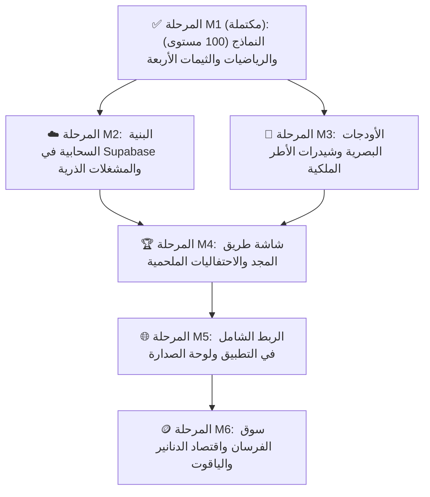

# 🏛️ خريطة مسار مراحل التنفيذ (Master Milestone Roadmap)
## منظومة المستويات الـ 100 والميادين وسوق الفرسان — «معركة أحفاد الصحابة»

> **المجلد المرجعي:** `docs/development_plans/master_levels_system/`  
> **الميثاق الأعلى:** [`08_ULTIMATE_MASTER_ARCHITECTURE.md`](file:///d:/newcuzeapp/flutter_application_1/docs/development_plans/08_ULTIMATE_MASTER_ARCHITECTURE.md)  
> **كبير المهندسين:** م. محمد لطف & فريق الذكاء الاصطناعي  
> **الدستور الحاكم:** الالتزام الصارم بقواعد `AGENT.md` (ممنوع الكود الصوري، فحص حي على السيرفر، 0 أخطاء).

---

## 🗺️ مخطط الاعتمادية وسير العمل (Dependency & Execution Pipeline)

---

## 📑 فهرس وثائق المراحل التفصيلية (Milestone Documentation)

| المرحلة | اسم الوثيقة ومسارها | الهدف الأساسي | المخرجات الرئيسية | الحالة الفعلية |
| :---: | :--- | :--- | :--- | :---: |
| **M1** | [`MILESTONE_1_DATA_MODELS_AND_MATH.md`](file:///d:/newcuzeapp/flutter_application_1/docs/development_plans/master_levels_system/MILESTONE_1_DATA_MODELS_AND_MATH.md) | بناء المحرك الرياضي للـ 100 مستوى والميادين الستة والثيمات الأربعة | `player_level_model.dart` `arena_model.dart` `app_custom_theme.dart` `store_item_model.dart` `progression_service.dart` | ✅ **مكتملة 100% (`12/12 Tests`)** |
| **M2** | [`MILESTONE_2_SUPABASE_ATOMIC_BACKEND.md`](file:///d:/newcuzeapp/flutter_application_1/docs/development_plans/master_levels_system/MILESTONE_2_SUPABASE_ATOMIC_BACKEND.md) | تحديث الجداول وإنشاء المشغلات والدوال الذرية في السيرفر | `009_glory_and_store.sql` `CloudSyncService` & `LeaderboardService` | ✅ **مكتملة 100% ومطبقة حياً** |
| **M3** | [`MILESTONE_3_ROYAL_UI_AND_SHADERS.md`](file:///d:/newcuzeapp/flutter_application_1/docs/development_plans/master_levels_system/MILESTONE_3_ROYAL_UI_AND_SHADERS.md) | بناء أودجات الواجهة الأندلسية وشيدر النبض الضوئي | `animated_avatar_frame.dart` `level_badge_widget.dart` `glory_progress_bar.dart` | ✅ **مكتملة 100% (`3/3 Widget Tests`)** |
| **M4** | [`MILESTONE_4_GLORY_ROAD_AND_CELEBRATION.md`](file:///d:/newcuzeapp/flutter_application_1/docs/development_plans/master_levels_system/MILESTONE_4_GLORY_ROAD_AND_CELEBRATION.md) | بناء شاشة مسار المجد ونافذة الاحتفال بالترقية | `glory_road_screen.dart` `level_up_celebration_dialog.dart` `arena_promotion_dialog.dart` | ⏳ قيد الانطلاق |
| **M5** | [`MILESTONE_5_GLOBAL_INTEGRATION_AND_QA.md`](file:///d:/newcuzeapp/flutter_application_1/docs/development_plans/master_levels_system/MILESTONE_5_GLOBAL_INTEGRATION_AND_QA.md) | إبراز المستوى والميدان في كل التطبيق والفحص النهائي | ربط `home_screen.dart` ربط `global_ranking_screen.dart` ربط `versus_screen.dart` | ⏳ مجدولة |
| **M6** | [`MILESTONE_6_KNIGHTS_STORE_AND_ECONOMY.md`](file:///d:/newcuzeapp/flutter_application_1/docs/development_plans/master_levels_system/MILESTONE_6_KNIGHTS_STORE_AND_ECONOMY.md) | بناء شاشة سوق الفرسان وتفعيل شراء الثيمات والأطر | `knights_store_screen.dart` `store_service.dart` | ⏳ مجدولة |
