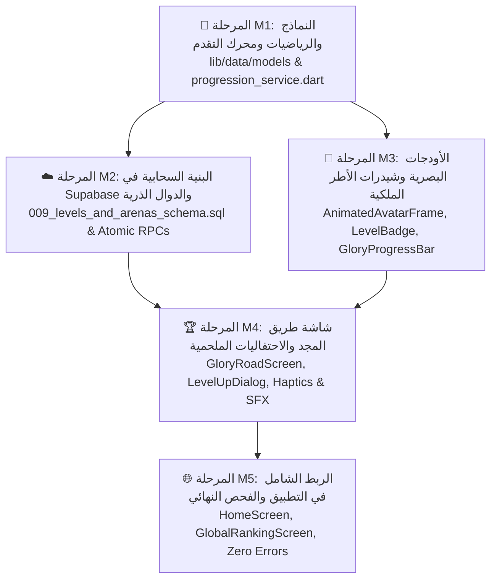

# 🏛️ خريطة مسار مراحل التنفيذ (Master Milestone Roadmap)
## نظام المستويات والميادين التنافسية — «معركة أحفاد الصحابة»

> **المجلد المرجعي:** `docs/development_plans/master_levels_system/`  
> **كبير المهندسين:** م. محمد لطف & فريق الذكاء الاصطناعي  
> **الحالة العامة:** جاهز للتنفيذ المرحلي المنضبط  
> **الدستور الحاكم:** الالتزام الصارم بقواعد `AGENT.md` (ممنوع الكود الصوري، فحص حي على السيرفر، 0 أخطاء).

---

## 🗺️ مخطط الاعتمادية وسير العمل (Dependency & Execution Pipeline)

---

## 📑 فهرس وثائق المراحل التفصيلية (Milestone Documentation)

| المرحلة | اسم الوثيقة ومسارها | الهدف الأساسي | المخرجات الرئيسية |
| :---: | :--- | :--- | :--- |
| **M1** | [`MILESTONE_1_DATA_MODELS_AND_MATH.md`](file:///d:/newcuzeapp/flutter_application_1/docs/development_plans/master_levels_system/MILESTONE_1_DATA_MODELS_AND_MATH.md) | بناء المحرك الرياضي والنماذج وكاشف الترقية | `player_level_model.dart` `arena_model.dart` `progression_service.dart` |
| **M2** | [`MILESTONE_2_SUPABASE_ATOMIC_BACKEND.md`](file:///d:/newcuzeapp/flutter_application_1/docs/development_plans/master_levels_system/MILESTONE_2_SUPABASE_ATOMIC_BACKEND.md) | تحديث الجداول وإنشاء دالة الحساب الذرية في السيرفر | `009_levels_and_arenas_schema.sql` تطبيق واختبار حي على Supabase |
| **M3** | [`MILESTONE_3_ROYAL_UI_AND_SHADERS.md`](file:///d:/newcuzeapp/flutter_application_1/docs/development_plans/master_levels_system/MILESTONE_3_ROYAL_UI_AND_SHADERS.md) | بناء أودجات الواجهة الأندلسية وشيدر النبض الضوئي | `animated_avatar_frame.dart` `level_badge_widget.dart` `glory_progress_bar.dart` |
| **M4** | [`MILESTONE_4_GLORY_ROAD_AND_CELEBRATION.md`](file:///d:/newcuzeapp/flutter_application_1/docs/development_plans/master_levels_system/MILESTONE_4_GLORY_ROAD_AND_CELEBRATION.md) | بناء شاشة مسار المجد ونافذة الاحتفال بالترقية | `glory_road_screen.dart` `level_up_celebration_dialog.dart` ربط الصوت البشري والنبض اللمسي |
| **M5** | [`MILESTONE_5_GLOBAL_INTEGRATION_AND_QA.md`](file:///d:/newcuzeapp/flutter_application_1/docs/development_plans/master_levels_system/MILESTONE_5_GLOBAL_INTEGRATION_AND_QA.md) | إبراز المستوى والميدان في كل التطبيق والفحص النهائي | ربط `home_screen.dart` ربط `global_ranking_screen.dart` فحص `flutter analyze` 0 errors |

---

## 🛡️ بروتوكول الانتقال بين المراحل (Strict Transition Protocol)
لا يجوز الانتقال من مرحلة إلى المرحلة التالية إلا بعد استيفاء شروط بوابة الجودة الخاصة بها:
1. اكتمال الأكواد والمنطق 100% دون أي متغيرات صورية أو استدعاءات فارغة.
2. اجتياز فحص `flutter analyze` بدون أي `error`.
3. التحقق المباشر والتجربة العملية للكود.
