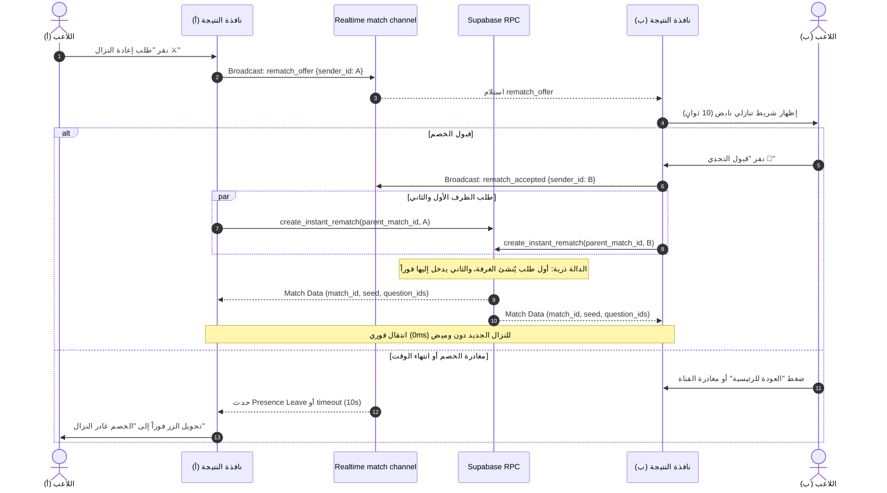

# 🚩 المعلم 1: بروتوكول إعادة النزال اللحظي ومنع ازدواجية الغرف (Instant Rematch Protocol)
> **المسار:** `docs/development_plans/multiplayer_matchmaking_system/MILESTONE_1_INSTANT_REMATCH_PROTOCOL.md`  
> **الإصدار المستهدف:** `1.0.11+12`  
> **الهدف:** تمكين اللاعبين من طلب وقبول إعادة النزال المباشر خلال 10 ثوانٍ من نافذة النتيجة دون العودة للرئيسية، مع الحماية التامة من التزامن المزدوج (Race Conditions) وسقف الـ 3 مباريات للكؤوس.

---

## 1. المعمارية الهندسية ومخطط التزامن اللحظي



---

## 2. مواصفات قاعدة البيانات وسيرفر Supabase (SQL RPC)

```sql
-- ==============================================================================
-- 🚀 MIGRATION: INSTANT REMATCH WITH IDEMPOTENCY & TROPHY ANTI-FARMING
-- ==============================================================================

-- 1. إضافة عمود الغرفة الأب لمعرفة التجديد وسقف المباريات
ALTER TABLE public.matches 
ADD COLUMN IF NOT EXISTS parent_match_id UUID REFERENCES public.matches(id),
ADD COLUMN IF NOT EXISTS rematch_count INTEGER DEFAULT 0;

CREATE INDEX IF NOT EXISTS idx_matches_parent_rematch 
ON public.matches(parent_match_id);

-- 2. دالة إنشاء أو جلب إعادة النزال الذرية (Idempotent RPC)
CREATE OR REPLACE FUNCTION public.create_instant_rematch(
  p_parent_match_id UUID,
  p_user_id UUID
)
RETURNS TABLE (
  match_id UUID,
  player1_id UUID,
  player2_id UUID,
  seed BIGINT,
  question_ids TEXT[],
  is_friendly BOOLEAN
)
LANGUAGE plpgsql
SECURITY DEFINER
AS $$
#variable_conflict use_column
DECLARE
  v_old_match RECORD;
  v_existing_rematch RECORD;
  v_new_match_id UUID;
  v_new_seed BIGINT;
  v_new_questions TEXT[];
  v_rematch_count INT := 0;
  v_is_friendly BOOLEAN := FALSE;
BEGIN
  -- A. جلب بيانات المباراة السابقة والتأكد من صحتها
  SELECT m.id, m.player1_id, m.player2_id, COALESCE(m.rematch_count, 0) AS count
  INTO v_old_match
  FROM public.matches AS m
  WHERE m.id = p_parent_match_id;

  IF NOT FOUND THEN
    RAISE EXCEPTION 'المباراة الأصلية غير موجودة';
  END IF;

  -- التأكد من أن المستخدم أحد طرفي المباراة
  IF v_old_match.player1_id != p_user_id AND v_old_match.player2_id != p_user_id THEN
    RAISE EXCEPTION 'غير مصرح لك بتجديد هذه المباراة';
  END IF;

  -- B. فحص وجود مباراة إعادة نزال أنشأها الطرف الآخر بالفعل (Idempotency Guard)
  SELECT m.id, m.player1_id, m.player2_id, m.seed, m.question_ids, (m.rematch_count >= 3) AS friendly
  INTO v_existing_rematch
  FROM public.matches AS m
  WHERE m.parent_match_id = p_parent_match_id
  LIMIT 1;

  IF v_existing_rematch.id IS NOT NULL THEN
    -- المباراة أُنشئت بالفعل من الخصم؛ نُعيد نفس البيانات فوراً!
    RETURN QUERY SELECT 
      v_existing_rematch.id, 
      v_existing_rematch.player1_id, 
      v_existing_rematch.player2_id, 
      v_existing_rematch.seed, 
      v_existing_rematch.question_ids,
      v_existing_rematch.friendly;
    RETURN;
  END IF;

  -- C. تحديد سقف الكؤوس (إذا تجاوزت 3 نزالات متتالية تصبح ودية بدون كؤوس)
  v_rematch_count := v_old_match.count + 1;
  IF v_rematch_count >= 3 THEN
    v_is_friendly := TRUE;
  END IF;

  -- D. توليد حزمة أسئلة جديدة وعشوائية بالكامل
  v_new_seed := FLOOR(RANDOM() * 2147483647)::BIGINT;
  SELECT ARRAY[
    'quran:1:' || (FLOOR(RANDOM() * 10)::INT),
    'hadith:1:' || (FLOOR(RANDOM() * 10)::INT),
    'fiqh:1:' || (FLOOR(RANDOM() * 10)::INT),
    'seerah:1:' || (FLOOR(RANDOM() * 10)::INT),
    'aqeedah:1:' || (FLOOR(RANDOM() * 10)::INT)
  ] INTO v_new_questions;

  -- E. إنشاء سجل المباراة الجديدة
  INSERT INTO public.matches (
    parent_match_id,
    player1_id,
    player2_id,
    seed,
    question_ids,
    status,
    rematch_count,
    created_at
  )
  VALUES (
    p_parent_match_id,
    v_old_match.player1_id,
    v_old_match.player2_id,
    v_new_seed,
    v_new_questions,
    'matched',
    v_rematch_count,
    NOW()
  )
  RETURNING id INTO v_new_match_id;

  -- إنشاء سجلات المشاركين في جدول match_participants
  INSERT INTO public.match_participants (match_id, user_id, current_score, is_ready)
  VALUES 
    (v_new_match_id, v_old_match.player1_id, 0, FALSE),
    (v_new_match_id, v_old_match.player2_id, 0, FALSE);

  RETURN QUERY SELECT 
    v_new_match_id,
    v_old_match.player1_id,
    v_old_match.player2_id,
    v_new_seed,
    v_new_questions,
    v_is_friendly;
END;
$$;
```

---

## 3. منطق العميل في تطبيق Flutter (`MultiplayerService`)

### أ. التوابع الجديدة الواجب إضافتها:
```dart
/// إرسال عرض إعادة النزال للخصم عبر قناة البث الحالية
Future<void> sendRematchOffer(String matchId);

/// الاستماع لأحداث إعادة النزال (العرض، القبول، والمغادرة)
void listenToRematchEvents({
  required String matchId,
  required Function(String senderId) onOfferReceived,
  required Function() onOfferAccepted,
  required Function() onOpponentLeft,
});

/// قبول العرض واستدعاء دالة السيرفر الذرية
Future<MatchmakingResult> acceptAndCreateRematch({
  required String parentMatchId,
});
```

---

## 4. تصميم واجهة المستخدم والحالات (UI State Machine)

تتغير نافذة `GameMatchResultDialog` الملكية وفق الحالات التالية:
1. **الحالة الافتراضية (Idle):**  
   زر ذهبي: `طلب إعادة النزال ⚔️` بجانب زر `العودة للرئيسية`.
2. **حالة انتظار الخصم (Waiting for Opponent):**  
   يتحول الزر إلى مؤشر نبض ذهبي: `بانتظار موافقة الخصم (08s)... ⏳` مع زر إلغاء صغير.
3. **حالة وصول طلب من الخصم (Offer Received):**  
   شريط إشعار علوي نابض: *"الخصم يتحداك في جولة ثانية!"* مع زرين:  
   * `[ ⚔️ قبول التحدي ]` (أخضر زمردي بارز).  
   * `[ ❌ انسحاب ]` (رمادي داكن).
4. **حالة مغادرة الخصم (Opponent Left):**  
   يتحول الزر فوراً إلى لون رمادي غير مفعل: `غادر الخصم النزال 🚪` مع توجيه تلقائي بعد ثانيتين.

---

## 5. مصفوفة التحقق والاختبار (Verification Checklist)

* [ ] اختبار عدم تكرار الغرف عند النقر المتزامن من هاتفين في نفس اللحظة (Race Condition Test).
* [ ] اختبار تحول المباراة الرابعة المتتالية إلى "مباراة ودية" لحماية الكؤوس.
* [ ] اختبار خروج الخصم للشاشة الرئيسية والتأكد من تغير الزر خلال أقل من 0.5 ثانية عبر `Presence Leave`.
* [ ] فحص كود Dart عبر `flutter analyze` والتأكد من خلوه من أي تحذيرات أو أخطاء.

