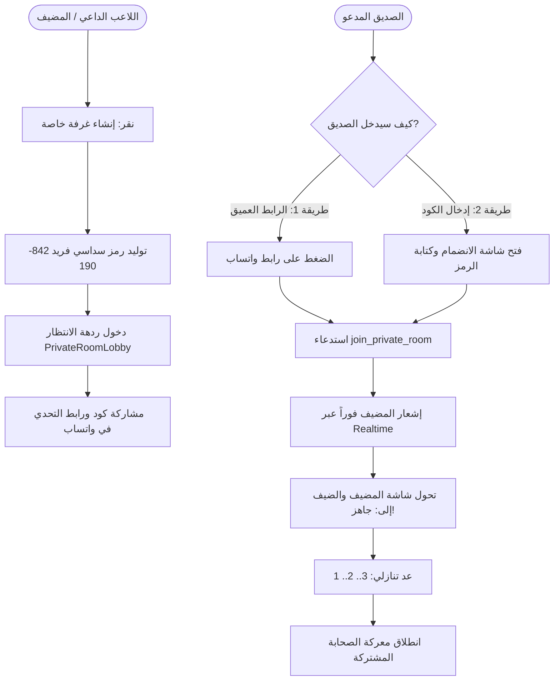

# 🚩 المعلم 2: غرف التحدي الخاصة وتحدي الأصدقاء (Private Rooms & WhatsApp Invite)
> **المسار:** `docs/development_plans/multiplayer_matchmaking_system/MILESTONE_2_PRIVATE_ROOMS_AND_INVITES.md`  
> **الإصدار المستهدف:** `1.0.12+13`  
> **الهدف:** تمكين أي لاعب من إنشاء غرفة خاصة برمز سداسي مميز (PIN Code) ومشاركتها عبر واتساب لدعوة أصدقائه، مع ردهة انتظار ملكية فاخرة.

---

## 1. المعمارية وتدفق الدعوة وانضمام الصديق



---

## 2. مواصفات قاعدة البيانات وسيرفر Supabase (SQL RPC)

```sql
-- ==============================================================================
-- 🚀 MIGRATION: PRIVATE ROOMS WITH 6-DIGIT PIN & 3-MINUTE EXPIRY
-- ==============================================================================

-- 1. إضافة أعمدة الغرفة الخاصة لجدول matches
ALTER TABLE public.matches
ADD COLUMN IF NOT EXISTS room_code VARCHAR(6),
ADD COLUMN IF NOT EXISTS is_private BOOLEAN DEFAULT FALSE,
ADD COLUMN IF NOT EXISTS expires_at TIMESTAMPTZ;

CREATE INDEX IF NOT EXISTS idx_matches_room_code 
ON public.matches(room_code) 
WHERE room_code IS NOT NULL;

-- 2. دالة إنشاء الغرفة وتوليد الكود
CREATE OR REPLACE FUNCTION public.create_private_room(
  p_host_id UUID
)
RETURNS TABLE (
  match_id UUID,
  room_code VARCHAR(6),
  expires_at TIMESTAMPTZ
)
LANGUAGE plpgsql
SECURITY DEFINER
AS $$
#variable_conflict use_column
DECLARE
  v_match_id UUID;
  v_code VARCHAR(6);
  v_expires TIMESTAMPTZ;
  v_seed BIGINT;
  v_questions TEXT[];
BEGIN
  -- تنظيف أي غرف قديمة غير مكتملة للمضيف
  UPDATE public.matches
  SET status = 'cancelled'
  WHERE player1_id = p_host_id AND status = 'waiting' AND is_private = TRUE;

  -- توليد كود سداسي عشوائي غير مكرر
  LOOP
    v_code := LPAD(FLOOR(RANDOM() * 900000 + 100000)::TEXT, 6, '0');
    EXIT WHEN NOT EXISTS (
      SELECT 1 FROM public.matches 
      WHERE room_code = v_code AND status = 'waiting' AND expires_at > NOW()
    );
  END LOOP;

  v_expires := NOW() + INTERVAL '3 minutes';
  v_seed := FLOOR(RANDOM() * 2147483647)::BIGINT;
  
  -- اختيار 5 أسئلة عشوائية
  SELECT ARRAY[
    'quran:1:' || (FLOOR(RANDOM() * 10)::INT),
    'hadith:1:' || (FLOOR(RANDOM() * 10)::INT),
    'fiqh:1:' || (FLOOR(RANDOM() * 10)::INT),
    'seerah:1:' || (FLOOR(RANDOM() * 10)::INT),
    'aqeedah:1:' || (FLOOR(RANDOM() * 10)::INT)
  ] INTO v_questions;

  -- إنشاء الغرفة
  INSERT INTO public.matches (
    player1_id,
    seed,
    question_ids,
    status,
    is_private,
    room_code,
    expires_at,
    created_at
  )
  VALUES (
    p_host_id,
    v_seed,
    v_questions,
    'waiting',
    TRUE,
    v_code,
    v_expires,
    NOW()
  )
  RETURNING id INTO v_match_id;

  -- إضافة المضيف في المشاركين
  INSERT INTO public.match_participants (match_id, user_id, is_ready, current_score)
  VALUES (v_match_id, p_host_id, TRUE, 0);

  RETURN QUERY SELECT v_match_id, v_code, v_expires;
END;
$$;

-- 3. دالة انضمام الضيف عبر الكود
CREATE OR REPLACE FUNCTION public.join_private_room(
  p_room_code VARCHAR(6),
  p_guest_id UUID
)
RETURNS TABLE (
  match_id UUID,
  host_id UUID,
  seed BIGINT,
  question_ids TEXT[]
)
LANGUAGE plpgsql
SECURITY DEFINER
AS $$
#variable_conflict use_column
DECLARE
  v_match RECORD;
BEGIN
  -- جلب الغرفة المفتوحة
  SELECT m.id, m.player1_id, m.seed, m.question_ids, m.player2_id
  INTO v_match
  FROM public.matches AS m
  WHERE m.room_code = p_room_code
    AND m.status = 'waiting'
    AND m.is_private = TRUE
    AND m.expires_at > NOW()
  FOR UPDATE;

  IF NOT FOUND THEN
    RAISE EXCEPTION 'الغرفة غير موجودة أو انتهت مهلتها الزمنية';
  END IF;

  IF v_match.player1_id = p_guest_id THEN
    RAISE EXCEPTION 'لا يمكنك الانضمام لغرفة أنشأتها أنت بنفسك';
  END IF;

  IF v_match.player2_id IS NOT NULL THEN
    RAISE EXCEPTION 'الغرفة ممتلئة بالفعل';
  END IF;

  -- تحديث الغرفة بإدخال الضيف وتحويل الحالة
  UPDATE public.matches
  SET player2_id = p_guest_id, status = 'matched'
  WHERE id = v_match.id;

  -- إضافة الضيف في المشاركين
  INSERT INTO public.match_participants (match_id, user_id, is_ready, current_score)
  VALUES (v_match.id, p_guest_id, TRUE, 0);

  RETURN QUERY SELECT v_match.id, v_match.player1_id, v_match.seed, v_match.question_ids;
END;
$$;
```

---

## 3. تصميم الواجهات الملكية (UI Specs)

### أ. شاشة بوابة الغرف الخاصة (`PrivateRoomHubScreen`):
* بطاقة "إنشاء غرفة" وزر ذهبي متوهج.
* بطاقة "الانضمام برمز" مع 6 مربعات إدخال رقمية بخط Cairo وتكبير تلقائي.

### ب. شاشة ردهة الانتظار للمضيف (`PrivateRoomLobbyScreen`):
* عرض الكود الذهبي بخط حجم 36 مع زر نسخ ومشاركة.
* بطاقتان متقابلتان: المضيف (أخضر جاهز 👑) والضيف (إطار منقط ينبض بنور ذهبي: *"بانتظار انضمام الصديق... ⏳"*).
* شريط مهلة الـ 3 دقائق مع زر أحمر لطيف: `إلغاء الغرفة`.

---

## 4. مصفوفة التحقق والاختبار (Verification Checklist)

* [ ] التحقق من إلغاء الغرفة تلقائياً عند مرور 3 دقائق وعدم قبول أي محاولة دخول بعدها.
* [ ] التحقق من استجابة شاشة المضيف ودخول الضيف في أقل من 300ms عبر Supabase Realtime.
* [ ] التحقق من منع المضيف من الانضمام لغرفته الخاصة بحساب ثانٍ في نفس الجهاز.
* [ ] فحص كود Dart عبر `flutter analyze` والتأكد من خلوه التام من أي خطأ.

