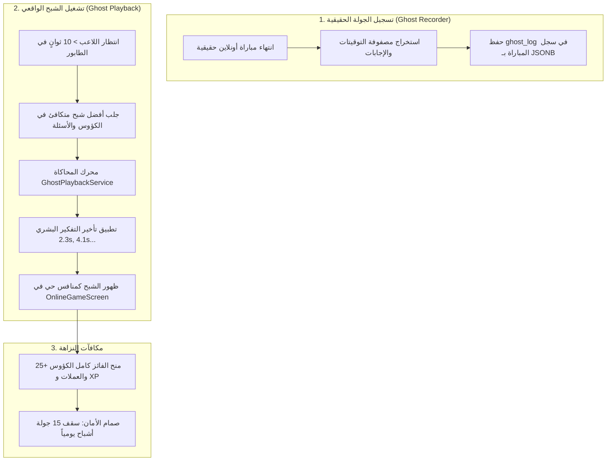

# 🚩 المعلم 4: محرك أشباح الصحابة للاعبين الحقيقيين (Ghost Replay Engine)
> **المسار:** `docs/development_plans/multiplayer_matchmaking_system/MILESTONE_4_ASYNCHRONOUS_GHOST_REPLAYS.md`  
> **الإصدار المستهدف:** `1.1.0+15`  
> **الهدف:** تسجيل جولات المتسابقين البشر بصيغة `JSONB` خفيفة للغاية، وتشغيلها كأشباح بشرية واقعية عند خلو الطابور في أوقات الفراغ الليلي، مع احتساب كامل للكؤوس والنقاط.

---

## 1. الهيكلية المعمارية لمحرك الأشباح



---

## 2. مواصفات قاعدة البيانات وسيرفر Supabase (SQL RPC)

```sql
-- ==============================================================================
-- 🚀 MIGRATION: GHOST REPLAYS RECORDING & ASYNCHRONOUS POOL
-- ==============================================================================

-- 1. إضافة عمود ghost_log بجدول matches لتخزين بصمة الجولة
ALTER TABLE public.matches
ADD COLUMN IF NOT EXISTS ghost_log JSONB;

-- 2. دالة تسجيل بصمة الشبح في نهاية المباراة (تُستدعى في finish_match)
CREATE OR REPLACE FUNCTION public.record_ghost_run(
  p_match_id UUID,
  p_user_id UUID,
  p_user_name TEXT,
  p_avatar_index INT,
  p_trophies INT,
  p_timeline JSONB
)
RETURNS VOID
LANGUAGE plpgsql
SECURITY DEFINER
AS $$
BEGIN
  -- حفظ البصمة كـ JSONB خفيف (أقل من 1KB)
  UPDATE public.matches
  SET ghost_log = jsonb_build_object(
    'user_id', p_user_id,
    'user_name', p_user_name,
    'avatar_index', p_avatar_index,
    'trophies', p_trophies,
    'timeline', p_timeline,
    'recorded_at', NOW()
  )
  WHERE id = p_match_id;
END;
$$;

-- 3. دالة جلب شبح متكافئ لمباراة ليلية
CREATE OR REPLACE FUNCTION public.fetch_compatible_ghost(
  p_my_trophies INT,
  p_category TEXT DEFAULT 'general'
)
RETURNS TABLE (
  ghost_name TEXT,
  ghost_avatar_index INT,
  ghost_trophies INT,
  ghost_timeline JSONB
)
LANGUAGE plpgsql
SECURITY DEFINER
AS $$
BEGIN
  RETURN QUERY
  SELECT 
    (m.ghost_log->>'user_name')::TEXT,
    (m.ghost_log->>'avatar_index')::INT,
    (m.ghost_log->>'trophies')::INT,
    (m.ghost_log->'timeline')
  FROM public.matches m
  WHERE m.ghost_log IS NOT NULL
    AND ABS((m.ghost_log->>'trophies')::INT - p_my_trophies) <= 300
  ORDER BY RANDOM()
  LIMIT 1;
END;
$$;
```

---

## 3. محاكي الأشباح البشري في Flutter (`GhostPlaybackService`)

* **تطبيق الانتروبيا البشرية (Human Thinking Entropy):**
  * لا يجيب الشبح فوراً برقم ثابت، بل يتبع بالضبط ثواني التفكير التي قضاها اللاعب البشري الحقيقي (مثلاً: 2450ms في السؤال الأول، 4100ms في السؤال الثاني).
  * يرتكب الشبح نفس الأخطاء البشرية التي وقع فيها اللاعب الأصلي، مما يجعل النزال طبيعياً ومثيراً 100%.

---

## 4. نظام المكافآت وصمام الأمان (Daily Soft Cap)

* **الفوز ضد الشبح:** يمنح اللاعب +25 كأساً، والعملات الذهبية كاملة، ونقاط الخبرة (XP).
* **الخسارة أمام الشبح:** يخصم -12 كأساً (لأن الشبح ذكي وبشري حقيقي).
* **صمام أمان النزاهة:** أول 15 جولة أشباح يومياً تمنح كؤوساً كاملة؛ وما زاد عنها في نفس الليلة يمنح نقاط خبرة وعملات فقط لحماية قمة لوحة المتصدرين.
* **صاحب الشبح الأصلي:** لا يتأثر بأي شكل ولا تنقص كؤوسه إطلاقاً.

---

## 5. مصفوفة التحقق والاختبار (Verification Checklist)

* [ ] التحقق من أن حجم سجل `ghost_log` في قاعدة البيانات لا يتجاوز 1 كيلوبايت.
* [ ] التحقق من واقعية حركة العداد وتقدم الشبح بدون أي تقطيع أو تجميد في واجهة المستخدم.
* [ ] التحقق من تطبيق صمام الـ 15 جولة يومياً لحماية الكؤوس.
* [ ] سلامة التحليل الثابت عبر `flutter analyze` واختبارات الوحدة `flutter test`.

