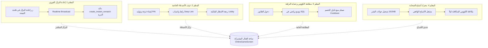

# ⚔️ منظومة التحديات الجماعية والمبارزات الملكية (Multiplayer Matchmaking System)
> **الموقع:** `docs/development_plans/multiplayer_matchmaking_system/`  
> **الإصدار الأساسي:** `1.0.10+11` ➔ **الإصدارات المستهدفة:** `1.0.11+12` وحتى `1.1.0+15`  
> **المرجعية:** دستور التنفيذ الهندسي الصارم (`AGENTS.md`) والمخطط العام `MULTIPLAYER_AND_SOCIAL_BATTLES_MASTER_PLAN.md`

---

## 🛡️ ميثاق الجودة الصارمة: القواعد الذهبية الـ 12 الملزمة (Zero-Tolerance Engineering Manifesto)
> **تنبيه ملزم لأي مهندس أو نموذج ذكاء اصطناعي يعمل على هذا المشروع:**  
> يُمنع منعاً باتاً كسر أو تجاوز القواعد الـ 12 التالية أثناء برمجة أي ميزة في هذه المنظومة:

### 🔹 المجموعة الأولى: سلامة الكود والأداء (Core Implementation)
1. **ممنوع منعاً باتاً الكود الوهمي أو الصوري (No Stubs / No Fake Wiring):**  
   يُحظر تماماً تعريف دوال فارغة أو مؤقتات واشتراكات شكلية (`Timer?`, `StreamSubscription?`) دون ربطها بمنطق تشغيلي حقيقي كامل، ويُمنع وضع تعليقات مثل `// TODO: implement later`.
2. **ممنوع الكود المبتور أو المختصر (Zero Incomplete Code):**  
   أي كود يُضاف يجب أن يكون كامل المعالجة بنسبة 100%، متضمناً معالجة الأخطاء (`try/catch`)، تنظيف الذاكرة (`dispose()`)، والتعامل مع جميع الحالات الشاذة (`Edge Cases`).
3. **أعلى معايير الكفاءة ومعدل 60 إطاراً (High Performance & 60 FPS):**  
   يُمنع أي منطق ثقيل يحجب الـ UI Thread أو يسبب ارتعاشاً (Jank). استدعاءات الشبكة غير حاجزة (Non-blocking)، واستعلامات SQL محسنة بفهارس لتنفذ في أقل من **50ms**.
4. **مناعة تامة ضد الانهيار (Crash Immunity & Non-Blocking Fallbacks):**  
   أي انقطاع في الشبكة أو عطل في الخادم يجب ألا يُسقط التطبيق أو يجمده إطلاقاً؛ بل ينتقل فوراً (0ms) للبديل المحلي السليم مع إشعار المستخدم بلباقة.
5. **قدسية تقدم ونقاط اللاعبين (Zero Data Loss Guarantee):**  
   الكؤوس، نقاط الخبرة، العملات، والمراحل لا يجوز أن تُفقد أو تتأخر مزامنتها تحت أي ظرف، وتُحدث سحابياً ومحلياً بالتزامن.
6. **التحديث الإلزامي الموحد لرقم الإصدار وسجل المشروع:**  
   مع كل ريليز، يجب تحديث رقم الإصدار بالتزامن في المواضع الأربعة (`pubspec.yaml`, `build.gradle.kts`, `app_constants.dart`, `splash_screen.dart`) وتوثيق التغييرات فوراً في `PROJECT_STATUS.md`.

### 🔹 المجموعة الثانية: قواعد الإنتاج والأمان ومناعة الذاكرة (Production Safety & Security)
7. **حماية دورة الحياة والذاكرة (Mounted & Memory Leak Guard):**  
   فحص إلزامي دائم: `if (!mounted) return;` قبل أي تعديل على الواجهة بعد أي استدعاء شبكي (`await`)، مع إلغاء صريح لجميع قنوات البث والمؤقتات في `dispose()`.
8. **حماية الشاشات وتكبير الخط (Zero-Overflow & Text Scaler Guard):**  
   منع تفيض البكسل (`RenderFlex overflow`)؛ حماية العناصر الحساسة كأكواد الغرف وشارات الكؤوس بـ `FittedBox` أو تقييد معامل تكبير الخط (`TextScaler.linear(1.0)`).
9. **مكافحة الغش وأمان قاعدة البيانات (Anti-Cheat & RLS Shield):**  
   منع أي تعديل مباشر للجداول الحساسة من العميل؛ جميع عمليات حسم الفائز والكؤوس تتم حصراً بدوال `SECURITY DEFINER RPC` تتحقق من `auth.uid() = p_user_id`.
10. **عزل المؤثرات الصوتية والاهتزاز (Decoupled Audio & Haptics):**  
    تشغيل كافة الأصوات والاهتزازات باستدعاءات غير حاجزة معزولة (`unawaited` مع `try/catch` صامت) لضمان عدم توقف مسار اللعب إذا تعثر ملف صوتي.
11. **مهلة التسامح عند تذبذب الشبكة (Network Flapping Grace Period):**  
    منح مهلة ذكية (5 إلى 7 ثوانٍ) لإعادة الاتصال التلقائي عند تبديل الشبكة (Wi-Fi إلى 4G) قبل إعلان مغادرة الخصم رسمياً.
12. **الحماية ضد التراجع البرمجي (Zero-Regression Test Suite):**  
    استمرار نجاح كافة اختبارات المشروع الـ 31 كاملة بنسبة 100%، وإضافة اختبارات وحدة جديدة مخصصة لكل معلم جديد قبل تسليمه.

---

## 📑 فهرس المعالم الهندسية التفصيلية (Milestones Directory)

| المعلم | الملف التفصيلي | النطاق والمحتوى | الحالة |
| :--- | :--- | :--- | :--- |
| **المعلم 1** | [MILESTONE_1_INSTANT_REMATCH_PROTOCOL.md](./MILESTONE_1_INSTANT_REMATCH_PROTOCOL.md) | بروتوكول إعادة النزال اللحظي، منع الغرف المزدوجة، سقف الـ 3 مباريات، وحساسية مغادرة الخصم. | 🟡 جاهز للتنفيذ |
| **المعلم 2** | [MILESTONE_2_PRIVATE_ROOMS_AND_INVITES.md](./MILESTONE_2_PRIVATE_ROOMS_AND_INVITES.md) | غرف التحدي الخاصة، الرمز السداسي (PIN)، رابط واتساب العميق، وردهة الانتظار الملكية. | ⚪ مجدول |
| **المعلم 3** | [MILESTONE_3_DYNAMIC_TROPHY_MATCHMAKING.md](./MILESTONE_3_DYNAMIC_TROPHY_MATCHMAKING.md) | خوارزمية مطابقة الكؤوس المتوسعة ذاتياً في SQL، وفلتر صمام أمان تكرار الخصم (Anti-Farming). | ⚪ مجدول |
| **المعلم 4** | [MILESTONE_4_ASYNCHRONOUS_GHOST_REPLAYS.md](./MILESTONE_4_ASYNCHRONOUS_GHOST_REPLAYS.md) | محرك أشباح الصحابة لتسجيل جولات اللاعبين البشر بصيغة `JSONB` وتشغيلها عند خلو الطابور. | ⚪ مجدول |

---

## 🏛️ المخطط التوجيهي العام وتكامل الأنظمة

